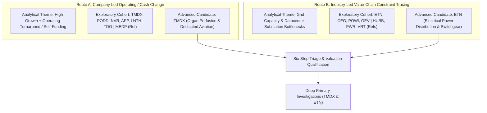

# ARX Terminal — Evidence-Led Opportunity Discovery Cycle 2: Experiment Specification & Search Receipts

**Document ID:** `ARX-DISCOVERY-CYCLE-2-SPEC-V1`  
**Effective Date:** October 22, 2026 (Reconciled & Corrected)  
**Governing Authority:** Product Owner Authorization — Evidence-Led Discovery Cycle 2  
**Governing Standard:** `ARX-DECISION-RESEARCH-PROCESS-V1` & ARX Closure Model v2  
**Applicability:** Internal Research Experiment Only (Non-Production / Non-Public)  

---

## 1. Experiment Objective & Decision Framework

### A. The Core Decision to Support
The objective of Discovery Cycle 2 is to test an operational question:
> **Does an evidence-led candidate generation process surface research-worthy opportunities beyond ARX's existing manually selected cohort with enough informational signal to justify ongoing discovery effort over manual queue additions?**

### B. Epistemic Separation of Core Inquiries
Under ARX Closure Model v2 and `ARX-DECISION-RESEARCH-PROCESS-V1`, four fundamentally distinct questions are evaluated separately:
1. **Is the discovery process useful?** (Process capability & operational efficiency)
2. **Does the evidence justify further investigation?** (Internal research queue prioritization)
3. **Does the company qualify for public Quality Watch research?** (Public standard gate under `QUALITY_WATCH_SELECTION_STANDARD.md`)
4. **Is the investment attractive under explicit assumptions?** (Valuation & portfolio allocation)

*A positive answer to one does not establish the others.* Surfacing a structurally sound business model does not establish public Quality Watch qualification, nor does verified technical arithmetic establish predictive investment outperformance.

---

## 2. Operating Boundary & Work Budget

### A. Eligible Population & Accessible Coverage
- **Eligible Search Universe:** Operating commercial enterprises with accessible audited Form 10-K (FY2025) and quarterly Form 10-Q (1H / Q2 2026) filings on SEC EDGAR.
- **Accessible Local Coverage:** The repository's reference dataset (`data/research/reference_polygon/tickers/`), SEC EDGAR public archive feeds, and regulatory filing disclosures.
- **Explicit Exclusions:** No activation of live market websocket ingestion, no background database scanners, no scheduled batch crawlers, and zero mutation of production watch snapshot tables.

### B. Evidence Cutoff & Freshness Baseline
- **Cutoff Date:** October 22, 2026.
- **Audited Baseline:** Form 10-K for fiscal years ended December 31, 2025 (or fiscal year equivalent).
- **Interim Baseline:** Form 10-Q for periods ended June 30, 2026 (Q2 2026) or September 30, 2026 where available.
- **Primary Source Standard:** Direct SEC EDGAR Archives URLs (`https://www.sec.gov/Archives/edgar/data/...`).

### C. Active Work Budget & Effort Guidance
- **Budget Standard:** Bounded active-work allocation (~1.5 to 2.5 analyst hours across generation, triage, and deep analysis).
- **Cohort Composition:** Exploratory cohort organized around two analytical themes, evaluated without arbitrary ticker quotas.
- **Deep Investigation Ceiling:** Deeper primary-source investigations are reserved for candidates with high decision-relevant uncertainty and clear value capture (`TMDX` and `ETN`), evaluated alongside prior benchmarks.

### D. Criteria for Escalating a Candidate
A candidate advances from initial generation to deep investigation only if it meets four cumulative criteria:
1. **Evidenced Observable Change:** A verifiable structural shift in unit economics, operating model, or capital allocation disclosed in primary regulatory filings.
2. **Consolidated Materiality:** The change directly impacts the primary driver of consolidated operating income and cash from operations (>50% of revenue or growth).
3. **Plausible Value Capture per Share:** A clear economic mechanism translating revenue growth into cash flow per share after capex, competition, debt service, and dilution.
4. **High Information Value:** A decisive unresolved question exists that internal research can meaningfully clarify, changing its queue priority.

### E. Stopping Rule & Decision Criteria
- **Candidate Stopping Rule:** Research on an individual candidate terminates immediately once evidence confirms that the central uncertainty cannot be resolved with accessible filings, or when the candidate's immediate disposition is settled.
- **Cycle Stopping Decision Matrix:**
  - **`CONTINUE` (Advance to Further Bounded Cycles):** If reproducible routes surface novel, high-conviction candidates outside the previous manual cohort that provide superior research signal and can be maintained within the active effort budget.
  - **`SIMPLIFY` (Narrow Search Scope):** If candidate generation requires excessive unstructured manual filtering relative to the quality of ideas surfaced, indicating that future discovery should narrow to single-theme or quantitative-first screens.
  - **`STOP` (Conclude Discovery Experiments):** If reproducible discovery yields no actionable differentiated signal compared to the existing 10-candidate expansion queue, demonstrating that internal discovery does not justify ongoing operational effort.

---

## 3. Candidate-Generation Routes & Methodological Receipts

### A. Nature of Candidate Generation
Candidate generation in Cycle 2 is an **exploratory, judgment-led cohort assembly organized around two analytical themes**. While filing retrieval (accessing exact primary 10-K/10-Q filings via direct CIKs and accession paths) is fully deterministic and reproducible, the initial selection of tickers was analyst-directed rather than an automated, deterministic market-wide crawler.

### Route A: Company-Led Operating & Cash-Conversion Change
- **Core Analytical Hypothesis:** Companies transitioning from capital-consuming expansion or clinical development into self-funding, high cash-conversion commercial networks experience structural expansion in free cash flow per share that consensus models often lag.
- **Selection Procedure & Focus:**
  1. *Filing Base:* Audited Form 10-K (FY2025) and quarterly Form 10-Q (1H 2026) filers in healthcare, industrials, and technology.
  2. *Analytical Criteria:*
     - Strong revenue momentum (>15% YoY).
     - Operating cash flow (CFO) expansion with meaningful free cash flow generation.
     - Manageable debt obligations or positive liquidity headroom.
- **Candidates Examined (7 total):**
  1. **`TMDX` (TransMedics Group, Inc. - CIK `0001756262`):** Organ Care System (OCS) rollout + owned aviation logistics network (National OCS Program - NOP). Operating income expanded from $37.5M in FY24 to $108.6M in FY25; operating cash flow of $192.8M. **(ADVANCED TO DEEP INVESTIGATION)**
  2. **`PODD` (Insulet Corporation - CIK `0001145197`):** Omnipod 5 automated insulin delivery platform. 17.5% operating margin and robust recurring disposable pod cash conversion. **(TRIAGED: PRIORITIZED_FOR_INTERNAL_MONITORING)**
  3. **`NVR` (NVR, Inc. - CIK `0000906163`):** Pure-play land-light option purchase model. Sustains >35% ROIC across housing cycles with zero funded debt and aggressive share retirements. **(TRIAGED: DEFERRED_CYCLICAL_CONSTRAINTS)**
  4. **`APP` (AppLovin Corporation - CIK `0001751008`):** Software AI advertising engine (AXON 2.0). Explosive FCF expansion, but governed by heavy platform counterparty concentration and high governance opacity. **(TRIAGED: DEFERRED_GOVERNANCE_RISK)**
  5. **`LNTH` (Lantheus Holdings - CIK `0001521036`):** Pylarify prostate cancer imaging cash generator. High current cash conversion offset by generic competition and patent challenges. **(TRIAGED: DEFERRED_PATENT_CLIFF)**
  6. **`TDG` (TransDigm Group - CIK `0001260221`):** Proprietary aerospace aftermarket replacement components. Massive cash generation and pricing power, but carries $22B+ funded debt and high interest sensitivity. **(TRIAGED: PRIORITIZED_FOR_INTERNAL_MONITORING)**
  7. **`MEDP` (Medpace Holdings - Baseline Reference):** Clinical trial CRO. Maintained as benchmark comparison for debt-free high cash conversion from the accepted Quality Watch collection.
- **Coverage Limitations & Gaps:**
  - Standard financial statement line items conflate maintenance capex with growth capex, and cash PP&E purchases do not reflect noncash aircraft acquisitions under finance leases.

---

### Route B: Industry-Led Structural Change & Value-Chain Constraint Tracing
- **Core Evidenced Macro/Industrial Constraint:**
  - *The Constraint:* The electrical grid interconnection and high-voltage power distribution bottleneck. Hyperscale AI data center construction is constrained by utility interconnect lead times (3 to 5 years for high-voltage transformers and utility-scale switchgear).
  - *Value-Chain Tracing:* Tracing customer capital expenditure from hyperscaler balance sheets to the physical electrical transmission, substation, and power management equipment providers upstream of the white space.
- **Candidates Examined (7 total):**
  1. **`ETN` (Eaton Corporation plc - CIK `0001551182`):** Global electrical power management leader. Record Electrical Americas backlog driven by datacenter megaprojects. Operating cash flow of $4,472M in FY25 with $3,553M FCF (79.5% conversion of CFO). **(ADVANCED TO DEEP INVESTIGATION)**
  2. **`CEG` (Constellation Energy Corp - CIK `0001868275`):** Merchant nuclear generator securing long-term 20-year PPAs (Microsoft Crane Clean Energy Center / Three Mile Island Unit 1 restart). High strategic value offset by FERC regulatory and interconnection uncertainty. **(TRIAGED: PRIORITIZED_FOR_INTERNAL_MONITORING)**
  3. **`POWI` (Power Integrations - CIK `0001043604`):** High-voltage GaN power ICs. High gross margins and debt-free balance sheet, but datacenter exposure is diluted by broader consumer appliance and industrial inventory overhang. **(TRIAGED: DEFERRED_CYCLICAL_EXPOSURE)**
  4. **`GEV` (GE Vernova - CIK `0001996810`):** Grid electrification, HVDC, and gas turbine manufacturing. Post-spin margin inflection, but legacy offshore wind contract liabilities and multi-year restructuring dilute quality. **(TRIAGED: DEFERRED_LEGACY_RESTRUCTURING)**
  5. **`HUBB` (Hubbell Incorporated - Baseline Reference from Cycle 1):** Utility transmission and distribution components. Examined and deferred in Cycle 1; re-evaluated as secondary grid reference. **(TRIAGED: PRIORITIZED_FOR_INTERNAL_MONITORING)**
  6. **`PWR` (Quanta Services - Baseline Reference from Prior Queue):** Electric grid transmission and substation contractor. Backlog expansion offset by lower structural operating margins (8-9%) and fixed-price execution risks. **(TRIAGED: REMAIN_IN_EXPANSION_QUEUE)**
  7. **`VRT` (Vertiv Holdings - Baseline Reference from Cycle 1):** Facility-level cooling and power distribution within the datacenter white space. Serves as benchmark comparison for infrastructure valuation.
- **Coverage Limitations & Gaps:**
  - Backlog definitions and order intake disclosures vary across capital goods issuers; comparisons reflect differing reporting frameworks.

---

## 4. Reconciled Population & Novelty Accounting

| Category | Route A (Operating / Cash Change) | Route B (Value-Chain Power Bottleneck) | Total Population |
| :--- | :--- | :--- | :--- |
| **Total Companies Examined** | 7 (including 1 reference) | 7 (including 3 references) | **14 Companies** |
| **Novel Candidates (Never Examined in Prior ARX Work)** | 6 (`TMDX, PODD, NVR, APP, LNTH, TDG`) | 4 (`ETN, CEG, POWI, GEV`) | **10 Novel Candidates** |
| **Prior Cohort References / Re-examined Candidates** | 1 (`MEDP` accepted Quality Watch) | 3 (`HUBB` Cycle 1 deferred, `PWR` queue, `VRT` Cycle 1) | **4 Prior References** |
| **Advanced to Deep Primary Investigation** | 1 (`TMDX`) | 1 (`ETN`) | **2 Deep Records** |
| **Prioritized for Internal Monitoring** | 2 (`PODD, TDG`) | 2 (`CEG, HUBB`) | **4 Priority Monitoring** |
| **Deferred with Documented Rationale** | 3 (`NVR, APP, LNTH`) | 2 (`POWI, GEV`) | **5 Deferred Candidates** |
| **Maintained in Expansion Queue** | 1 (`MEDP` reference) | 2 (`PWR, VRT` references) | **3 Benchmark Queue** |
