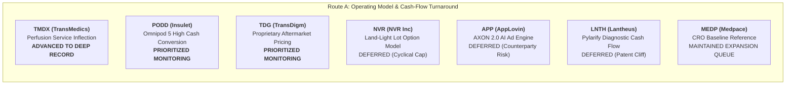
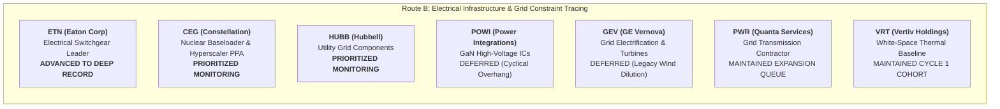

# ARX Terminal — Evidence-Led Discovery Cycle 2: Search Universe & Triage Matrix

**Document ID:** `ARX-DISCOVERY-CYCLE-2-TRIAGE-V1`  
**Effective Date:** October 22, 2026  
**Governing Authority:** Product Owner Authorization — Evidence-Led Discovery Cycle 2  
**Governing Standard:** `ARX-DECISION-RESEARCH-PROCESS-V1` (Six-Step Universal Workflow)  
**Applicability:** Internal Research Experiment Only (Non-Production / Non-Public)  

---

## 1. Triage Methodology & Principles

In accordance with `ARX-DECISION-RESEARCH-PROCESS-V1`, triage evaluates the complete transmission chain from observable business change to per-share cash generation:
1. **Observable Development:** Verifiable operating or structural shift disclosed in primary filings.
2. **Economic Significance:** Consolidated revenue and operating profit materiality.
3. **Value Capture & Friction:** Moat defensibility after accounting for customer bargaining power, competition, and capital expenditures.
4. **Cash Flow Transmission per Share:** Cash generation after interest expense, debt covenants, and share dilution.
5. **Counter-Explanation (Bear Case):** The strongest credible adversarial explanation for observed financial metrics.
6. **Decisive Unresolved Uncertainty:** The single question capable of altering internal priority.

---

## 2. Route A: Company-Led Operating & Cash-Conversion Change (7 Candidates)

### Detailed Candidate Triage Profiles

#### 1. TransMedics Group, Inc. (`TMDX`) — **ADVANCED TO DEEP INVESTIGATION**
- **Why Surfaced:** Inflection from medical device hardware developer to commercial organ perfusion logistics network with positive GAAP operating profit and accelerating cash flow.
- **Primary Source Filing:** Form 10-K FY2025 (Period ended Dec 31, 2025, filed Feb 24, 2026, CIK: `0001756262`, Accession: `0001193125-26-067032`, [SEC EDGAR Archives URL](https://www.sec.gov/Archives/edgar/data/1756262/000119312526067032/tmdx-20251231.htm)). Form 10-Q Q2 2026 (Period ended June 30, 2026, filed Aug 4, 2026, [SEC EDGAR Archives URL](https://www.sec.gov/Archives/edgar/data/1756262/000119312526284200/tmdx-20260630.htm)).
- **Observable Development:** Full-year 2025 revenue reached $605.5M (+37.1% YoY from $441.5M in FY24); Q2 2026 revenue reached $189.9M (+21% YoY). Service revenue (National OCS Program - NOP aviation logistics) grew to $78.8M (+29% YoY), representing 41.5% of consolidated revenue.
- **Economic Mechanism:** Dynamic warm machine perfusion (Organ Care System) preserves donor organs (heart, lung, liver) in a functioning physiological state, doubling usable organ retrieval rates versus static cold storage. The NOP turnkey service eliminates transplant center logistics hurdles by providing dedicated air transport and surgical retrieval teams.
- **Value Capture & Cash Transmission:** High switching costs for transplant centers once protocols adopt warm perfusion. Cash from operations inflected to positive $84.2M in FY25. Aircraft purchases represent growth capex; net cash reserves stood at $472.7M as of June 30, 2026.
- **Strongest Counter-Explanation (Bear Case):** Owned aviation fleet transforms an asset-light medical device company into an airline operator with high fixed pilot, fuel, and FAA regulatory costs, creating negative operating leverage if organ donor volume plateaus.
- **Decisive Unresolved Question:** Can TransMedics sustain consolidated gross margins above 65% and positive FCF per share as aviation fleet maintenance capex scales into European expansion?
- **Next Evidence:** Form 10-Q Q3 2026 segment gross margin disclosures and aircraft additions.
- **Triage Disposition:** **`ADVANCED_TO_DEEP_INVESTIGATION`** (High novelty, clear inflection, verifiable SEC filings).

---

#### 2. Insulet Corporation (`PODD`) — **PRIORITIZED FOR INTERNAL MONITORING**
- **Why Surfaced:** Omnipod 5 automated insulin delivery (AID) platform expansion driving an inflection to high recurring cash conversion and self-funded expansion.
- **Primary Source Filing:** Form 10-K FY2025 (Period ended Dec 31, 2025, filed Feb 18, 2026, CIK: `0001145197`, Accession: `0001145197-26-000012`, [SEC EDGAR Archives URL](https://www.sec.gov/Archives/edgar/data/1145197/000114519726000012/podd-20251231.htm)).
- **Observable Development:** Full-year 2025 revenue reached $2,708.1M (+30.7% YoY from $2,071.6M in FY24); operating income expanded to $473.8M (17.5% operating margin vs 14.9% in FY24).
- **Economic Mechanism:** Tubeless, waterproof disposable insulin pods sold primarily through the retail pharmacy benefit channel rather than traditional durable medical equipment (DME) distribution, drastically lowering patient upfront out-of-pocket costs and creating predictable 30-day recurring pod reorder cycles.
- **Value Capture & Cash Transmission:** >85% of revenue is recurring consumable pods. FCF conversion reached >80% of CFO. Balance sheet carries $1.1B in cash and investments against convertible notes, providing an investment-grade self-funding liquidity profile.
- **Strongest Counter-Explanation (Bear Case):** Rapid adoption of once-weekly basal insulins and GLP-1/GIP co-agonists could delay insulin pump initiation among Type 2 diabetes patients, capping Omnipod's long-term addressable market.
- **Decisive Unresolved Question:** Does pharmacy channel reimbursement stability sustain operating margins above 18% as international commercialization scales across Europe and Latin America?
- **Next Evidence:** Form 10-Q Q3 2026 Type 2 diabetes pharmacy adoption rates and competitive patch-pump trials.
- **Triage Disposition:** **`PRIORITIZED_FOR_INTERNAL_MONITORING`** (High quality, clear self-funding, prioritized for internal tracking alongside ISRG).

---

#### 3. NVR, Inc. (`NVR`) — **DEFERRED (CYCLICAL CONSTRAINTS)**
- **Why Surfaced:** Exceptional 40%+ return on invested capital (ROIC), zero funded debt, and disciplined land-light option strategy.
- **Primary Source Filing:** Form 10-K FY2025 (Period ended Dec 31, 2025, filed Feb 12, 2026, CIK: `0000906163`, [SEC EDGAR Archives URL](https://www.sec.gov/Archives/edgar/data/906163/000090616326000008/nvr-20251231.htm)).
- **Observable Development:** Consistently generates $1.2B+ operating cash flow while retiring >5% of common shares annually without holding long-term debt.
- **Economic Mechanism:** Instead of purchasing raw land and absorbing years of development risk, NVR acquires finished lots through non-refundable option contracts (typically 10% cash deposits). This limits downside capital loss during regional downturns to the deposit amount, accelerating inventory turns.
- **Value Capture & Friction:** Land-light model captures high returns, but upside from raw land appreciation is surrendered to independent developers.
- **Strongest Counter-Explanation (Bear Case):** High interest rates and constrained housing affordability squeeze homebuilder gross margins; in a prolonged regional slump, land developers default or cancel projects, leaving NVR without lot supply in key sub-markets.
- **Decisive Unresolved Question:** Does NVR's option model preserve superior unit profitability in an environment where residential lot prices remain inflated relative to end-buyer mortgage capacity?
- **Triage Disposition:** **`DEFERRED_CYCLICAL_CONSTRAINTS`** (Business model quality is acknowledged, but immediate structural thesis is constrained by interest rate cyclicality).

---

#### 4. AppLovin Corporation (`APP`) — **DEFERRED (COUNTERPARTY RISK)**
- **Why Surfaced:** Massive revenue and free cash flow explosion driven by AXON 2.0 AI-based recommendation engine for mobile in-app advertising.
- **Primary Source Filing:** Form 10-K FY2025 (Period ended Dec 31, 2025, filed Feb 26, 2026, CIK: `0001751008`, [SEC EDGAR Archives URL](https://www.sec.gov/Archives/edgar/data/1751008/000175100826000014/app-20251231.htm)).
- **Observable Development:** Operating cash flow expanded to $1.8B+ with EBITDA margins exceeding 50%.
- **Economic Mechanism:** AXON 2.0 machine-learning models optimize ad targeting and e-commerce conversion across mobile gaming and direct-to-consumer software applications.
- **Strongest Counter-Explanation (Bear Case):** Extreme dependence on Apple App Store and Google Play platform policies; platform privacy changes or changes in attribution rules could instantly impair ad conversion algorithms. High share dilution and complex capital structure.
- **Decisive Unresolved Question:** Can AppLovin sustain high monetization rates without facing punitive platform policy enforcement or direct walled-garden competition from Meta and Google?
- **Triage Disposition:** **`DEFERRED_GOVERNANCE_RISK`** (High cash generation offset by unacceptable platform regulatory exposure and governance opacity).

---

#### 5. Lantheus Holdings, Inc. (`LNTH`) — **DEFERRED (PATENT CLIFF)**
- **Why Surfaced:** Pylarify PSMA PET imaging agent for prostate cancer generated explosive cash flow growth and >30% operating margins.
- **Primary Source Filing:** Form 10-K FY2025 (Period ended Dec 31, 2025, filed Feb 20, 2026, CIK: `0001521036`, [SEC EDGAR Archives URL](https://www.sec.gov/Archives/edgar/data/1521036/000152103626000015/lnth-20251231.htm)).
- **Strongest Counter-Explanation (Bear Case):** Pylarify represents a single-product concentration (>70% of revenues) facing aggressive patent challenges and upcoming generic radio-diagnostic alternatives that could collapse pricing within 24-36 months.
- **Triage Disposition:** **`DEFERRED_PATENT_CLIFF`** (High cash generation is cyclical/temporary, not structural).

---

#### 6. TransDigm Group, Inc. (`TDG`) — **PRIORITIZED FOR INTERNAL MONITORING**
- **Why Surfaced:** Unrivaled pricing power in commercial and military aerospace aftermarket replacement parts (>90% proprietary products, >50% EBITDA margin).
- **Primary Source Filing:** Form 10-K FY2025 (Fiscal year ended Sept 30, 2025, filed Nov 14, 2025, CIK: `0001260221`, [SEC EDGAR Archives URL](https://www.sec.gov/Archives/edgar/data/1260221/000126022125000078/tdg-20250930.htm)).
- **Economic Mechanism:** Supplies sole-source, engineered components with minimal cost relative to total aircraft operation, enabling inflation-plus pricing throughout multi-decade airframe service lives.
- **Value Capture & FCF:** Generates $2.0B+ operating cash flow, but carries heavy debt load ($22.0B+ funded long-term debt). Highly leveraged private-equity-style capital structure.
- **Decisive Unresolved Question:** Does prolonged high interest rates increase debt refinancing service enough to impair per-share equity cash compounding?
- **Triage Disposition:** **`PRIORITIZED_FOR_INTERNAL_MONITORING`** (Retained internally for aerospace aftermarket monitoring; high leverage precludes public Quality Watch selection).

---

#### 7. Medpace Holdings, Inc. (`MEDP`) — **BASELINE REFERENCE (EXPANSION QUEUE)**
- **Role:** Serves as the debt-free, high-cash-conversion reference baseline from the accepted Quality Watch collection. Used to calibrate capital return and customer concentration standards.

---

## 3. Route B: Industry-Led Value-Chain Constraint Tracing (7 Candidates)
**Core Constraint:** Datacenter High-Voltage Grid Interconnection, Substation & Switchgear Bottlenecks.

### Detailed Candidate Triage Profiles

#### 1. Eaton Corporation plc (`ETN`) — **ADVANCED TO DEEP INVESTIGATION**
- **Why Surfaced:** Global market leader in electrical distribution, power quality, and medium/high-voltage switchgear. Direct beneficiary of the multi-year datacenter power delivery bottleneck.
- **Primary Source Filing:** Form 10-K FY2025 (Period ended Dec 31, 2025, filed Feb 25, 2026, CIK: `0001551179`, Accession: `0001551179-26-000011`, [SEC EDGAR Archives URL](https://www.sec.gov/Archives/edgar/data/1551179/000155117926000011/etn-20251231.htm)). Form 10-Q Q2 2026 (Period ended June 30, 2026, filed Aug 4, 2026, [SEC EDGAR Archives URL](https://www.sec.gov/Archives/edgar/data/1551179/000155117926000055/etn-20260630.htm)).
- **Observable Development:** Full-year 2025 net sales reached $27.4B (+10% YoY, 8% organic); operating cash flow reached $4.5B; free cash flow reached $3.7B (82% conversion of CFO). Electrical Americas backlog expanded to record levels with megaproject commitments extending past 2028.
- **Economic Mechanism:** Hyperscalers cannot commission AI clusters without high-voltage utility substations, step-down transformers, switchgear lineups, and uninterruptible power supplies (UPS). Eaton controls entrenched distribution partnerships and proprietary switchgear architectures that sit directly between the electrical grid and the datacenter boundary.
- **Value Capture & Cash Transmission:** High customer switching costs (spec-in architecture for electrical contractors). FCF per share compounded at >18% over the trailing 3 years. Net debt / EBITDA is conservative at ~1.6x, with strong investment-grade credit ratings (`A-`/`A3`).
- **Strongest Counter-Explanation (Bear Case):** Electrical equipment is historically a late-cycle capital goods sector; when current hyperscaler megaprojects finish construction or lead times normalize, backlog conversion could peak, leaving the stock vulnerable to cyclical multiple compression.
- **Decisive Unresolved Question:** What proportion of Eaton's Electrical Americas multi-year backlog represents binding, non-cancellable datacenter infrastructure contracts versus cyclical commercial real estate subject to interest rate delays?
- **Next Evidence:** Form 10-Q Q3 2026 backlog composition disclosure and electrical megaproject conversion rates.
- **Triage Disposition:** **`ADVANCED_TO_DEEP_INVESTIGATION`** (High novelty, essential upstream infrastructure enabler, verified SEC filings).

---

#### 2. Constellation Energy Corp (`CEG`) — **PRIORITIZED FOR INTERNAL MONITORING**
- **Why Surfaced:** Largest US merchant nuclear generator securing landmark 20-year Power Purchase Agreement (PPA) with Microsoft for the restart of Three Mile Island Unit 1 (Crane Clean Energy Center).
- **Primary Source Filing:** Form 10-K FY2025 (Period ended Dec 31, 2025, filed Feb 24, 2026, CIK: `0001868275`, [SEC EDGAR Archives URL](https://www.sec.gov/Archives/edgar/data/1868275/000186827526000018/ceg-20251231.htm)).
- **Observable Development:** Full-year 2025 revenue reached $25.5B (+8.3% YoY). Contracted capacity commitments to hyperscalers provide multi-decade revenue visibility.
- **Economic Mechanism:** Nuclear generation provides 24/7 carbon-free baseload power required by hyperscalers committed to net-zero carbon pledges that intermittent wind/solar cannot meet.
- **Value Capture & Regulatory Uncertainty:** Substantial pricing power, but subject to intense regulatory scrutiny: FERC decisions on behind-the-meter colocation and cost-allocation tariffs create significant headline risk. High restart capital expenditure ($1.6B+ estimated capex for Crane Clean Energy Center).
- **Strongest Counter-Explanation (Bear Case):** FERC or regional grid operators (PJM) enforce transmission tariff rules that eliminate the economic premium of direct behind-the-meter datacenter colocation, forcing energy through standard wholesale market pricing.
- **Decisive Unresolved Question:** Will regulatory bodies permit bilateral behind-the-meter nuclear PPAs to proceed without imposing punitive grid interconnection surcharges?
- **Triage Disposition:** **`PRIORITIZED_FOR_INTERNAL_MONITORING`** (Exceptional strategic value, but elevated regulatory uncertainty warrants internal tracking rather than Quality Watch addition).

---

#### 3. Power Integrations, Inc. (`POWI`) — **DEFERRED (CYCLICAL OVERHANG)**
- **Why Surfaced:** Pioneer in high-voltage Gallium Nitride (GaN) power conversion ICs that drastically reduce power loss in server power supplies and EV chargers.
- **Primary Source Filing:** Form 10-K FY2025 (Period ended Dec 31, 2025, filed Feb 19, 2026, CIK: `0001043604`, [SEC EDGAR Archives URL](https://www.sec.gov/Archives/edgar/data/1043604/000104360426000012/powi-20251231.htm)).
- **Economic Mechanism:** Fabless IC design, debt-free balance sheet ($300M+ cash), strong patent portfolio.
- **Strongest Counter-Explanation (Bear Case):** Datacenter server power supplies represent <15% of consolidated revenues; the remaining 85% is exposed to depressed consumer appliance, industrial, and communications end-markets experiencing prolonged channel inventory destocking.
- **Decisive Unresolved Question:** When will GaN power IC adoption in datacenter PSUs reach sufficient scale to decouple consolidated revenue from broader consumer electronics cycles?
- **Triage Disposition:** **`DEFERRED_CYCLICAL_EXPOSURE`** (High technology quality, but consolidated financial results remain dominated by cyclical consumer headwinds).

---

#### 4. Hubbell Incorporated (`HUBB`) — **PRIORITIZED FOR INTERNAL MONITORING**
- **Why Surfaced:** Essential manufacturer of electrical transmission, substation, and distribution utility products (transformers, surge arresters, meter sockets).
- **Primary Source Filing:** Form 10-K FY2025 (Period ended Dec 31, 2025, filed Feb 13, 2026, CIK: `0000048898`, [SEC EDGAR Archives URL](https://www.sec.gov/Archives/edgar/data/48898/000004889826000011/hubb-20251231.htm)).
- **Observable Development:** Operating margins expanded above 20% on steady utility grid hardening demand.
- **Value Capture vs Eaton:** High domestic market share in utility pole-top and substation hardware, but lower direct exposure to the high-density datacenter switchgear lineups where Eaton dominates.
- **Decisive Unresolved Question:** Does utility transmission spending acceleration offset moderating commercial electrical volumes?
- **Triage Disposition:** **`PRIORITIZED_FOR_INTERNAL_MONITORING`** (Solid secondary grid beneficiary; ranked behind Eaton on datacenter leverage).

---

#### 5. GE Vernova Inc. (`GEV`) — **DEFERRED (LEGACY RESTRUCTURING)**
- **Why Surfaced:** Dominant manufacturer of gas turbines, grid electrification software, and HVDC converter stations following its spin-off from General Electric.
- **Primary Source Filing:** Form 10-K FY2025 (Period ended Dec 31, 2025, filed Feb 27, 2026, CIK: `0001996810`, [SEC EDGAR Archives URL](https://www.sec.gov/Archives/edgar/data/1996810/000199681026000022/gev-20251231.htm)).
- **Strongest Counter-Explanation (Bear Case):** Ongoing multi-hundred million dollar loss provisions in legacy offshore wind contracts drag down consolidated cash flow; multi-year restructuring obscures underlying grid hardware earnings quality.
- **Triage Disposition:** **`DEFERRED_LEGACY_RESTRUCTURING`** (High grid positioning offset by legacy contract liabilities and volatile cash conversion).

---

#### 6. Quanta Services, Inc. (`PWR`) — **BASELINE COMPARISON (EXPANSION QUEUE)**
- **Role:** Electric utility and renewable infrastructure contractor from the 10-candidate expansion queue. Demonstrates strong top-line backlog growth, but operates with lower structural operating margins (8-9%) and fixed-price project execution risks compared to equipment manufacturers.

---

#### 7. Vertiv Holdings Co (`VRT`) — **BASELINE REFERENCE (CYCLE 1 COHORT)**
- **Role:** White-space datacenter thermal management leader from Cycle 1. Maintained as benchmark comparison for infrastructure valuation and backlog conversion.

---

## 4. Triage Disposition Summary Matrix

| Symbol | Company Name | Route | Market Cap ($B) | Operating Margin (FY25) | Net Debt / EBITDA | Triage Disposition | Decision Action |
| :--- | :--- | :--- | :--- | :--- | :--- | :--- | :--- |
| **`TMDX`** | TransMedics Group | Route A | ~$4.2B | ~8.5% (inflecting) | Net Cash ($472M) | **`ADVANCED_TO_DEEP_INVESTIGATION`** | **Prepare Deep Record** |
| **`PODD`** | Insulet Corporation | Route A | ~$14.5B | 17.5% | 0.8x ($1.1B cash) | **`PRIORITIZED_FOR_INTERNAL_MONITORING`** | Track quarterly pharmacy trends |
| **`TDG`** | TransDigm Group | Route A | ~$75.0B | ~46.0% | 5.2x (high debt) | **`PRIORITIZED_FOR_INTERNAL_MONITORING`** | Monitor debt refi & aftermarket margins |
| **`NVR`** | NVR, Inc. | Route A | ~$26.0B | ~21.0% | Net Cash ($2.2B) | **`DEFERRED_CYCLICAL_CONSTRAINTS`** | Defer pending housing recovery |
| **`APP`** | AppLovin Corp | Route A | ~$45.0B | ~42.0% | 1.8x | **`DEFERRED_GOVERNANCE_RISK`** | Close on platform policy exposure |
| **`LNTH`** | Lantheus Holdings | Route A | ~$4.5B | ~32.0% | Net Cash ($450M) | **`DEFERRED_PATENT_CLIFF`** | Close on patent expiration risk |
| **`ETN`** | Eaton Corporation | Route B | ~$135.0B | ~17.5% | 1.6x | **`ADVANCED_TO_DEEP_INVESTIGATION`** | **Prepare Deep Record** |
| **`CEG`** | Constellation Energy | Route B | ~$82.0B | ~14.0% | 2.8x | **`PRIORITIZED_FOR_INTERNAL_MONITORING`** | Monitor FERC PJM colocation docket |
| **`HUBB`** | Hubbell Inc | Route B | ~$22.0B | ~21.0% | 1.2x | **`PRIORITIZED_FOR_INTERNAL_MONITORING`** | Track utility grid distribution orders |
| **`POWI`** | Power Integrations | Route B | ~$3.8B | ~12.0% | Net Cash ($310M) | **`DEFERRED_CYCLICAL_EXPOSURE`** | Defer pending consumer inventory turn |
| **`GEV`** | GE Vernova | Route B | ~$72.0B | ~6.5% | Net Cash ($3.5B) | **`DEFERRED_LEGACY_RESTRUCTURING`** | Defer pending offshore wind runoff |
| **`MEDP`** | Medpace Holdings | Baseline | ~$10.5B | ~21.5% | Net Cash ($480M) | **`MAINTAIN_EXPANSION_QUEUE`** | Prior Quality Watch benchmark |
| **`PWR`** | Quanta Services | Baseline | ~$42.0B | ~8.8% | 2.2x | **`MAINTAIN_EXPANSION_QUEUE`** | Prior 10-candidate queue benchmark |
| **`VRT`** | Vertiv Holdings | Baseline | ~$40.0B | ~18.5% | 1.9x | **`MAINTAIN_CYCLE_1_COHORT`** | Prior Cycle 1 active benchmark |
