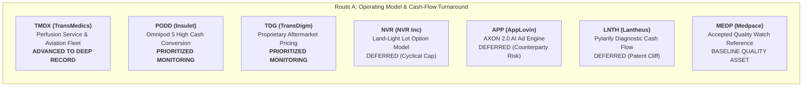
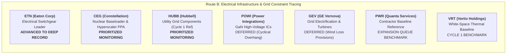

# ARX Terminal — Evidence-Led Discovery Cycle 2: Search Universe & Triage Matrix

**Document ID:** `ARX-DISCOVERY-CYCLE-2-TRIAGE-V1`  
**Effective Date:** October 22, 2026 (Reconciled & Corrected)  
**Governing Authority:** Product Owner Authorization — Evidence-Led Discovery Cycle 2  
**Governing Standard:** `ARX-DECISION-RESEARCH-PROCESS-V1` (Six-Step Universal Workflow)  
**Applicability:** Internal Research Experiment Only (Non-Production / Non-Public)  

---

## 1. Triage Methodology & Principles

In accordance with `ARX-DECISION-RESEARCH-PROCESS-V1`, triage evaluates the complete transmission chain from observable business change to per-share cash generation:
1. **Observable Development:** Verifiable operating or structural shift disclosed in primary filings.
2. **Economic Significance:** Consolidated revenue and operating profit materiality.
3. **Value Capture & Friction:** Moat defensibility after accounting for customer bargaining power, competition, and capital expenditures.
4. **Cash Flow Transmission per Share:** Cash generation after interest expense, debt covenants, and share dilution.
5. **Counter-Explanation (Bear Case):** The strongest credible adversarial explanation for observed financial metrics.
6. **Decisive Unresolved Uncertainty:** The single question capable of altering internal priority.

---

## 2. Route A: Company-Led Operating & Cash-Conversion Change (7 Candidates)

### Detailed Candidate Triage Profiles

#### 1. TransMedics Group, Inc. (`TMDX`) — **ADVANCED TO DEEP INVESTIGATION**
- **Why Surfaced:** Operating model turnaround driven by the National OCS Program (NOP) turnkey perfusion and aviation logistics network, accompanied by substantial operating cash flow expansion.
- **Primary Source Filings:**
  - *Form 10-K FY2025:* Filed February 24, 2026 (CIK: `0001756262`, Accession: `0001193125-26-067032`, [SEC EDGAR Archives URL](https://www.sec.gov/Archives/edgar/data/1756262/000119312526067032/tmdx-20251231.htm)).
  - *Form 10-Q Q2 2026:* Filed August 4, 2026 (CIK: `0001756262`, Accession: `0001193125-26-332843`, [SEC EDGAR Archives URL](https://www.sec.gov/Archives/edgar/data/1756262/000119312526332843/tmdx-20260630.htm)).
- **Reconciled Reported Financials (FY2025):**
  - Consolidated revenue: **$605.494M** (+37.1% YoY from $441.540M in FY2024 and $241.623M in FY2023).
  - Gross profit: **$362.806M** (59.92% gross margin).
  - Operating income: **$108.583M** (17.93% operating margin). *(Note on profitability timeline: Operating profitability was achieved in FY2024 at $37.496M and expanded in FY2025; FY2025 was not the initial year of operating profit).*
  - Net income: **$190.291M**, which includes a nonrecurring income tax benefit of **$82.769M** primarily resulting from a **$103.3M valuation allowance release** on deferred tax assets in Q4 2025.
  - Cash from operating activities (CFO): **$192.840M**.
  - Cash purchases of property, plant, and equipment (PP&E): **$59.251M**.
  - Free cash flow (CFO minus cash PP&E): **$133.589M** (69.27% FCF / CFO conversion).
- **Balance Sheet & Capital Structure (June 30, 2026):**
  - Gross cash and cash equivalents: **$472.675M**.
  - Convertible senior notes principal (1.50% due 2028): **$459.996M** ($460.0M face value).
  - Other borrowings principal: **$60.000M**.
  - Total borrowing principal: **$519.996M** (carrying value: $517.2M).
  - Finance lease liabilities: **$347.660M** (reflecting aircraft financing arrangements).
  - Total debt + finance lease obligations: **$867.656M**.
  - Net Position: Under the standard convention (net debt = included debt obligations minus included cash), total borrowings ($519.996M) less gross cash ($472.675M) yields **+$47.321M net debt** (excluding finance leases). Including finance lease liabilities of $347.660M ($867.656M total), net debt is **+$394.981M**. Obligations exceed cash, resulting in positive net debt.
- **Economic Mechanism:** Dynamic warm machine perfusion preserves donor organs in a functioning state, expanding retrieval yield. NOP air logistics removes surgical center transport friction.
- **Capital Intensity Disclosure:** Simple cash CFO minus cash PP&E ($59.251M in FY25) does not reflect all asset additions; material aircraft were added under noncash finance lease agreements ($340.040M noncash additions in 1H 2026, resulting in $347.660M finance lease liabilities at Q2 2026).
- **Strongest Counter-Explanation (Bear Case):** Operating an owned aviation fleet introduces asset-heavy transportation economics: pilot salary inflation, jet fuel price volatility, FAA maintenance groundings, and aircraft lease debt service.
- **Decisive Unresolved Question:** Can TransMedics sustain gross margins near 60% and cover aircraft finance lease commitments if US donor organ volume decelerates?
- **Triage Disposition:** **`ADVANCED_TO_DEEP_INVESTIGATION`** (Significant business transformation; complex capital structure warrants deep primary analysis).

---

#### 2. Insulet Corporation (`PODD`) — **PRIORITIZED FOR INTERNAL MONITORING**
- **Why Surfaced:** Omnipod 5 automated insulin delivery (AID) platform expansion driving an inflection to high recurring cash conversion and self-funded expansion.
- **Primary Source Filing:** Form 10-K FY2025 (Filed Feb 18, 2026, CIK: `0001145197`, Accession: `0001145197-26-000012`, [SEC EDGAR Archives URL](https://www.sec.gov/Archives/edgar/data/1145197/000114519726000012/podd-20251231.htm)).
- **Reconciled Financial Facts:** Full-year 2025 revenue reached **$2,708.1M** (+30.7% YoY from $2,071.6M in FY24); operating income reached **$473.8M** (17.49% operating margin).
- **Economic Mechanism:** Tubeless, waterproof disposable pods sold through the retail pharmacy benefit channel, lowering patient upfront cost and generating predictable 30-day recurring revenue (>85% recurring).
- **Strongest Counter-Explanation (Bear Case):** Rapid adoption of once-weekly basal insulins and GLP-1/GIP co-agonists could delay pump initiation among Type 2 diabetes patients, capping Omnipod's addressable market.
- **Decisive Unresolved Question:** Does pharmacy channel reimbursement stability sustain operating margins above 18% as international commercialization scales?
- **Triage Disposition:** **`PRIORITIZED_FOR_INTERNAL_MONITORING`** (High quality, clear self-funding, prioritized for internal tracking alongside ISRG).

---

#### 3. NVR, Inc. (`NVR`) — **DEFERRED (CYCLICAL CONSTRAINTS)**
- **Why Surfaced:** Exceptional return on invested capital (>35% ROIC), zero funded debt, and disciplined land-light option strategy.
- **Primary Source Filing:** Form 10-K FY2025 (Filed Feb 12, 2026, CIK: `0000906163`, [SEC EDGAR Archives URL](https://www.sec.gov/Archives/edgar/data/906163/000090616326000008/nvr-20251231.htm)).
- **Economic Mechanism:** Acquires finished lots through non-refundable option contracts (~10% cash deposits) rather than raw land banking, eliminating multi-year land development risk.
- **Strongest Counter-Explanation (Bear Case):** Elevated mortgage rates and housing affordability constraints squeeze homebuilder gross margins; land developers may default or delay projects in regional downturns.
- **Triage Disposition:** **`DEFERRED_CYCLICAL_CONSTRAINTS`** (Business model quality acknowledged, but structural thesis constrained by interest rate cyclicality).

---

#### 4. AppLovin Corporation (`APP`) — **DEFERRED (GOVERNANCE RISK)**
- **Why Surfaced:** Free cash flow expansion driven by AXON 2.0 AI-based mobile in-app recommendation engine.
- **Primary Source Filing:** Form 10-K FY2025 (Filed Feb 26, 2026, CIK: `0001751008`, [SEC EDGAR Archives URL](https://www.sec.gov/Archives/edgar/data/1751008/000175100826000014/app-20251231.htm)).
- **Strongest Counter-Explanation (Bear Case):** Extreme platform counterparty dependence on Apple App Store and Google Play; attribution rule shifts or store policy changes create existential revenue volatility.
- **Triage Disposition:** **`DEFERRED_GOVERNANCE_RISK`** (High cash generation offset by unacceptable platform regulatory exposure and governance opacity).

---

#### 5. Lantheus Holdings, Inc. (`LNTH`) — **DEFERRED (PATENT CLIFF)**
- **Why Surfaced:** Pylarify PSMA PET prostate cancer imaging agent cash generator.
- **Primary Source Filing:** Form 10-K FY2025 (Filed Feb 20, 2026, CIK: `0001521036`, [SEC EDGAR Archives URL](https://www.sec.gov/Archives/edgar/data/1521036/000152103626000015/lnth-20251231.htm)).
- **Strongest Counter-Explanation (Bear Case):** Single-product concentration (>70% of revenues) facing patent challenges and generic diagnostic alternatives within 24–36 months.
- **Triage Disposition:** **`DEFERRED_PATENT_CLIFF`** (Cash flow is temporary/cyclical, not structural).

---

#### 6. TransDigm Group, Inc. (`TDG`) — **PRIORITIZED FOR INTERNAL MONITORING**
- **Why Surfaced:** Pricing power in commercial and military aerospace aftermarket replacement parts (>90% proprietary products, >45% EBITDA margin).
- **Primary Source Filing:** Form 10-K FY2025 (Fiscal year ended Sept 30, 2025, filed Nov 14, 2025, CIK: `0001260221`, [SEC EDGAR Archives URL](https://www.sec.gov/Archives/edgar/data/1260221/000126022125000078/tdg-20250930.htm)).
- **Economic Mechanism:** Sole-source components with minimal cost relative to total airframe operation, enabling inflation-plus pricing across multi-decade service lives.
- **Debt & Leverage:** Carries substantial debt ($22.0B+ funded debt), creating high interest expense sensitivity.
- **Triage Disposition:** **`PRIORITIZED_FOR_INTERNAL_MONITORING`** (Retained for internal tracking; elevated leverage precludes public Quality Watch selection).

---

#### 7. Medpace Holdings, Inc. (`MEDP`) — **ACCEPTED QUALITY WATCH BASELINE (REFERENCE)**
- **Role:** Already published Quality Watch asset (PR #41). Serves as the debt-free, high-cash-conversion reference baseline to calibrate CRO and healthcare capital return standards.

---

## 3. Route B: Industry-Led Value-Chain Constraint Tracing (7 Candidates)
**Core Constraint:** Datacenter High-Voltage Grid Interconnection, Substation & Switchgear Bottlenecks.

### Detailed Candidate Triage Profiles

#### 1. Eaton Corporation plc (`ETN`) — **ADVANCED TO DEEP INVESTIGATION**
- **Why Surfaced:** Global market leader in electrical distribution, power quality, and medium/high-voltage switchgear, directly positioned at the datacenter utility substation interface.
- **Primary Source Filings:**
  - *Form 10-K FY2025:* Filed February 25, 2026 (CIK: `0001551182`, Accession: `0001551182-26-000007`, [SEC EDGAR Archives URL](https://www.sec.gov/Archives/edgar/data/1551182/000155118226000007/etn-20251231.htm)).
  - *Form 10-Q Q2 2026:* Filed July 31, 2026 (CIK: `0001551182`, Accession: `0001551182-26-000030`, [SEC EDGAR Archives URL](https://www.sec.gov/Archives/edgar/data/1551182/000155118226000030/etn-20260630.htm)).
- **Reconciled Reported Financials (FY2025):**
  - Net sales: **$27,448M** (+10.3% YoY from $24,878M in FY2024).
  - Cost of products sold: **$17,131M**; Gross profit: **$10,317M** (37.59% gross margin).
  - Electrical Americas net sales: **$13,276M**; segment operating profit: **$3,972M** (29.92% segment margin).
  - Total segment operating profit: **$6,713M** (24.46% total segment margin).
  - Net income attributable to Eaton shareholders: **$4,087M** (Consolidated Net income: **$4,090M**).
  - Operating cash flow (CFO): **$4,472M**.
  - Capital expenditures for PP&E: **$919M**.
  - Free cash flow (CFO minus cash PP&E): **$3,553M** (79.45% FCF / CFO conversion).
- **Balance Sheet & Leverage (Dec 31, 2025):**
  - Cash ($622M) and short-term investments ($181M): **$803M**.
  - Short-term debt ($1M), current portion of long-term debt ($1,136M), and long-term debt ($8,758M): **$9,895M total debt**.
  - Net debt: **$9,092M** (~1.6x Net Debt / EBITDA).
  - Shares outstanding: **387.9M** (retired 5.0M shares in FY25).
- **Economic Mechanism:** Hyperscalers cannot commission compute without high-voltage utility substations, step-down transformers, switchgear lineups, and uninterruptible power supplies (UPS). Eaton controls entrenched distribution partnerships and proprietary switchgear architectures.
- **Strongest Counter-Explanation (Bear Case):** Electrical equipment is historically late-cycle; when current hyperscaler megaprojects peak or lead times normalize, backlog conversion could decelerate, leaving expanded plant capacity under-absorbed.
- **Decisive Unresolved Question:** What percentage of Eaton's Electrical Americas multi-year backlog represents firm, non-cancellable datacenter infrastructure contracts versus cyclical commercial building construction?
- **Triage Disposition:** **`ADVANCED_TO_DEEP_INVESTIGATION`** (Essential upstream electrical enabler; verified primary filings warrant deep examination).

---

#### 2. Constellation Energy Corp (`CEG`) — **PRIORITIZED FOR INTERNAL MONITORING**
- **Why Surfaced:** Largest US merchant nuclear generator securing landmark 20-year Power Purchase Agreement (PPA) with Microsoft for the restart of Three Mile Island Unit 1 (Crane Clean Energy Center).
- **Primary Source Filing:** Form 10-K FY2025 (Filed Feb 24, 2026, CIK: `0001868275`, [SEC EDGAR Archives URL](https://www.sec.gov/Archives/edgar/data/1868275/000186827526000018/ceg-20251231.htm)).
- **Reconciled Financial Facts:** Full-year 2025 revenue was **$25.5B** (+8.3% YoY). Contracted capacity provides multi-decade revenue visibility.
- **Economic Mechanism:** Nuclear generation provides 24/7 carbon-free baseload power required by hyperscalers with net-zero carbon pledges that intermittent renewables cannot supply.
- **Regulatory Uncertainty:** Substantial pricing power, but subject to intense regulatory scrutiny: FERC decisions on behind-the-meter colocation and cost-allocation tariffs create significant headline risk. High restart capex ($1.6B+ estimated capex for Crane Clean Energy Center).
- **Triage Disposition:** **`PRIORITIZED_FOR_INTERNAL_MONITORING`** (High strategic value, but elevated regulatory uncertainty warrants internal monitoring).

---

#### 3. Power Integrations, Inc. (`POWI`) — **DEFERRED (CYCLICAL OVERHANG)**
- **Why Surfaced:** High-voltage Gallium Nitride (GaN) power conversion ICs reducing power loss in server power supplies and EV chargers.
- **Primary Source Filing:** Form 10-K FY2025 (Filed Feb 19, 2026, CIK: `0001043604`, [SEC EDGAR Archives URL](https://www.sec.gov/Archives/edgar/data/1043604/000104360426000012/powi-20251231.htm)).
- **Strongest Counter-Explanation (Bear Case):** Datacenter server power supplies represent <15% of consolidated revenues; the remaining 85% is exposed to depressed consumer appliance, industrial, and communications end-markets experiencing channel inventory overhang.
- **Triage Disposition:** **`DEFERRED_CYCLICAL_EXPOSURE`** (High technology quality, but consolidated financial results remain dominated by cyclical consumer headwinds).

---

#### 4. Hubbell Incorporated (`HUBB`) — **PRIORITIZED FOR INTERNAL MONITORING (CYCLE 1 RE-EXAMINATION)**
- **Role:** Examined and deferred in Cycle 1. Re-evaluated as a secondary grid hardware play.
- **Primary Source Filing:** Form 10-K FY2025 (Filed Feb 13, 2026, CIK: `0000048898`, [SEC EDGAR Archives URL](https://www.sec.gov/Archives/edgar/data/48898/000004889826000011/hubb-20251231.htm)).
- **Observable Financials:** Operating margins ~20–21% on steady utility grid modernization demand.
- **Value Chain Positioning:** High domestic share in utility pole-top and transmission connectors, but lower direct exposure to the high-density datacenter switchgear lineups where Eaton dominates.
- **Triage Disposition:** **`PRIORITIZED_FOR_INTERNAL_MONITORING`** (Solid secondary grid supplier; ranked behind Eaton on datacenter leverage).

---

#### 5. GE Vernova Inc. (`GEV`) — **DEFERRED (RESTRUCTURING VOLATILITY)**
- **Why Surfaced:** Gas turbines, grid electrification software, and HVDC converter stations manufacturer post-spin from General Electric.
- **Primary Source Filing:** Form 10-K FY2025 (Filed Feb 27, 2026, CIK: `0001996810`, [SEC EDGAR Archives URL](https://www.sec.gov/Archives/edgar/data/1996810/000199681026000022/gev-20251231.htm)).
- **Strongest Counter-Explanation (Bear Case):** Multi-hundred million dollar loss provisions in legacy offshore wind contracts drag down consolidated cash flow; multi-year restructuring obscures underlying grid hardware earnings quality.
- **Triage Disposition:** **`DEFERRED_LEGACY_RESTRUCTURING`** (Strong grid positioning offset by legacy contract liabilities and volatile cash conversion).

---

#### 6. Quanta Services, Inc. (`PWR`) — **EXPANSION QUEUE BENCHMARK (REFERENCE)**
- **Role:** Electric utility and renewable infrastructure contractor from the 10-candidate expansion queue. Demonstrates strong backlog growth, but operates with lower structural operating margins (8-9%) and fixed-price project execution risks compared to equipment manufacturers.

---

#### 7. Vertiv Holdings Co (`VRT`) — **CYCLE 1 BENCHMARK (REFERENCE)**
- **Role:** White-space datacenter thermal management leader from Cycle 1. Maintained as benchmark comparison for infrastructure valuation and backlog conversion.

---

## 4. Reconciled Triage Disposition Summary

| Symbol | Company Name | Route | Novelty Status | Operating Margin (FY25) | Net Debt Position | Triage Disposition | Decision Action |
| :--- | :--- | :--- | :--- | :--- | :--- | :--- | :--- |
| **`TMDX`** | TransMedics Group | Route A | **Novel** | 17.93% | -$395M (incl. leases) | **`ADVANCED_TO_DEEP_INVESTIGATION`** | **Prepare Deep Record** |
| **`PODD`** | Insulet Corporation | Route A | **Novel** | 17.49% | 0.8x Net Debt | **`PRIORITIZED_FOR_INTERNAL_MONITORING`** | Track quarterly pharmacy trends |
| **`TDG`** | TransDigm Group | Route A | **Novel** | ~46.0% | 5.2x (high debt) | **`PRIORITIZED_FOR_INTERNAL_MONITORING`** | Monitor debt refi & aftermarket margins |
| **`NVR`** | NVR, Inc. | Route A | **Novel** | ~21.0% | Net Cash ($2.2B) | **`DEFERRED_CYCLICAL_CONSTRAINTS`** | Defer pending housing recovery |
| **`APP`** | AppLovin Corp | Route A | **Novel** | ~42.0% | 1.8x Net Debt | **`DEFERRED_GOVERNANCE_RISK`** | Close on platform policy exposure |
| **`LNTH`** | Lantheus Holdings | Route A | **Novel** | ~32.0% | Net Cash ($450M) | **`DEFERRED_PATENT_CLIFF`** | Close on patent expiration risk |
| **`ETN`** | Eaton Corporation | Route B | **Novel** | 24.46% (Segment) | 1.6x Net Debt | **`ADVANCED_TO_DEEP_INVESTIGATION`** | **Prepare Deep Record** |
| **`CEG`** | Constellation Energy | Route B | **Novel** | ~14.0% | 2.8x Net Debt | **`PRIORITIZED_FOR_INTERNAL_MONITORING`** | Monitor FERC PJM colocation docket |
| **`HUBB`** | Hubbell Inc | Route B | **Cycle 1 Ref** | ~20.5% | 1.2x Net Debt | **`PRIORITIZED_FOR_INTERNAL_MONITORING`** | Track utility grid distribution orders |
| **`POWI`** | Power Integrations | Route B | **Novel** | ~12.0% | Net Cash ($310M) | **`DEFERRED_CYCLICAL_EXPOSURE`** | Defer pending consumer inventory turn |
| **`GEV`** | GE Vernova | Route B | **Novel** | ~6.5% | Net Cash ($3.5B) | **`DEFERRED_LEGACY_RESTRUCTURING`** | Defer pending offshore wind runoff |
| **`MEDP`** | Medpace Holdings | Baseline | **Watch Asset** | ~21.5% | Net Cash ($480M) | **`MAINTAIN_EXPANSION_QUEUE`** | Prior Quality Watch benchmark |
| **`PWR`** | Quanta Services | Baseline | **Queue Ref** | ~8.8% | 2.2x Net Debt | **`MAINTAIN_EXPANSION_QUEUE`** | Prior 10-candidate queue benchmark |
| **`VRT`** | Vertiv Holdings | Baseline | **Cycle 1 Ref** | ~18.5% | 1.9x Net Debt | **`MAINTAIN_CYCLE_1_COHORT`** | Prior Cycle 1 active benchmark |
