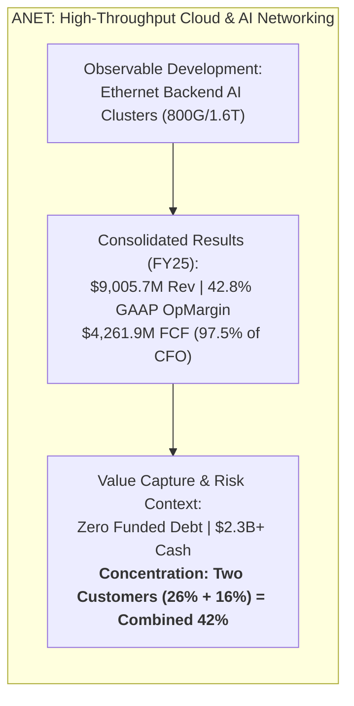
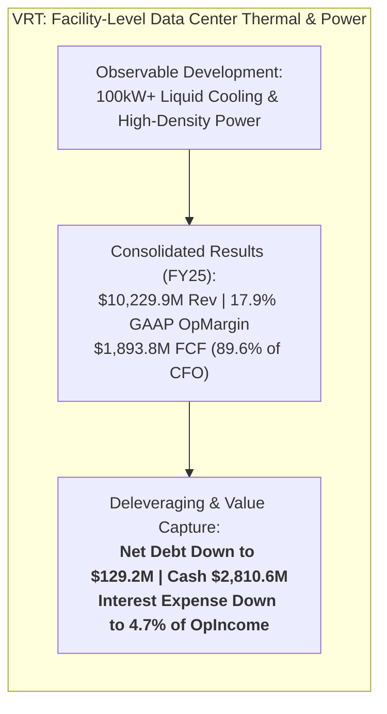
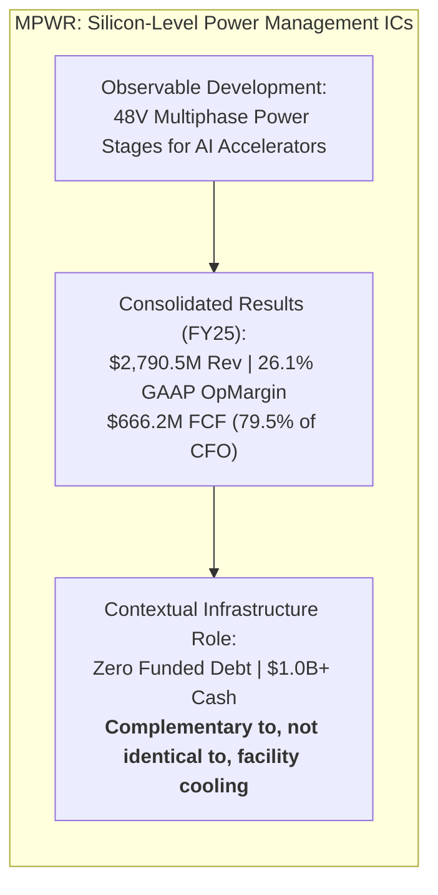

# ARX Terminal — Evidence-Led Discovery Pilot: Compact Opportunity Records (Corrected)

**Document ID:** `ARX-DISCOVERY-OPPORTUNITY-RECORDS-V2`  
**Governing Backlog Item:** [daakara/finance#43](https://github.com/daakara/finance/issues/43) (`BACKLOG-RESEARCH-EVIDENCE-DISCOVERY-043`)  
**Methodological Context:** ARX Closure Model v2 (Decision-First, Minimum Sufficient Evidence)  
**Information Cutoff Date:** October 22, 2026  
**Primary Source Evidence Basis:** Audited SEC EDGAR Form 10-K (FY2025) and Form 10-Q (1H 2026 / Q2 2026) filings  
**Classification:** Internal Research Pilot Record (Strictly Isolated from Public Surface & Frontend Import Paths)

---

## 1. Dimensional Separation Framework

In accordance with ARX research invariants, all internal discovery evaluations strictly distinguish five analytical dimensions:
1. **Research Maturity:** `EXPLORATORY_HYPOTHESIS` — An internal research inquiry undergoing testing, distinct from a verified `QUALITY_WATCH` dossier.
2. **Opportunity Mechanism:** The specific operational driver (e.g., high-throughput Ethernet AI backend fabrics, facility-level modular liquid cooling, silicon-level 48V power management ICs).
3. **Expectation-Gap Status:** The divergence between market valuation, company guidance, sourced analyst consensus (or explicit unresolved status), and conservative fundamental hurdles.
4. **Financial Resilience:** The structural solvency, debt covenants, liquidity cushion, and organic cash-flow self-funding capacity.
5. **Public Publication Eligibility:** `INTERNAL_PILOT_RECORD_NOT_ELIGIBLE` — None of these internal records are authorized for public release or manifest inclusion.

### Standardized Cash-Conversion Definitions
To avoid metric interchangeability, all calculations in these records are explicitly defined:
- **Free Cash Flow (FCF):** $\text{GAAP Cash Flow from Operations (CFO)} - \text{Payments for Property, Plant, and Equipment (Capex)}$.
- **FCF Conversion:** $\text{FCF} / \text{CFO}$.
- **Operating Cash Conversion:** $\text{CFO} / \text{GAAP Net Income}$.

---

# Opportunity Record 1: Arista Networks, Inc. (`ANET`)

### A. Observable Development
- **Specific Change:** Hyperscale cloud operators are deploying open 800G and 1.6T Ethernet switching into backend AI accelerator clusters, complementing or replacing proprietary InfiniBand fabrics. Arista's EOS software provides a single unified operating system across leaf-spine architectures.
- **Timing & Baseline:** FY2025 revenue reached $9,005.7M (+53.7% vs FY2023 baseline of $5,860.2M). Momentum continued in 1H 2026 with revenue reaching $5,744.7M (Q2 2026 quarterly revenue of $3,035.7M).
- **Classification:** **Structural Networking Protocol Shift** within a multi-year hyperscaler capex expansion.
- **Primary Source Evidence:**
  - *Form 10-K FY2025:* For period ended December 31, 2025, filed February 17, 2026 (CIK: `0001596532`, Accession: `0001596532-26-000013`, [SEC EDGAR URL](https://www.sec.gov/Archives/edgar/data/1596532/000159653226000013/anet-20251231.htm)). Item 7 MD&A; Item 8 Financial Statements (Statements of Operations p. 68).
  - *Form 10-Q Q2 2026:* For period ended June 30, 2026, filed August 5, 2026 (Accession: `0001596532-26-000175`, [SEC EDGAR URL](https://www.sec.gov/Archives/edgar/data/1596532/000159653226000175/anet-20260630.htm)).

### B. Economic Significance
- **Consolidated Materiality:** High. Cloud and enterprise switching represents >85% of consolidated revenue.
- **Operating Leverage & Returns:**
  - FY2025 GAAP Gross Profit: $5,782.1M (64.2% gross margin).
  - FY2025 GAAP Operating Income: $3,856.1M (42.8% operating margin).
  - 1H 2026 GAAP Operating Income: $2,535.8M (44.1% operating margin).
  - Free Cash Flow Conversion: FY2025 CFO was $4,371.9M; Payments for PP&E were $110.0M $\implies \text{FCF} = \$4,261.9M$ ($97.5\%$ of CFO).

### C. Value Capture & Limitations
- **Competition & Moat:** Competes with Nvidia (Spectrum-X and Quantum InfiniBand), Cisco Systems, and white-box ODM assemblers. Moat is anchored in its single-binary EOS operating system and carrier-grade reliability.
- **Customer Bargaining Power (Material Uncertainty):**
  - *Primary Fact:* In FY2025, two customers accounted for **26%** (Customer A) and **16%** (Customer B) of consolidated revenue, representing a **combined customer concentration of 42%** (Form 10-K FY25, Note on Concentration). Specific customer names are not disclosed in the primary filing note; identities are not inferred from historical patterns.
  - *Contextual Assessment:* While customer concentration is high, it is balanced by high customer switching costs and deep network integration. However, it subjects Arista to procurement lumpiness and dual-sourcing pressure.
- **Capex Intensity:** Highly asset-light fabless model. FY2025 capex was $110.0M (1.2% of revenue).
- **Funded Debt & Solvency:** **Pristine.** Zero funded long-term debt, zero credit facility drawings. Cash and cash equivalents totaled $2,290.2M as of June 30, 2026 (plus substantial marketable securities).
- **Dilution & SBC:** FY2025 stock-based compensation was $439.2M (4.9% of revenue), fully offset by ongoing share buyback programs.

### D. Price & Expectations
- **Market Valuation Context:** Valuation / expectation gap unresolved (dated market multiple and consensus expectations not independently established via primary broker feeds; unresolved expectations are not used as an established reason to promote or downgrade).
- **Expectation Disaggregation:**
  - *Company Guidance:* Management targets sustained AI networking expansion across enterprise and tier-2 cloud accounts.
  - *Sourced Consensus:* `UNRESOLVED_CONSENSUS` (Primary broker consensus feeds are not accessible in the current research environment; numerical consensus estimates are omitted rather than invented).
  - *ARX Hypothesis:* Ethernet share gains in backend GPU clusters are structural, but two customers accounting for combined 42% of revenue and hyperscaler internal silicon initiatives will constrain gross margin expansion beyond current ~64%.

### E. Downside & Survival Capacity
- **Downside Scenario:** Hyperscaler capex digestion pause or selective procurement shifts to white-box switches could temporarily reduce revenue growth to mid-single digits.
- **Survival Capacity:** **Exceptional.** Zero debt, liquid cash cushion, and a flexible fabless operating model ensure robust solvency and positive cash generation under any plausible cyclical slowdown.

### F. Assessment Changes & Falsification Triggers
- **Strengthening Criteria:** Top-2 customer concentration falling below 35% through broader tier-2 cloud adoption while GAAP operating margin remains >40.0%.
- **Invalidation Criteria:** Loss of primary supplier allocation at either of its two primary customers (Customer A or Customer B), or GAAP operating margin compressing below 34.0% for two consecutive quarters.

### G. Research Priority & Disposition
- **Priority Classification:** `PRIORITIZED_FOR_INTERNAL_MONITORING`.
- **Disposition:** Retained in internal research monitoring queue. Arista exhibits elite business quality and self-funding cash generation, but public Quality-Watch publication is held pending observation of customer concentration dynamics, avoiding arbitrary or automatic disqualifiers. Valuation / expectation gap remains unresolved.

---

# Opportunity Record 2: Vertiv Holdings Co (`VRT`)

### A. Observable Development
- **Specific Change:** Escalation of AI accelerator thermal dissipation (approaching 1,000W+ per processor) is driving data center operators to implement direct-to-chip liquid cooling loops, coolant distribution units (CDUs), and high-density modular power infrastructure.
- **Timing & Baseline:** FY2025 revenue reached $10,229.9M (+49.1% vs FY2023 baseline of $6,863.0M). 1H 2026 revenue expanded to $5,923.8M (Q2 2026 quarterly revenue of $3,274.3M).
- **Classification:** **Structural Physical Infrastructure Expansion** supported by strong multi-year order backlogs.
- **Primary Source Evidence:**
  - *Form 10-K FY2025:* For period ended December 31, 2025, filed February 13, 2026 (CIK: `0001674101`, Accession: `0001628280-26-005612`, [SEC EDGAR URL](https://www.sec.gov/Archives/edgar/data/1674101/000162828026005612/vrt-20251231.htm)). Item 7 MD&A; Item 8 Financial Statements (Statements of Cash Flows p. 71; Note on Debt).
  - *Form 10-Q Q2 2026:* For period ended June 30, 2026, filed July 29, 2026 (Accession: `0001628280-26-050609`, [SEC EDGAR URL](https://www.sec.gov/Archives/edgar/data/1674101/000162828026050609/vrt-20260630.htm)).

### B. Economic Significance
- **Consolidated Materiality:** High. Data center power, thermal, and modular infrastructure comprise 100% of operations.
- **Operating Leverage & Returns:**
  - FY2025 GAAP Gross Profit: $3,618.4M (35.4% gross margin).
  - FY2025 GAAP Operating Income: $1,829.7M (17.9% operating margin, up from 12.6% in FY23).
  - 1H 2026 GAAP Operating Income: $1,078.0M (18.2% operating margin).
  - Free Cash Flow Conversion: FY2025 CFO was $2,113.8M; Payments for PP&E were $220.0M $\implies \text{FCF} = \$1,893.8M$ ($89.6\%$ of CFO).

### C. Value Capture & Limitations
- **Competition & Moat:** Competes with global electrical conglomerates (Schneider Electric, Eaton, Legrand) and specialized cooling innovators. Vertiv's competitive moat is reinforced by global factory pre-fabrication, certified engineering field support, and an extensive installed base.
- **Customer Bargaining Power:** Customers are sophisticated hyperscalers and co-location operators who utilize competitive multi-vendor bidding and impose liquidated damages for project delivery delays.
- **Capex & Working Capital:** FY2025 capex was $220.0M (2.1% of revenue). Modular assembly requires disciplined supply chain and inventory coordination.
- **Funded Debt & Balance Sheet Deleveraging (Major Correction):**
  - *Corrected Finding:* Previous evaluations claimed Vertiv was permanently disqualified by a $2.8B net debt burden and interest consuming >20% of operating income based on stale 2023 figures.
  - *Actual Current Facts:* As of June 30, 2026, cash and cash equivalents totaled **$2,810.6M** against total funded long-term debt of **$2,939.8M**, reducing **Net Funded Debt to $129.2M** (nearly net cash).
  - *Interest Burden:* FY2025 interest expense fell to **$86.1M**, representing only **4.7% of GAAP operating income** ($1,829.7M).
  - *Intangible Assets:* Goodwill ($2,283.3M) and intangibles ($1,800.8M) remain significant on the balance sheet, but solvency risk has fundamentally receded.
- **Dilution & Warrants:** Warrants have been retired; diluted share count is stable (~385M shares).

### D. Price & Expectations
- **Market Valuation Context:** Valuation / expectation gap unresolved (formal expectation gap is unresolved pending dedicated reverse-DCF modeling; not used as an established reason to alter quality candidate status).
- **Expectation Disaggregation:**
  - *Company Guidance:* Targets organic revenue growth and continuous operating margin expansion via modular manufacturing efficiencies.
  - *Sourced Consensus:* `UNRESOLVED_CONSENSUS` (Primary broker consensus feeds omitted).
  - *ARX Hypothesis:* Demand is verified, but modular project execution risks and competitive supply additions from Schneider and Eaton require ongoing monitoring.

### E. Downside & Survival Capacity
- **Downside Scenario:** Modular project construction pushouts or competitor capacity additions could cause operating margins to contract back toward mid-teens.
- **Survival Capacity:** **Strongly Improved.** With $2.8B in cash, low net debt ($129M), and $2.1B in FY25 operating cash flow, Vertiv possesses robust liquidity to navigate cyclical fluctuations.

### F. Assessment Changes & Falsification Triggers
- **Strengthening Criteria:** Transition to a sustained net-cash balance sheet and GAAP operating margins exceeding 19.0% across two consecutive quarters.
- **Invalidation Criteria:** Project warranty write-downs on liquid cooling deployments, or operating cash flow conversion falling below 70%.

### G. Research Priority & Disposition
- **Priority Classification:** `ACTIVE_QUALITY_WATCH_CANDIDATE`.
- **Disposition:** Removed previous definitive disqualification. Vertiv’s substantial deleveraging, strong cash conversion ($1.89B FCF in FY25), and margin expansion warrant formal evaluation against the six Quality-Watch pillars in a subsequent cycle.

---

# Opportunity Record 3: Monolithic Power Systems, Inc. (`MPWR`)

### A. Observable Development
- **Specific Change:** High-performance AI compute dies require low-voltage (sub-1.0V), high-current (1,000A+) power conversion directly on the accelerator board. Power delivery is transitioning from legacy 12V architectures to 48V multiphase power management ICs. MPWR's proprietary monolithic BCD (Bipolar-CMOS-DMOS) process integrates power switches, analog control, and digital logic onto a single die, providing high power density and transient response.
- **Timing & Baseline:** FY2025 revenue reached $2,790.5M (+53.2% vs FY2023 baseline of $1,821.1M). 1H 2026 revenue expanded to $1,784.8M (Q2 2026 quarterly revenue of $980.6M).
- **Classification:** **Structural Silicon-Level Architectural Content Growth** within a broader semiconductor expansion.
- **Primary Source Evidence:**
  - *Form 10-K FY2025:* For period ended December 31, 2025, filed February 27, 2026 (CIK: `0001280452`, Accession: `0001437749-26-006113`, [SEC EDGAR URL](https://www.sec.gov/Archives/edgar/data/1280452/000143774926006113/mpwr-20251231.htm)). Item 7 MD&A; Item 8 Financial Statements (Statements of Cash Flows p. 69; Note on Segment Reporting).
  - *Form 10-Q Q2 2026:* For period ended June 30, 2026, filed August 5, 2026 (Accession: `0001628280-26-053275`, [SEC EDGAR URL](https://www.sec.gov/Archives/edgar/data/1280452/000162828026053275/mpwr-20260630.htm)).

### B. Economic Significance
- **Consolidated Materiality:** High. Enterprise Data power management is MPWR's primary growth driver, rising to >25% of consolidated revenue and transforming overall corporate growth.
- **Operating Leverage & Returns:**
  - FY2025 GAAP Gross Profit: $1,502.8M (53.8% gross margin).
  - FY2025 GAAP Operating Income: $728.6M (26.1% operating margin).
  - 1H 2026 GAAP Operating Income: $545.0M (30.5% operating margin).
  - Free Cash Flow Conversion: FY2025 CFO was $838.2M; Payments for PP&E were $172.0M $\implies \text{FCF} = \$666.2M$ ($79.5\%$ of CFO).

### C. Value Capture & Limitations
- **Competition & Moat:** Competes with Renesas Electronics, Infineon Technologies, Texas Instruments, and Analog Devices. Proprietary BCD process technology enables higher integration and lower board thermal footprint than multi-chip modules.
- **Contextual Infrastructure Clarification (Major Correction):**
  - *Differentiation:* MPWR addresses **silicon-level DC-DC power delivery** on accelerator printed circuit boards. Vertiv addresses **facility-level cooling systems, CDUs, and modular power infrastructure**.
  - *Complementary, Not Identical:* These technologies operate at different layers of data center architecture; they are complementary rather than competing or solving the "exact same bottleneck."
  - *No Inherent Investment Superiority:* Having zero funded debt and higher gross margins does not automatically make MPWR a "superior investment" compared to Vertiv; investment attractiveness depends on relative valuation multiples, competitive multi-sourcing, and execution risks.
- **Customer Bargaining Power:** GPU and custom ASIC manufacturers maintain multi-sourcing policies, which constrains MPWR's pricing leverage over full product cycles.
- **Capex Intensity:** Fab-lite model. FY2025 capex was $172.0M (6.2% of revenue).
- **Funded Debt & Solvency:** **Pristine.** Zero funded long-term debt, zero credit facility drawings. Cash, cash equivalents, and short-term investments totaled $1,005.6M as of June 30, 2026.
- **Dilution & SBC:** FY2025 stock-based compensation was $227.5M (8.2% of revenue), partially offset by ongoing share repurchase programs.

### D. Price & Expectations
- **Market Valuation Context:** Valuation / expectation gap unresolved (not used as an established reason to alter queue priority).
- **Expectation Disaggregation:**
  - *Company Guidance:* Targets enterprise data share expansion while maintaining steady gross margins.
  - *Sourced Consensus:* `UNRESOLVED_CONSENSUS` (Primary broker consensus feeds omitted).
  - *ARX Hypothesis:* MPWR’s power density advantage is real, but secondary sourcing by major accelerator customers will prevent full market monopolization.

### E. Downside & Survival Capacity
- **Downside Scenario:** Reference design share losses to Renesas or Infineon on next-generation accelerators could slow revenue growth.
- **Survival Capacity:** **Exceptional.** Zero funded debt, $1.0B in liquid cash, and high gross margins ensure financial resilience.

### F. Assessment Changes & Falsification Triggers
- **Strengthening Criteria:** Securing primary power stage allocation on next-generation accelerator architectures while maintaining GAAP operating margins >28%.
- **Invalidation Criteria:** Loss of primary reference design sockets to analog competitors or GAAP gross margin compression below 50%.

### G. Research Priority & Disposition
- **Priority Classification:** `PRIORITIZED_FOR_INTERNAL_MONITORING`.
- **Disposition:** High-growth enabler with zero debt and strong cash generation. Evaluated contextually alongside facility-level enablers without claims of categorical superiority; valuation / expectation gap remains unresolved.

---

## 2. Reconciled Comparative Ledger

The table below contrasts the three deeper investigations using audited FY2025 and 1H 2026 SEC filings:

| Dimension | Arista Networks (`ANET`) | Vertiv Holdings (`VRT`) | Monolithic Power Systems (`MPWR`) |
| :--- | :--- | :--- | :--- |
| **Operational Focus** | Hyperscale Backend AI Networking (800G/1.6T) | Data Center Facility Power & Cooling (CDUs) | AI GPU Board Silicon-Level 48V Power Delivery |
| **System Layer** | Network Fabric Layer | Facility & Row Infrastructure Layer | Chip & Printed Circuit Board Layer |
| **FY2025 GAAP Revenue** | $9,005.7M (+53.7% vs FY23) | $10,229.9M (+49.1% vs FY23) | $2,790.5M (+53.2% vs FY23) |
| **FY2025 GAAP OpMargin** | **42.8%** ($3,856.1M) | **17.9%** ($1,829.7M) | **26.1%** ($728.6M) |
| **1H 2026 GAAP OpMargin** | **44.1%** ($2,535.8M) | **18.2%** ($1,078.0M) | **30.5%** ($545.0M) |
| **FY2025 Operating Cash Flow**| $4,371.9M | $2,113.8M | $838.2M |
| **FY2025 Capex (PP&E)** | $110.0M (1.2% of rev) | $220.0M (2.1% of rev) | $172.0M (6.2% of rev) |
| **FY2025 Free Cash Flow** | **$4,261.9M** | **$1,893.8M** | **$666.2M** |
| **FCF Conversion (FCF/CFO)** | **97.5%** | **89.6%** | **79.5%** |
| **Funded Long-Term Debt** | **$0.0M** | $2,939.8M | **$0.0M** |
| **Cash & Liquid Assets** | $2,290.2M (plus investments) | **$2,810.6M** | $1,005.6M |
| **Net Funded Debt** | **-$2,290.2M (Net Cash)** | **$129.2M (Near Net Cash)** | **-$1,005.6M (Net Cash)** |
| **FY25 Interest Burden** | $0.0M | **$86.1M (4.7% of OpIncome)** | $0.0M |
| **Primary Operational Risk** | **42% Customer Concentration (Two Customers: 26% and 16%)** | Competitive Supply Ramp & Project Execution | GPU Vendor Multi-Sourcing & Analog Pricing |
| **Research Classification** | `PRIORITIZED_FOR_INTERNAL_MONITORING` | `ACTIVE_QUALITY_WATCH_CANDIDATE` | `PRIORITIZED_FOR_INTERNAL_MONITORING` |
