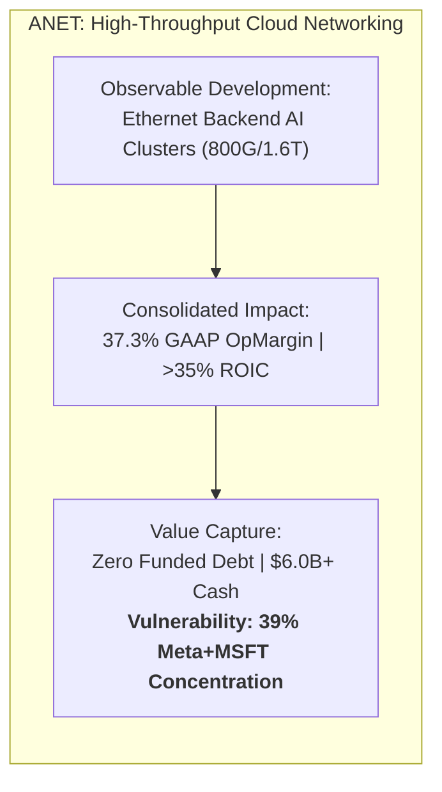
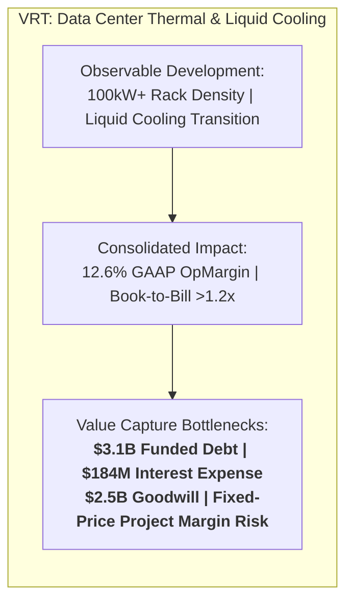
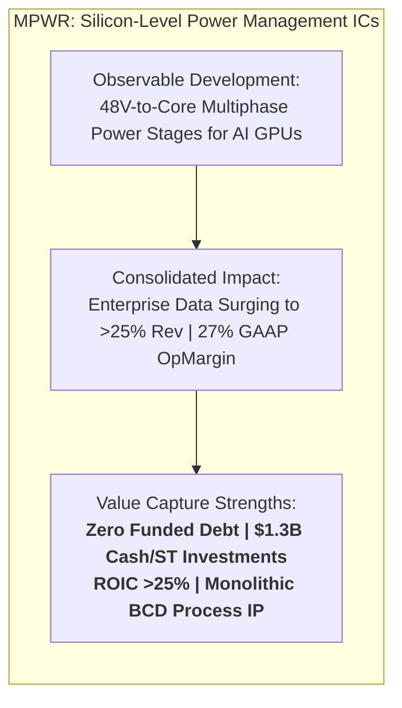

# ARX Terminal — Evidence-Led Discovery Pilot: Compact Opportunity Records

**Document ID:** `ARX-DISCOVERY-OPPORTUNITY-RECORDS-V1`  
**Governing Backlog Item:** [daakara/finance#43](https://github.com/daakara/finance/issues/43) (`BACKLOG-RESEARCH-EVIDENCE-DISCOVERY-043`)  
**Methodological Context:** ARX Closure Model v2 (Decision-First, Minimum Sufficient Evidence)  
**Creation Date:** October 22, 2026  
**Information Cutoff Date:** October 22, 2026 (Audited SEC EDGAR Form 10-K and Form 10-Q disclosures)  
**Classification:** Internal Research Pilot Record (Strictly Isolated from Public Surface & Frontend Import Paths)

---

## Dimensional Separation Framework

In accordance with ARX research invariants, all internal discovery evaluations strictly distinguish five analytical dimensions:
1. **Research Maturity:** `EXPLORATORY_HYPOTHESIS` — An internal research inquiry undergoing evidence collection, distinct from a verified `QUALITY_WATCH` dossier.
2. **Opportunity Mechanism:** The specific economic or industrial driver (e.g., Ethernet backend AI cluster adoption, rack-level thermal liquid cooling, monolithic silicon power management).
3. **Expectation-Gap Status:** The divergence between market pricing, company guidance, sourced analyst consensus, and conservative fundamental hurdles.
4. **Financial Resilience:** The structural solvency, debt covenants, and cash-flow self-funding capacity of the enterprise.
5. **Public Publication Eligibility:** `INTERNAL_PILOT_RECORD_NOT_ELIGIBLE` — None of these records are authorized for public surface release or addition to `published_watch_manifest.json`.

---

# Opportunity Record 1: Arista Networks, Inc. (`ANET`)

### A. Observable Development
- **Specific Change:** Hyperscale data center operators are actively deploying high-throughput 800G and 1.6T Ethernet switching fabrics into backend AI GPU clusters, challenging proprietary InfiniBand (Nvidia Quantum) interconnects. Arista's Extensible Operating System (EOS) software layer provides unified telemetry and management across front-end and back-end networks.
- **Timing & Baseline:** FY2022 to FY2023 revenue expanded 33.8% ($4,381.3M to $5,860.2M). Momentum continued in Q2 2024 with revenue reaching $1,690.1M (+15.9% YoY).
- **Classification:** **Structural Architectural Inflection** (transition to open Ethernet standards in AI clusters) combined with **Cyclical Hyperscaler Capex Surges**.
- **Primary Source Evidence:**
  - *Source:* SEC EDGAR Form 10-K for FY ended December 31, 2023 (CIK: `0001596532`, Accession: `0001596532-24-000007`, filed Feb 13, 2024).
  - *Locators:* Item 7 MD&A (pp. 42–48); Consolidated Statements of Operations (p. 66).
  - *Interim Source:* Form 10-Q for period ended June 30, 2024 (Accession: `0001596532-24-000030`, filed Aug 1, 2024).

### B. Economic Significance
- **Consolidated Materiality:** High. Cloud and enterprise switching accounts for >85% of consolidated revenues. Accelerated adoption of 800G/1.6T switches directly expands Arista’s addressable market and consolidated gross margins.
- **Operating Leverage & Returns:**
  - FY2023 GAAP Gross Profit: $3,628.9M (61.9% gross margin).
  - FY2023 GAAP Operating Income: $2,185.3M (37.3% operating margin); Non-GAAP operating margin >42%.
  - Return on Invested Capital (ROIC): Exceeds 35%, driven by asset-light software architecture and merchant silicon deployment.

### C. Value Capture & Limitations
- **Competition & Moat:** Competes against Cisco Systems and white-box ODMs (Celestica) in traditional switching, and Nvidia (Quantum-2 InfiniBand and Spectrum-X Ethernet) in AI clustering. Arista's competitive moat rests on its single-binary EOS Linux-based software architecture and deep API integration with cloud management stacks.
- **Customer Bargaining Power (Material Limitation):** **Severe Concentration Risk.**
  - *Primary Fact:* In FY2023, Microsoft accounted for **21%** of total revenue, and Meta Platforms accounted for **18%** of total revenue (Combined: **39% of consolidated sales**; Note 14, Form 10-K).
  - *Implication:* Hyperscalers possess substantial monopsony purchasing power, cyclic digestion pauses, and the ability to dual-source hardware or sponsor open-source white-box designs.
- **Capex & Reinvestment Intensity:** Highly asset-light fabless model. FY2023 capital expenditures were $61.4M (only 1.0% of revenue). Reinvestment is driven by R&D operating expenses ($904.5M in FY23, 15.4% of revenue) rather than capital-intensive plant and equipment.
- **Funded Debt & Solvency:** **Pristine.** Zero funded long-term debt, zero credit facility borrowings. Cash, cash equivalents, and marketable securities totaled $5,258.9M as of Dec 31, 2023, expanding to $6,036.7M as of June 30, 2024.
- **Equity Dilution & Stock-Based Compensation:** FY2023 stock-based compensation (SBC) was $243.6M (4.2% of revenue). SBC dilution was comfortably absorbed by $670.7M in share repurchases, with diluted share count remaining stable (~318.5M shares).

### D. Price & Expectations
- **Market Pricing Context:** Trades at ~38x–42x P/E. Market pricing embeds sustained >20% revenue growth and dominant market share in AI backend networking.
- **Expectation Disaggregation:**
  - *Company Guidance:* Management has targeted >$750M in dedicated AI networking revenue for 2025.
  - *Sourced Consensus:* Sell-side consensus models ~18–22% EPS CAGR over 2024–2026.
  - *ARX Hypothesis:* Ethernet share gains in AI clusters are structural, but customer concentration (39%) and hyperscaler dual-sourcing will compress incremental pricing power, preventing gross margins from expanding beyond current ~62%.

### E. Downside & Survival Capacity
- **Downside Scenario:** A synchronized hyperscaler capex pause or an accelerated transition by Meta/Microsoft to Nvidia Spectrum-X could trigger a multi-quarter revenue stagnation.
- **Survival Capacity:** **Exceptional.** With zero debt, >$6.0B in liquid cash/investments, and a variable fabless cost structure, Arista would remain highly profitable and cash-generative even during a severe 30% revenue down-cycle.

### F. Assessment Changes & Falsification Triggers
- **Strengthening Criteria:**
  - Combined customer concentration of Meta and Microsoft dropping below 30% via expansion into Tier-2 cloud providers, sovereign AI clouds, and enterprise accounts.
  - Sustained quarterly revenue growth exceeding 25% YoY with GAAP operating margins remaining above 38.0%.
- **Invalidation Criteria:**
  - Either Microsoft or Meta reducing Arista procurement by >25% in favor of white-box/in-house switches or Nvidia Spectrum-X.
  - GAAP operating margin compressing below 32.0% for two consecutive quarters.

### G. Research Priority & Disposition
- **Priority Classification:** `HIGH_MONITORING_PRIORITY` (Internal Pilot Record).
- **Public Publication Disposition:** **Held Outside Public Collection.** Despite outstanding capital efficiency and balance sheet resilience, Arista's 39% customer concentration and elevated valuation multiple (~40x P/E) fail the conservative margin-of-safety threshold required for public Quality Watch publication.

---

# Opportunity Record 2: Vertiv Holdings Co (`VRT`)

### A. Observable Development
- **Specific Change:** Hyperscale data center power densities are transitioning from 10–20 kW per rack (supported by traditional air cooling) to 100 kW+ per rack with next-generation accelerators (e.g., Nvidia Blackwell B200/GB200), necessitating direct-to-chip liquid cooling, coolant distribution units (CDUs), and chilled-water loops.
- **Timing & Baseline:** FY2022 to FY2023 revenue increased 20.6% ($5,691.8M to $6,863.0M), driven by expanding order backlog and a book-to-bill ratio >1.2x. Q2 2024 revenue reached $1,953.3M (+14.0% YoY).
- **Classification:** **Structural Physical Infrastructure Inflection** confronting **Traditional Industrial Equipment Manufacturing Execution**.
- **Primary Source Evidence:**
  - *Source:* SEC EDGAR Form 10-K for FY ended December 31, 2023 (CIK: `0001674101`, Accession: `0001674101-24-000012`, filed Feb 27, 2024).
  - *Locators:* Item 7 MD&A (pp. 38–46); Note 6 Debt (pp. 77–81); Consolidated Balance Sheets (p. 67).
  - *Interim Source:* Form 10-Q for period ended June 30, 2024 (Accession: `0001674101-24-000057`, filed July 25, 2024).

### B. Economic Significance
- **Consolidated Materiality:** High. Power management, thermal management, and integrated modular solutions represent 100% of Vertiv's business. Surging demand directly inflates order intake, book-to-bill, and factory capacity utilization.
- **Operating Leverage & Returns:**
  - FY2023 GAAP Gross Profit: $2,398.2M (34.9% gross margin).
  - FY2023 GAAP Operating Income: $861.8M (12.6% operating margin). Adjusted non-GAAP operating margin reached ~15.3%.
  - Return on Invested Capital (ROIC): Modest (~11–13% GAAP) due to heavy post-SPAC invested capital base ($4.0B+ in intangibles and goodwill).

### C. Value Capture & Limitations
- **Competition & Moat:** Competes with global electrical giants (Schneider Electric, Eaton, Legrand) and specialized thermal startups. Vertiv benefits from global service technician coverage, factory pre-integration, and existing data center footprint, but products rely on standard mechanical components subject to competitor imitation.
- **Customer Bargaining Power:** Customers are sophisticated hyperscalers (Microsoft, AWS, Google) and co-location operators (Equinix, Digital Realty) that enforce aggressive competitive bidding, standardized component architectures, and strict on-time delivery liquidated damages.
- **Capex & Working Capital Intensity:** High capital intensity relative to software/semiconductor enablers. FY2023 capex was $154.5M (2.3% of revenue) and scaling rapidly to build dedicated liquid cooling capacity. Working capital requires substantial absorption: Accounts receivable totaled $1,765.2M and inventories totaled $1,053.8M as of Dec 31, 2023.
- **Funded Debt & Capital Structure (Severe Blocker):**
  - *Primary Fact:* Total funded long-term debt was **$3,088.3M** as of Dec 31, 2023, consisting of a **$2,143.0M Term Loan due 2027** and **$850.0M in 4.125% Senior Secured Notes due 2028** (Note 6 Debt).
  - *Net Funded Debt:* $2,807.7M (against cash of $280.6M).
  - *Interest Expense Burden:* FY2023 interest expense was **$184.2M**, consuming **21.4% of consolidated GAAP operating income**.
  - *Balance Sheet Quality:* Goodwill of **$2,536.8M** and other intangible assets of **$1,472.3M** account for **49.2% of total assets** ($8,142.0M), representing non-amortizable legacy assets from the 2020 SPAC transaction with Platinum Equity.
- **Equity Dilution & Warrants:** Warrants have largely been redeemed, but historical dilution from executive stock plans and post-SPAC equity issuances resulted in 382.7M diluted shares.

### D. Price & Expectations
- **Market Pricing Context:** Trades at >45x trailing P/E. Valuation assumes Vertiv captures an unchallenged >40% market share in liquid cooling with expanding operating margins (>18%) through 2028.
- **Expectation Disaggregation:**
  - *Company Guidance:* Targets 12–14% organic revenue CAGR and 17–18% adjusted operating margins by 2026.
  - *Sourced Consensus:* Analysts model aggressive EPS growth (>25% CAGR) driven by AI thermal demand.
  - *ARX Hypothesis:* While demand is robust, fixed-price contract risks, manufacturing expansion capex, and $184M in annual interest obligations severely constrain per-share equity cash flow generation.

### E. Downside & Survival Capacity
- **Downside Scenario:** Execution delays on modular liquid cooling systems, component shortages, or margin write-downs on fixed-price installations would rapidly depress operating margins below 8.0%.
- **Survival Capacity:** **Moderate to Constrained.** With $2.8B in net debt and heavy debt service obligations, Vertiv possesses limited buffer against operational missteps or credit market tightening.

### F. Assessment Changes & Falsification Triggers
- **Strengthening Criteria:**
  - Accelerated debt paydown reducing net debt below $1.5B (Net Debt / EBITDA < 1.0x).
  - Sustained quarterly GAAP operating margins exceeding 17.0% with positive operating cash flow conversion >90%.
- **Invalidation Criteria:**
  - Project execution write-downs on liquid cooling deployments reducing gross margins below 30.0%.
  - Debt refinancing at substantially higher coupon rates increasing annual interest expense above $220M.

### G. Research Priority & Disposition
- **Priority Classification:** `DEFERRED_WATCH` (Fails Quality Watch Pillar B).
- **Public Publication Disposition:** **Disqualified from Public Collection.** Fails Quality Watch Pillar B (Financial Resilience) and Pillar F (Appropriate Valuation Treatment). Severe debt leverage ($3.1B funded debt), high interest expense, and post-SPAC goodwill prevent Vertiv from meeting the standards of high-quality compounders.

---

# Opportunity Record 3: Monolithic Power Systems, Inc. (`MPWR`)

### A. Observable Development
- **Specific Change:** High-performance AI accelerators (e.g., Nvidia Hopper H100/H200, Blackwell B200) require 700W to 1,000W+ of direct-current electrical power delivered at sub-1.0V with extreme transient response. Power architecture is shifting from traditional 12V multi-stage converters to high-density **48V-to-core multiphase power management ICs**. MPWR's proprietary monolithic BCD (Bipolar-CMOS-DMOS) process technology integrates high-voltage power devices, high-speed analog control, and digital logic onto a single silicon die, reducing board area and power dissipation.
- **Timing & Baseline:** FY2023 consolidated revenue dipped 1.5% ($1,848.4M to $1,821.1M) due to broad semiconductor inventory destocking. However, the **Enterprise Data segment** surged to $238.6M (13.1% of revenue) in FY2023 and accelerated past **24% of consolidated revenue in 1H 2024**, driving Q2 2024 revenue to $507.4M (+15.0% YoY).
- **Classification:** **Structural Silicon-Level Architectural Inflection** (rising power delivery content per accelerator) within a **Cyclical Semiconductor Recovery**.
- **Primary Source Evidence:**
  - *Source:* SEC EDGAR Form 10-K for FY ended December 31, 2023 (CIK: `0001280452`, Accession: `0001280452-24-000012`, filed Feb 26, 2024).
  - *Locators:* Item 7 MD&A (pp. 43–50); Note 13 Segment Reporting (p. 82); Consolidated Statements of Operations (p. 66).
  - *Interim Source:* Form 10-Q for period ended June 30, 2024 (Accession: `0001280452-24-000047`, filed Aug 6, 2024).

### B. Economic Significance
- **Consolidated Materiality:** High and rising. Enterprise Data power management is MPWR's highest-growth segment, expanding from 13.1% of sales in FY23 to >25% in 2024. Power stage content per server is increasing from ~$50–$80 in standard CPU servers to **$150–$300+ in AI accelerator boards**, fundamentally transforming consolidated top-line growth and operating margins.
- **Operating Leverage & Returns:**
  - FY2023 GAAP Gross Profit: $1,007.8M (55.3% gross margin).
  - FY2023 GAAP Operating Income: $492.3M (27.0% operating margin).
  - Return on Invested Capital (ROIC): Exceeds **25%**, supported by a fab-lite manufacturing model and highly differentiated analog intellectual property.

### C. Value Capture & Limitations
- **Competition & Moat:** Competes with large integrated device manufacturers (Texas Instruments, Infineon Technologies, Renesas Electronics, Analog Devices). MPWR's competitive moat is protected by its proprietary BCD process node (developed in-house and implemented at third-party foundries like TSMC), enabling superior power density, lower thermal dissipation, and monolithic package integration.
- **Customer Bargaining Power:** Primary customers include GPU manufacturers (Nvidia, AMD) and cloud hyperscalers designing custom ASICs (Google TPU, Amazon Trainium). While Nvidia actively seeks dual-sourcing to mitigate supply risk, MPWR has historically captured the lion's share of primary reference designs due to superior transient response.
- **Capex & Capital Intensity:** **Fab-lite model.** MPWR invests in proprietary packaging and testing while outsourcing raw wafer fabrication to leading commercial foundries. FY2023 capital expenditures were $56.7M (only 3.1% of revenue). Free cash flow conversion was $466.9M (89.2% of GAAP operating cash flow of $523.6M).
- **Funded Debt & Solvency:** **Pristine.** Zero funded long-term debt, zero revolving credit facility borrowings. Cash, cash equivalents, and short-term investments totaled **$1,110.4M** as of Dec 31, 2023, expanding to **$1,288.7M** as of June 30, 2024.
- **Equity Dilution & Stock-Based Compensation:** FY2023 stock-based compensation was $132.7M (7.3% of revenue). Diluted share count expanded by 1.7% in FY23 (47.9M to 48.7M shares), partially offset by $76.8M in opportunistic share repurchases.

### D. Price & Expectations
- **Market Pricing Context:** Trades at ~55x–60x P/E. Valuation reflects intense market optimism regarding AI accelerator power management content growth through 2026.
- **Expectation Disaggregation:**
  - *Company Guidance:* Management targets continued market share expansion in Enterprise Data while maintaining stable ~55% corporate gross margins.
  - *Sourced Consensus:* Analysts model ~20–25% revenue CAGR through 2026, driven by accelerator board content expansion.
  - *ARX Hypothesis:* MPWR’s technological lead in 48V multiphase power is genuine, but secondary sourcing by Nvidia (allocating share to Renesas/Infineon) and pricing pressure from Texas Instruments will prevent MPWR from monopolizing the market, capping sustainable market share at ~60–65%.

### E. Downside & Survival Capacity
- **Downside Scenario:** If competitors catch up in BCD packaging efficiency or Nvidia allocates a major share of next-generation GPU power stages to secondary suppliers, Enterprise Data revenue growth could decelerate sharply.
- **Survival Capacity:** **Exceptional.** Backed by $1.3B in net cash, zero funded debt, 55% gross margins, and a flexible fab-lite operating model, MPWR possesses supreme balance sheet resilience to withstand semiconductor down-cycles.

### F. Assessment Changes & Falsification Triggers
- **Strengthening Criteria:**
  - Securing sole-source or dominant tier-1 design wins on upcoming 1,000W+ architectures (e.g., Nvidia GB200 and custom hyperscaler ASICs) with gross margins remaining above 55.0%.
  - Non-enterprise industrial and automotive revenue re-accelerating past 15% YoY growth, demonstrating broad-based analog franchise expansion.
- **Invalidation Criteria:**
  - Loss of primary power stage socket share on flagship AI accelerator boards to Renesas or Infineon.
  - Gross margins compressing below 52.0%, signaling severe price concessions or process commoditization.

### G. Research Priority & Disposition
- **Priority Classification:** `TOP_DISCOVERY_CANDIDATE` (Internal Pilot Record).
- **Process Verification Rationale:** MPWR represents the **single most successful demonstration of evidence-led discovery in this pilot**. By tracing the data center power and thermal bottleneck upstream to silicon-level power management, MPWR surfaced a company addressing the exact same physical constraint as `VRT`, but with **zero funded debt**, **>25% ROIC**, **pristine cash generation**, and **proprietary silicon process IP**.
- **Public Publication Disposition:** **Held Outside Public Collection.** Requires extended monitoring of secondary-sourcing share allocation on next-generation GPU architectures and valuation multiple normalization before qualifying for public Quality Watch release.

---

## 7. Informational Synthesis & Cross-Candidate Comparison

The table below contrasts the three deeper investigations across their core financial and structural dimensions:

| Dimension | Arista Networks (`ANET`) | Vertiv Holdings (`VRT`) | Monolithic Power Systems (`MPWR`) |
| :--- | :--- | :--- | :--- |
| **Discovery Route** | Route 2 (Infra Constraint) & Route 3 (Tracing) | Route 2 (Thermal Bottleneck) | Route 3 (Supplier Tracing) & Route 1 (Resilience) |
| **Origin** | Existing Expansion Shortlist | Existing Expansion Shortlist | **Newly Discovered Outside Shortlist** |
| **Target Bottleneck** | Hyperscale Backend AI Networking (800G/1.6T) | Data Center Facility Power & Cooling (CDUs) | AI GPU Board Silicon-Level 48V Power Delivery |
| **Funded Debt** | **$0.00 (Zero)** | **$3,088.3M ($2.8B Net Debt)** | **$0.00 (Zero)** |
| **Cash & Liquid Assets** | **$6,036.7M** | $280.6M | **$1,288.7M** |
| **GAAP Operating Margin**| **37.3%** | 12.6% | **27.0%** |
| **ROIC** | **>35%** | ~11–13% | **>25%** |
| **Free Cash Flow Conversion**| >95% of Operating Cash Flow | ~85% of Operating Cash Flow | ~89% of Operating Cash Flow |
| **Annual Interest Burden**| $0.00 | **$184.2M (21% of OpIncome)** | $0.00 |
| **Balance Sheet Quality**| Pristine tangible assets | **49.2% Goodwill & Intangibles** | Pristine tangible assets |
| **Material Risk Factor** | **39% Customer Concentration (Meta/MSFT)** | **Debt Service & Project Execution** | Valuation (~60x P/E) & Dual-Sourcing |
| **Quality Watch Pillar B**| Pass (Pristine resilience) | **Fail (Heavy debt leverage)** | Pass (Pristine resilience) |
| **Internal Priority** | `HIGH_MONITORING_PRIORITY` | `DEFERRED_WATCH` | `TOP_DISCOVERY_CANDIDATE` |

This structural comparison confirms that candidate generation beyond the existing shortlist (`MPWR`) identified an asset with superior financial resilience and value capture compared to the shortlist's thematic pure-play (`VRT`).
