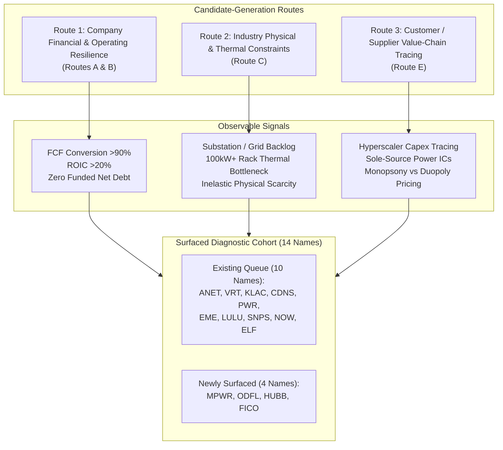

# ARX Terminal — Evidence-Led Discovery Pilot: Search Universe & Candidate Triage Matrix

**Document ID:** `ARX-DISCOVERY-PILOT-UNIVERSE-TRIAGE-V1`  
**Governing Authority:** [daakara/finance#43](https://github.com/daakara/finance/issues/43) (`BACKLOG-RESEARCH-EVIDENCE-DISCOVERY-043`)  
**Methodological Context:** ARX Closure Model v2 (Decision-First, Minimum Sufficient Evidence)  
**Intake Date:** October 22, 2026  
**Filing Availability Cutoff:** Current SEC EDGAR Form 10-K / Form 10-Q filings available as of October 2026  
**Classification:** Internal Research Pilot Record (Strictly Isolated from Public Surface & Frontend Import Paths)

---

## 1. Testable Operating Premise & Analytical Horizon

### Operating Premise
> **“Identify companies where observable developments or valuation changes could create an attractive opportunity relative to the risks and expectations reflected in the price.”**

Under this premise, the pilot investigates candidates exhibiting one or more of seven operational opportunity mechanisms:
1. **Accelerated Growth or Margin Expansion:** Structural expansion in gross or operating margins driven by product mix shifts or scale efficiencies.
2. **Enhanced Economic Durability:** Widening competitive moats, rising customer switching costs, or network effects substantiated by observable business metrics.
3. **De-risked Balance Sheet & Financing:** Sustained organic cash conversion reducing dependency on external capital markets or debt refinancing.
4. **Disciplined Capital Allocation:** Reinvestment at high return on invested capital (ROIC) combined with non-dilutive balance sheet management.
5. **Price-versus-Business Divergence:** Valuation compression occurring during stable or improving underlying operating performance.
6. **Inelastic Supply / Infrastructure Constraints:** Mission-critical bottlenecks where structural demand exceeds physical or regulatory capacity.
7. **Cyclical Inflection Resilience:** Cyclical downturns where the business possesses sufficient liquidity and balance sheet strength to capture market share from distressed peers.

### Provisional Analytical Horizon
- **Horizon Assumption:** **3 to 5 Years**  
  *Governance Qualification:* Explicitly designated as a **provisional pilot analytical horizon**, not a ratified ARX Terminal product policy.
- **Shorter-Term Evidence Events:** Monitored separately via quarterly SEC EDGAR filings (Forms 10-Q and 8-K), gross margin trends, and backlog conversion checkpoints to provide falsifiable intermediate feedback without compressing the thesis into short-term trading noise.

---

## 2. Search Universe & Population Boundaries

### Population Baseline & Source Lineage
- **Primary Source Authority:** Sprint 2 Package 1 Multi-Feed Population Baseline (`docs/research/radar-us-listed-coverage/coverage_capacity_baseline.json`, October 2026).
- **Ingestion Feeds Examined:**
  - SEC EDGAR Company Directory: 10,444 raw rows (10,276 parsed).
  - Nasdaq Listed Directory: 5,634 rows.
  - Other Listed (NYSE / NYSE American) Directory: 7,674 rows.
  - Distinct multi-feed candidate join keys: 16,448.
- **Security-Type Boundaries & Scope Invariants:**
  - *Included:* US-listed operating common stocks.
  - *Excluded:* 5,789 ETFs/ETNs, 484 preferred share issues, 468 warrants, 97 units, 58 rights issues.
  - *ADR Treatment:* 506 depositary receipts are tracked in a separate qualification bucket and excluded from this pilot's primary operating-company cohort.
  - *Multiple Share Classes:* Disambiguated by FIGI and share class voting rights (e.g., GOOG vs GOOGL).
- **Provisional Non-Derivative Operating Population:** Estimated at ~5,871 common operating companies.
- **Portion Actually Examined:** A bounded, reproducible diagnostic cohort of **14 operating companies**:
  - The **10 comparison candidates** from the existing expansion queue: `KLAC`, `LULU`, `EME`, `VRT`, `ANET`, `CDNS`, `PWR`, `SNPS`, `NOW`, `ELF`.
  - **4 newly surfaced candidates** generated through independent evidence-led discovery routes: `MPWR`, `ODFL`, `HUBB`, `FICO`.
- **Data Limitations & Selection Biases:**
  - This pilot does **not** represent an automated full-universe market scan; operational ingestion and scanning pipelines remain strictly inactive.
  - Slices are biased toward companies with audited SEC EDGAR XBRL filings, established operational histories, and liquid exchange listings to guarantee source verifiable evidence.
  - Missing data or unexamined tickers do not indicate inferior business quality; records without primary SEC evidence are marked unsupported rather than discarded.

---

## 3. Multiple Candidate-Generation Routes

The pilot deployed three materially different routes spanning company-level operating fundamentals, industry structural bottlenecks, and customer/supplier value-chain tracing:

### Route 1: Company Financial & Operating Resilience (Routes A & B)
- **Observable Signal:** Structural inflection in operating cash flow conversion (Cash Flow from Operations / Net Income > 90%), sustained return on invested capital (ROIC > 20%), and pristine capital structure (zero or negative net debt), accompanied by revenue mix expansion into higher-margin, mission-critical product lines.
- **Comparison Baseline:** FY2023 vs FY2024 / TTM primary financial statements.
- **Available Source:** SEC EDGAR Form 10-K / Form 10-Q (Statements of Cash Flows, Balance Sheets, Note on Segment Reporting).
- **Economic Significance:** Isolates businesses that fund rapid expansion organically without equity dilution or reliance on high-yield debt markets.
- **Known Limitations:** Working capital swings, customer advance billings, or R&D capitalization can temporarily distort cash conversion metrics.

### Route 2: Industry Physical / Power / Thermal Constraints (Route C)
- **Observable Signal:** Severe physical infrastructure constraints (substation transformer lead times >100 weeks, transmission interconnect queues, data center power density exceeding 100 kW/rack) where physical laws enforce demand inelasticity.
- **Comparison Baseline:** 2023–2026 infrastructure deployment schedules, utility interconnection queues (FERC / PJM), hyperscaler capex filings.
- **Available Source:** Primary hyperscaler 10-K disclosures (Item 1 & Item 7 Capex), equipment manufacturer backlog disclosures.
- **Economic Significance:** Surfaces equipment and component providers commanding pricing power from physical scarcity rather than transient software demand.
- **Known Limitations:** EPC contractors and equipment assemblers frequently suffer from fixed-price contract overruns, high working capital requirements, and heavy debt service that destroy shareholder returns despite strong top-line demand.

### Route 3: Customer / Supplier Value-Chain Tracing (Route E)
- **Observable Signal:** Tracing multi-billion dollar capex allocations from hyperscalers (Meta, Microsoft, Alphabet, Amazon) down to critical tier-1 and tier-2 semiconductor and silicon-level power management providers.
- **Comparison Baseline:** FY2023 to FY2024 customer concentration footnotes (Customer Concentration Note, SEC EDGAR Form 10-K).
- **Available Source:** Form 10-K Item 1 (Major Customers), Supplier Form 10-K Segment Disclosures.
- **Economic Significance:** Identifies high-margin component enablers capturing economic rent upstream without exposure to end-consumer adoption risk.
- **Known Limitations:** Severe customer concentration (>30% revenue from 2 hyperscalers) grants customers monopsony pricing power during cyclical digestion phases.

---

## 4. Research Effort Budget & Practical Stopping Rule

- **Effort Allocation:** Bounded to **4 to 6 hours** of focused primary filing extraction, financial reconciliation, and cross-route triage.
- **Stopping Rule:**
  1. Complete triage across all 14 surfaced candidates.
  2. Select 2 to 3 deeper investigations offering maximum informational contrast.
  3. Author compact, reusable opportunity records for the selected candidates.
  4. Formulate an evidence-based process evaluation (`CONTINUE`, `SIMPLIFY`, or `STOP`).
  5. Cease research immediately without preparing full rejected dossiers, modifying public manifests, or activating live pipelines.

---

## 5. Comprehensive Full-Queue Screening & Candidate Triage Matrix

The matrix below evaluates all 14 candidates (10 comparison names + 4 newly surfaced names) against the operating premise, primary filing evidence, value-capture mechanisms, and decision relevance.

| Symbol | Company Name | Discovery Route(s) | Primary Trigger & Observable Development | Consolidated Materiality | Primary SEC Evidence Source | Critical Decisive Question | Demanding Valuation / Assumptions? | Triage Decision | Concise Selection / Deferral Rationale |
| :--- | :--- | :--- | :--- | :--- | :--- | :--- | :--- | :---: | :--- |
| **`ANET`** | Arista Networks, Inc. | Route 2 (Infra Constraint) & Route 3 (Supplier Tracing) | Hyperscalers migrating backend AI clusters from InfiniBand to 800G/1.6T Ethernet; operating margins >40%; zero funded debt; $6.0B+ cash/ST investments. | **High** (>80% of revenue from cloud/enterprise networking) | Form 10-K FY23 (CIK 0001596532); Form 10-Q Q2 2024. | Can Arista maintain pricing power and share against Nvidia proprietary NVLink/Spectrum-X while Meta & Microsoft comprise ~39% of revenue? | Moderate-High (Trades at ~38-42x P/E; requires sustained >20% revenue CAGR). | **SELECTED FOR DEEP INVESTIGATION** | Top-tier company-led financials (zero debt, elite cash conversion) confronting intense customer concentration. Provides ideal test of value capture vs customer power. |
| **`VRT`** | Vertiv Holdings Co | Route 2 (Industry Thermal Constraint) | Power and thermal bottleneck in AI data centers; rack densities shifting from 10–20 kW (air) to 100 kW+ (liquid cooling); trailing book-to-bill >1.2x. | **High** (Core power/thermal equipment provider) | Form 10-K FY23 (CIK 0001674101); Form 10-Q Q2 2024. | Can operating cash flow cover $3.1B funded debt, $175M+ annual interest expense, and post-SPAC goodwill ($2.5B) without fixed-price contract margin compression? | High (P/E >45x; requires flawless modular execution and sustained 15%+ operating margins). | **SELECTED FOR DEEP INVESTIGATION** | Pure-play thematic darling testing whether an intense industry constraint can overcome weak balance sheet resilience, heavy debt service, and project margin volatility. |
| **`MPWR`** | Monolithic Power Systems, Inc. | Route 3 (Supplier Tracing) & Route 1 (Financial Resilience) | Transition of AI accelerator power delivery from 12V to 48V multiphase power management ICs; Enterprise Data segment surging; 27% GAAP operating margin; zero debt; $1.3B cash. | **High** (Enterprise Data expanding from 13% to >25% of consolidated revenue) | Form 10-K FY23 (CIK 0001280452); Form 10-Q Q2 2024. | Does proprietary BCD process technology protect against Renesas, Infineon, and TI competition as AI GPU power stages commoditize? | High (P/E ~60x; discounts rapid enterprise power share gains). | **SELECTED FOR DEEP INVESTIGATION** | Discovered outside the existing shortlist. Solves the exact same power/thermal constraint as VRT at the silicon level, but with zero debt, >25% ROIC, and pristine cash generation. |
| **`KLAC`** | KLA Corp. | Route 2 (Infra Constraint) & Route 3 (Supplier Tracing) | Wafer process diagnostics & metrology monopoly (>50% optical wafer inspection share); advanced packaging and GAA node complexity increasing inspection intensity. | **High** (>85% of revenue from process control equipment) | Form 10-K FY24 ended June 30, 2024 (CIK 0000704440). | Will China revenue concentration (~40% in FY24) face severe US export control restrictions, offsetting advanced packaging tailwinds? | Moderate-High (Trades at ~28x P/E; cyclical WFE trough uncertainty). | **DEFERRED** | Quintessential moat, but $5.9B funded debt, cyclical semiconductor equipment exposure, and China regulatory overhang warrant deferral to a later cycle. |
| **`CDNS`** | Cadence Design Systems, Inc. | Route 3 (Supplier Tracing) | Electronic Design Automation (EDA) software duopoly; mission-critical chip design software with >85% recurring revenue; zero funded debt. | **High** (>90% EDA software & IP) | Form 10-K FY23 (CIK 0000813672); Form 10-Q Q2 2024. | Does heavy stock-based compensation (~$300M+/yr, ~7-8% of rev) materially erode true per-share cash flow at ~45x P/E? | Very High (Multiple demands sustained low-teens growth with zero execution errors). | **DEFERRED** | Excellent business quality, but valuation hurdle is extreme and SBC dilution schedule requires specialized multi-year forensic reconciliation. |
| **`SNPS`** | Synopsys, Inc. | Route 3 (Supplier Tracing) | EDA software duopoly alongside CDNS; pending $35B transformational acquisition of Ansys (`ANSS`). | **High** (Acquisition fundamentally alters business mix) | Form 10-K FY23 (CIK 0000883241); Form 8-K Jan 16, 2024 (Ansys merger agreement). | What will the post-merger capital structure look like after issuing ~$19B in equity and $16B in cash/debt? | Incalculable until closing (Transaction pending regulatory approvals in China/EU). | **DISCONTINUED (Current Cycle)** | Pending $35B acquisition obscures standalone capital structure, leverage, and cash conversion. Cannot model until transaction closes. |
| **`LULU`** | Lululemon Athletica Inc. | Route 1 (Financial Resilience) | Premium athletic apparel brand; international revenue expanding (+34% in China); zero funded debt; high historical ROIC. | **High** (Single brand retail focus) | Form 10-K FY23 (CIK 0001397187); Form 10-Q Q2 2024. | Can international growth compensate for North American comp-store sales stagnation and product execution missteps (Breezethrough pause)? | Low-Moderate (Valuation compressed to ~18-20x P/E), but operating moat is contested. | **DISCONTINUED (Current Cycle)** | Lacks a structural industrial or regulatory constraint mechanism. North American core is mature and facing intensifying athletic wear competition. |
| **`EME`** | EMCOR Group, Inc. | Route 2 (Industry Constraint) | Specialty mechanical/electrical contractor benefiting from industrial reshoring, semiconductor fabs, and data centers. | **High** (>70% electrical and mechanical construction) | Form 10-K FY23 (CIK 0000105634); Form 10-Q Q2 2024. | Does EMCOR possess modular pre-fabrication moats comparable to peer `FIX` (Comfort Systems), or is it exposed to fixed-price project margin risks? | Moderate (P/E ~25-28x). | **DEFERRED** | Solid contractor, but heavily trails already-published peer `FIX` on ROIC (FIX >28% vs EME ~18%) and modular manufacturing margins. Subordinate to FIX. |
| **`PWR`** | Quanta Services, Inc. | Route 2 (Industry Constraint) | Leading electric utility transmission, substation, and renewable generation interconnect contractor; multi-year utility capex cycle. | **High** (Dominant transmission EPC contractor) | Form 10-K FY23 (CIK 0001050915); Form 10-Q Q2 2024. | Can operating margins withstand percentage-of-completion cost escalations while servicing >$4.0B in funded acquisition debt? | High (P/E ~32x; thin ~6-8% operating margins leave little buffer for project write-downs). | **DEFERRED** | High debt load and percentage-of-completion project write-down risks fail conservative balance sheet resilience criteria. |
| **`NOW`** | ServiceNow, Inc. | Route 1 (Financial Resilience) | Enterprise IT workflow automation platform; renewal rates >98%; expanding into GenAI Pro Plus tiers. | **High** (Core enterprise cloud subscription) | Form 10-K FY23 (CIK 0001373715); Form 10-Q Q2 2024. | How much of reported $3.4B operating cash flow represents true owner cash flow after subtracting $1.5B+ annual stock-based compensation? | Very High (Trades at ~50x forward earnings; massive SBC dilution reduces net cash generation). | **DEFERRED** | High-quality workflow moat, but extreme stock-based compensation requires forensic dilution adjustments before per-share cash generation can be verified. |
| **`ELF`** | e.l.f. Beauty, Inc. | Route 1 (Financial Resilience) | Mass cosmetics disruptor; rapid market share gains via Gen-Z digital marketing and value pricing; Naturium acquisition. | **High** (Single-category cosmetics focus) | Form 10-K FY24 ended Mar 31, 2024 (CIK 0001601430). | How vulnerable is e.l.f.'s ~80% China contract-manufacturing supply chain to potential US tariff escalations? | High (Growth decelerating from >40% to mid-teens; multiple ~35x). | **DISCONTINUED (Current Cycle)** | Supply chain concentration in China creates severe geopolitical/tariff vulnerabilities; slowing domestic beauty consumption adds cyclical risk. |
| **`ODFL`** | Old Dominion Freight Line, Inc. | Route 1 (Operating Resilience) & Route D (Price-vs-Business Divergence) | Less-Than-Truckload (LTL) pricing power leader; market share gains post-Yellow Corp bankruptcy; pristine balance sheet (zero net debt); ROIC >25%. | **High** (Pure-play LTL carrier) | Form 10-K FY23 (CIK 0000878927); Form 10-Q Q2 2024. | Will the freight recession prolong tonnage declines, or does real estate terminal scarcity guarantee long-term pricing discipline? | Moderate (Trading at mid-cycle ~28x P/E during industrial recession). | **DEFERRED (Strong Future Candidate)** | Outstanding company-led moat and pristine balance sheet. Deferred for future Quality Watch cohort because freight cycle trough requires further macro monitoring. |
| **`HUBB`** | Hubbell Incorporated | Route 2 (Industry Constraint) | Utility electrical transmission components, insulators, transformers, and smart grid automation; multi-year grid upgrade cycle. | **High** (>60% utility solutions segment) | Form 10-K FY23 (CIK 0000048898); Form 10-Q Q2 2024. | Can Hubbell sustain recent ~20% operating margins once utility supply-chain component backlogs normalize? | Moderate (P/E ~26-28x). | **DEFERRED** | Strong industrial enabler, but capital structure carries $1.8B funded debt and ROIC (~14-16%) is lower than semiconductor/software enablers. |
| **`FICO`** | Fair Isaac Corporation | Route 1 (Financial Inflection) | B2B credit score pricing monopoly; aggressive wholesale score price increases passing directly to mortgage/credit originators; software FCF conversion >100%. | **High** (Scores segment drives majority of operating profit) | Form 10-K FY23 ended Sept 30, 2023 (CIK 0000814547). | Can FICO sustain price hikes without triggering antitrust scrutiny or FHFA alternative scoring adoption (VantageScore)? | Very High (P/E >70x; funded debt $2.1B resulting in negative book equity from share repurchases). | **DEFERRED** | Unparalleled pricing power, but aggressive leveraged recapitalization (negative book equity) and regulatory scrutiny require dedicated balance sheet audit. |

---

## 6. Informational Value of Selected Deeper Investigations

The screening matrix selected **three highly contrasting candidates** that directly test the core questions of the Evidence-Led Discovery Pilot:

1. **`ANET` (Arista Networks — Existing Queue / Routes 2 & 3):**
   - *Core Informational Value:* Tests whether a company with **elite company-led financials** (zero debt, >40% operating margins, >90% FCF conversion) can preserve its economics in the face of **severe customer concentration** (Meta and Microsoft comprise ~39% of sales) and intense competitive threats from Nvidia's proprietary network fabrics.
2. **`VRT` (Vertiv Holdings — Existing Queue / Route 2):**
   - *Core Informational Value:* Tests whether an **intense thematic tailwind** (100 kW+ liquid cooling bottleneck) can generate acceptable shareholder cash flow per share when encumbered by **troubled company-level value capture** ($3.1B funded debt, $175M annual interest expense, $2.5B post-SPAC goodwill, and fixed-price project margin volatility).
3. **`MPWR` (Monolithic Power Systems — Newly Surfaced / Routes 1 & 3):**
   - *Core Informational Value:* Tests whether **evidence-led supplier tracing outside the original shortlist** can surface a structurally superior candidate solving the exact same power/thermal constraint as VRT, but with vastly superior value capture (zero funded debt, 27% GAAP operating margin, proprietary silicon BCD process, and self-funding FCF).

This triad provides an authoritative, evidence-grounded basis for evaluating whether evidence-led discovery beyond the initial shortlist improves research prioritization.
