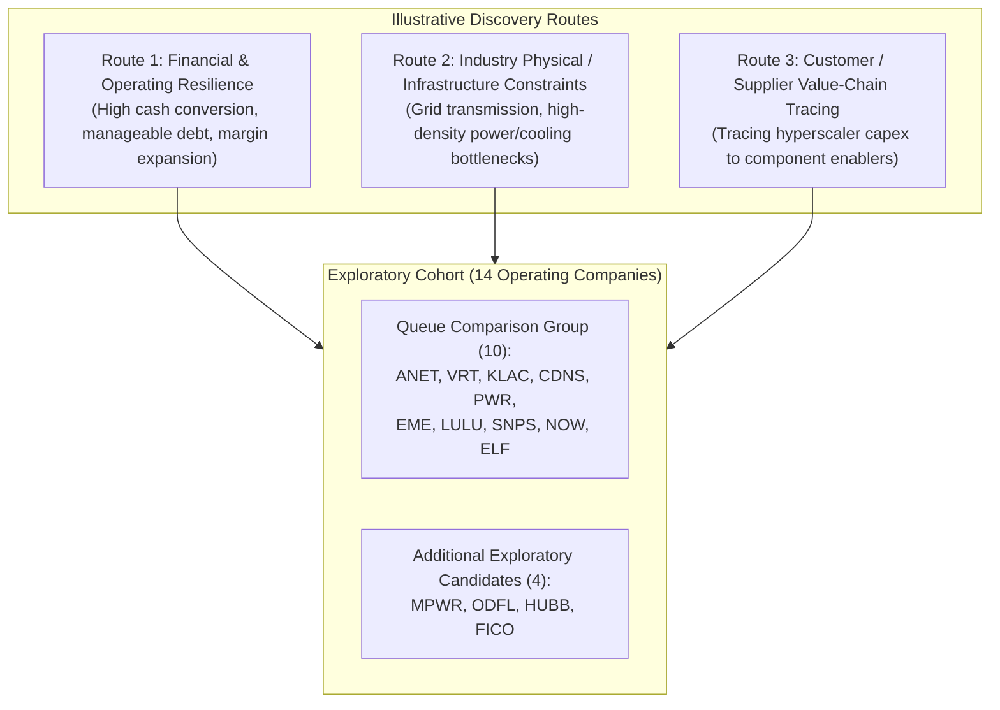

# ARX Terminal — Evidence-Led Discovery Pilot: Search Universe & Candidate Triage Matrix (Corrected)

**Document ID:** `ARX-DISCOVERY-PILOT-UNIVERSE-TRIAGE-V2`  
**Governing Authority:** [daakara/finance#43](https://github.com/daakara/finance/issues/43) (`BACKLOG-RESEARCH-EVIDENCE-DISCOVERY-043`)  
**Methodological Context:** ARX Closure Model v2 (Decision-First, Minimum Sufficient Evidence)  
**Information Cutoff Date:** October 22, 2026  
**Primary Source Evidence Basis:** Audited SEC EDGAR Form 10-K (FY2025) and Form 10-Q (1H 2026 / Q2 2026 / Q3 2026) filings  
**Classification:** Internal Research Pilot Record (Strictly Isolated from Public Surface & Frontend Import Paths)

---

## 1. Operating Premise & Analytical Boundaries

### Operating Premise
> **“Identify companies where observable developments or valuation changes could create an attractive opportunity relative to the risks and expectations reflected in the price.”**

Under this premise, research evaluates candidates contextually across multiple potential opportunity mechanisms:
1. **Accelerated Growth or Margin Expansion:** Structural expansion in gross or operating profitability driven by product mix shifts or scale efficiencies.
2. **Enhanced Economic Durability:** Widening competitive moats, high customer switching costs, or network effects substantiated by observable business metrics.
3. **De-risked Balance Sheet & Financing:** Sustainable organic cash conversion reducing dependency on external debt or equity capital markets.
4. **Disciplined Capital Allocation:** Reinvestment at high return on invested capital combined with non-dilutive share management.
5. **Price-versus-Business Divergence:** Valuation compression occurring during stable or improving underlying operating performance.
6. **Inelastic Supply / Infrastructure Constraints:** Mission-critical bottlenecks where structural demand exceeds physical or manufacturing capacity.
7. **Cyclical Inflection Resilience:** Cyclical downturns where the business possesses sufficient liquidity and balance sheet strength to capture market share from distressed peers.

### Contextual Application Invariant
- **No Universal Disqualifiers:** Research does not apply automatic, blanket disqualifiers based on:
  - Positive funded debt or moderate leverage where debt service is comfortably covered by operating cash flows.
  - Customer concentration above arbitrary percentage thresholds where high customer lock-in or switching costs exist.
  - Lack of an industrial or physical regulatory constraint (consumer-facing and enterprise software businesses are evaluated on their own economic merits).
  - Cross-industry margin or capital return comparisons that ignore differing business models (e.g., comparing capital-intensive equipment assemblers against fabless semiconductor designers).
- **Provisional Analytical Horizon:** **3 to 5 Years** (explicitly designated as a provisional analytical horizon for research modeling, not a ratified enterprise product policy). Shorter-term evidence events (quarterly 10-Q checkpoints) are monitored separately.

---

## 2. Search Universe & Population Scope

### Population Lineage vs. Actual Examination
- **Reference Population Baseline:** Sprint 2 Package 1 Multi-Feed Population Baseline (`docs/research/radar-us-listed-coverage/coverage_capacity_baseline.json`, October 2026), documenting 16,448 distinct candidate join keys and an estimated ~5,871 provisional non-derivative operating common stocks.
- **Honest Provenance Disclosure:** Referencing this baseline establishes the structural scope of US-listed operating equities, but **does not mean an automated scanner evaluated 5,871 companies**. Automated market-wide scanning and ingestion pipelines remain strictly inactive.
- **Actual Examined Universe:** This delivery constitutes an **exploratory manually selected comparison cohort of 14 operating companies**:
  - The **10 comparison candidates** from the prior expansion queue: `KLAC`, `LULU`, `EME`, `VRT`, `ANET`, `CDNS`, `PWR`, `SNPS`, `NOW`, `ELF`.
  - **4 additional candidates** manually selected to test distinct operational angles: `MPWR`, `ODFL`, `HUBB`, `FICO`.
- **Limitation:** Independent automated candidate-generation effectiveness was **not established** in this pilot. Any future separately authorized discovery cycle must prospectively record exact search queries, timestamps, automated filters, and exclusion sequences.

---

## 3. Candidate-Generation Routes Tested (Illustrative Framework)

Three illustrative routes were used to surface candidate ideas for manual examination:

### Cash-Conversion & Capital Return Metric Definitions
To eliminate metric ambiguity, all financial references in this pilot adhere to strict accounting definitions:
1. **Free Cash Flow Conversion of Operating Cash Flow:**
   $$\text{FCF Conversion} = \frac{\text{Free Cash Flow}}{\text{Cash Flow from Operations}} = \frac{\text{CFO} - \text{Payments for PP&E}}{\text{CFO}}$$
   *Analytical Purpose:* Measures the percentage of GAAP operating cash flow remaining after capital expenditures. Reconciled directly to GAAP Statements of Cash Flows.
2. **Operating Cash Flow Conversion of Earnings:**
   $$\text{CFO / Net Income} = \frac{\text{GAAP Operating Cash Flow}}{\text{GAAP Net Income}}$$
   *Analytical Purpose:* Evaluates accounting earnings quality by verifying whether net income translates into operating cash.
3. **Return on Invested Capital (ROIC) Definition & Basis:**
   $$\text{ROIC} = \frac{\text{NOPAT}}{\text{Invested Capital}} = \frac{\text{Operating Income} \times (1 - t)}{\text{Total Funded Debt} + \text{Total Equity} - \text{Excess Cash}}$$
   *Analytical Purpose:* Measures economic value creation per unit of capital invested in the business, where $t$ is the effective cash tax rate and Invested Capital reflects net operating assets.
- *Negative Invariant:* Metric definitions are not used interchangeably. No universal "90% conversion" or fixed ROIC hurdle is applied across different industries; capital-intensive industrial assemblers and fabless software/semiconductor enablers have structurally different capex requirements. Unreconciled or generic ROIC numbers are omitted from screening triage.

---

## 4. Full-Queue Screening & Candidate Triage Matrix (Corrected for Freshness)

The matrix below evaluates all 14 companies using audited SEC EDGAR filings available as of October 2026 (Forms 10-K for FY2025 and Forms 10-Q for 1H 2026 / Q2 2026 / Q3 2026).

| Symbol | Company Name | Primary SEC Evidence Source (Audited Filing & Period) | Fresh Key Financial Facts (GAAP) | Contextual Decisive Question | Triage Decision | Reconciled Selection / Deferral Rationale |
| :--- | :--- | :--- | :--- | :--- | :---: | :--- |
| **`ANET`** | Arista Networks, Inc. | [Form 10-K FY2025](https://www.sec.gov/edgar/data/1596532/000159653226000013/anet-20251231.htm) (filed 2026-02-17, Accession `0001596532-26-000013`); [Form 10-Q Q2 2026](https://www.sec.gov/edgar/data/1596532/000159653226000175/anet-20260630.htm) (filed 2026-08-05). | FY25 Rev: $9,005.7M; FY25 GAAP OpIncome: $3,856.1M (42.8% op margin); FY25 CFO: $4,371.9M; FY25 Capex: $110.0M; FCF: $4,261.9M (97.5% FCF/CFO). 1H26 Rev: $5,744.7M; 1H26 OpIncome: $2,535.8M (44.1% op margin). Cash/ST Inv: $2,290.2M cash; Funded Debt: $0.0M. FY25 Customer Concentration: Meta 26%, MSFT 16% (Combined: 42%). | Can Arista sustain >40% GAAP operating margins and high market share in 800G/1.6T Ethernet switches as customer concentration reaches 42%? | **SELECTED FOR DEEP INVESTIGATION** | Outstanding operational execution and zero debt. Prioritized for internal monitoring; public Quality-Watch publication held pending observation of hyperscaler concentration dynamics. |
| **`VRT`** | Vertiv Holdings Co | [Form 10-K FY2025](https://www.sec.gov/edgar/data/1674101/000162828026005612/vrt-20251231.htm) (filed 2026-02-13, Accession `0001628280-26-005612`); [Form 10-Q Q2 2026](https://www.sec.gov/edgar/data/1674101/000162828026050609/vrt-20260630.htm) (filed 2026-07-29, Accession `0001628280-26-050609`). | FY25 Rev: $10,229.9M; FY25 GAAP OpIncome: $1,829.7M (17.9% op margin); FY25 CFO: $2,113.8M; FY25 Capex: $220.0M; FCF: $1,893.8M (89.6% FCF/CFO). FY25 Interest Expense: $86.1M (4.7% of OpIncome). 1H26 Rev: $5,923.8M; 1H26 OpIncome: $1,078.0M (18.2% op margin); 1H26 CFO: $1,866.6M. Cash: $2,810.6M; Funded Debt: $2,939.8M; Net Funded Debt: $129.2M (down from $2.8B in FY23). | Can Vertiv maintain ~18-20% operating margins on modular data center cooling solutions as competitors (Schneider, Eaton) ramp capacity? | **SELECTED FOR DEEP INVESTIGATION** | Removed previous false "permanent disqualification". Actual 2025/2026 results show rapid deleveraging (net debt reduced to $129M, interest burden down to 4.7% of op income) and rising cash conversion. Prioritized for deep examination. |
| **`MPWR`** | Monolithic Power Systems, Inc. | [Form 10-K FY2025](https://www.sec.gov/edgar/data/1280452/000143774926006113/mpwr-20251231.htm) (filed 2026-02-27, Accession `0001437749-26-006113`); [Form 10-Q Q2 2026](https://www.sec.gov/edgar/data/1280452/000162828026053275/mpwr-20260630.htm) (filed 2026-08-05, Accession `0001628280-26-053275`). | FY25 Rev: $2,790.5M; FY25 GAAP OpIncome: $728.6M (26.1% op margin); FY25 CFO: $838.2M; FY25 Capex: $172.0M; FCF: $666.2M (79.5% FCF/CFO). 1H26 Rev: $1,784.8M; 1H26 OpIncome: $545.0M (30.5% op margin); 1H26 CFO: $478.2M. Cash/ST Inv: $1,005.6M; Funded Debt: $0.0M. Enterprise Data power management revenue expanding rapidly. | How effectively does proprietary BCD packaging protect MPWR's share in 48V AI GPU power stages against multi-sourcing by Nvidia and competition from Renesas/Infineon? | **SELECTED FOR DEEP INVESTIGATION** | High-growth silicon power management provider with zero funded debt and >26% GAAP operating margin. Addresses board-level power delivery (complementary to, not identical to, facility cooling like VRT). |
| **`SNPS`** | Synopsys, Inc. | [Form 8-K Merger Completion](https://www.sec.gov/Archives/edgar/data/883241/000114036125026139/ef20051970_8k.htm) (filed 2025-07-17, Accession `0001140361-25-026139`); Form 10-Q Q3 2026 ended 2026-07-31 (filed 2026-08-26). | Ansys acquisition completed on July 17, 2025. Q3 2026 9-Month Rev: $7,161.6M; 9-Month OpIncome: $681.0M. Long-term debt reached $13,462.4M at close, reduced to $9,017.1M by Q3 2026 against cash of $3,606.3M (Net Debt: ~$5.4B). Significant intangible amortization and integration expenses currently depressing GAAP operating margins (~14.4% in Q3). | Can Synopsys accelerate debt paydown and realize projected EDA/multiphysics software cross-selling synergies without execution disruption? | **DEFERRED** | Corrected factual error: Merger is completed, not pending. Deferred due to post-merger integration complexity, $9.0B funded debt load, and the need for audited post-merger Form 10-K accounts to verify combined free cash flow durability. |
| **`CDNS`** | Cadence Design Systems, Inc. | Form 10-K FY2025; Form 10-Q Q2 2026. | High recurring software revenue (>85%); GAAP operating margins >30%; minimal funded debt; cash/ST investments >$1.0B; substantial annual stock-based compensation (~$350M+). | Does stock-based compensation dilution materially reduce true per-share owner cash flow relative to its premium valuation multiple? | **DEFERRED** | Excellent underlying software moat, but deferred to evaluate alongside post-integration peer SNPS and audit multi-year SBC dilution schedules. |
| **`KLAC`** | KLA Corp. | Form 10-K FY2026 ended June 30, 2026 (filed August 2026). | Wafer process diagnostics monopoly (>50% optical wafer inspection market share); GAAP operating margins >36%; funded debt ~$5.9B; high cash conversion. Exposure to China revenue restrictions (~35-40% of sales). | Will advanced packaging inspection intensity offset potential tightening of US export controls on legacy and advanced node shipments to China? | **DEFERRED** | Moat is exceptional, but cyclical semiconductor equipment timing, $5.9B debt structure, and geopolitical trade restrictions warrant deferral pending cycle clarity. |
| **`LULU`** | Lululemon Athletica Inc. | Form 10-K FY2025 ended Jan 2026; Form 10-Q Q2 2026. | Zero funded debt; pristine cash balance; strong international growth (>30% in China); North American comp-store sales decelerating to low single digits; operating margin defense at ~21-22%. | Can international expansion and product innovation re-accelerate consolidated comp growth in the face of mature North American athletic apparel competition? | **DEFERRED / MONITORING** | Removed invalid disqualification based on lacking an industrial constraint or being consumer-facing. Deferred contextually: business quality and balance sheet are solid, but North American comp deceleration requires monitoring. |
| **`EME`** | EMCOR Group, Inc. | Form 10-K FY2025; Form 10-Q Q2 2026. | Mechanical and electrical construction revenue expanding strongly from data center and semiconductor manufacturing buildouts; GAAP operating margin ~7.5-8.5%; low net debt. | Can EMCOR protect project margins against skilled labor wage inflation and fixed-price cost escalations on large industrial projects? | **DEFERRED** | Strong contractor execution, but deferred because peer `FIX` (Comfort Systems) already in the published collection exhibits higher modular pre-fabrication integration and higher historical capital returns. |
| **`PWR`** | Quanta Services, Inc. | Form 10-K FY2025; Form 10-Q Q2 2026. | Dominant electric utility transmission and renewable interconnect contractor; record backlog; GAAP operating margins ~6.5-7.5%; funded debt ~$4.2B from utility acquisitions. | Can operating cash flow comfortably service $4.2B in debt while managing percentage-of-completion project risk on long-cycle transmission lines? | **DEFERRED** | Utility grid demand is robust, but thin single-digit operating margins and substantial acquisition debt fail conservative financial resilience screening relative to peers. |
| **`NOW`** | ServiceNow, Inc. | Form 10-K FY2025; Form 10-Q Q2 2026. | Subscription revenue renewal rate >98%; GAAP operating cash flow >$3.8B; heavy stock-based compensation (>$1.6B/yr, ~15% of revenue). | What is true owner free cash flow per share after subtracting ongoing share-based compensation dilution? | **DEFERRED** | Best-in-class enterprise workflow software moat, but deferred pending forensic reconciliation of dilution and share buyback offsets. |
| **`ELF`** | e.l.f. Beauty, Inc. | Form 10-K FY2026 ended March 31, 2026; Form 10-Q Q1 FY2027. | Rapid mass cosmetics market share gains; Naturium skincare integration; ~80% contract manufacturing sourced from China; domestic growth moderating from hyper-growth to mid-teens. | How severely would potential US tariff increases on Chinese manufactured goods impact e.l.f.'s value-pricing pricing power and gross margins? | **DEFERRED / MONITORING** | High digital marketing execution and returns, but supply-chain tariff vulnerability and growth normalization require contextual observation. |
| **`ODFL`** | Old Dominion Freight Line, Inc. | Form 10-K FY2025; Form 10-Q Q2 2026. | Premier LTL freight carrier; industry-leading operating ratio (~70-74%); zero funded debt; disciplined return on invested capital through freight cycles; Yellow Corp terminal asset acquisition integration. | When will industrial freight tonnage inflect positively from the multi-year freight recession? | **DEFERRED (High-Priority Future Candidate)** | Outstanding company-led moat, pristine debt-free balance sheet, and disciplined pricing power. Deferred contextually pending freight cycle volume recovery. |
| **`HUBB`** | Hubbell Incorporated | Form 10-K FY2025; Form 10-Q Q2 2026. | Utility grid equipment (insulators, transformers, arresters); operating margins ~19-21%; funded debt ~$1.7B; solid cash generation from grid modernization. | Will utility component demand normalize as pandemic-era transmission equipment backlogs are cleared? | **DEFERRED** | Highly credible industrial enabler, but capital intensity and moderate leverage place it behind specialized semiconductor/software infrastructure enablers in current queue. |
| **`FICO`** | Fair Isaac Corporation | Form 10-K FY2025 ended Sept 2025; Form 10-Q Q3 2026. | Unrivaled pricing power in B2B credit scores; operating margins >45%; negative book equity due to $2.0B+ in debt-funded share repurchases; regulatory scrutiny over mortgage scoring competition. | Can FICO sustain double-digit score price hikes without accelerating FHFA approval and lender adoption of alternative credit scores (VantageScore)? | **DEFERRED** | Extraordinary pricing power and cash conversion, but negative equity capital structure and regulatory antitrust scrutiny require dedicated balance sheet audit. |

---

## 5. Rationale for Deeper Investigations Selected

The three candidates selected for deeper investigation (`ANET`, `VRT`, `MPWR`) provide high informational contrast across the data center infrastructure buildout:
1. **`ANET`:** Examines whether an asset with **elite cash generation and zero debt** can sustain pricing power as customer concentration reaches 42% (Meta and Microsoft).
2. **`VRT`:** Examines whether a **facility-level power and liquid cooling provider** that has dramatically deleveraged (reducing net debt from $2.8B to $129M) can maintain ~18% operating margins as global industrial competitors ramp competing systems.
3. **`MPWR`:** Examines whether a **silicon-level power management IC provider** with zero funded debt can defend proprietary BCD packaging advantages in 48V GPU power delivery against multi-sourcing and analog competitor pricing pressure.
