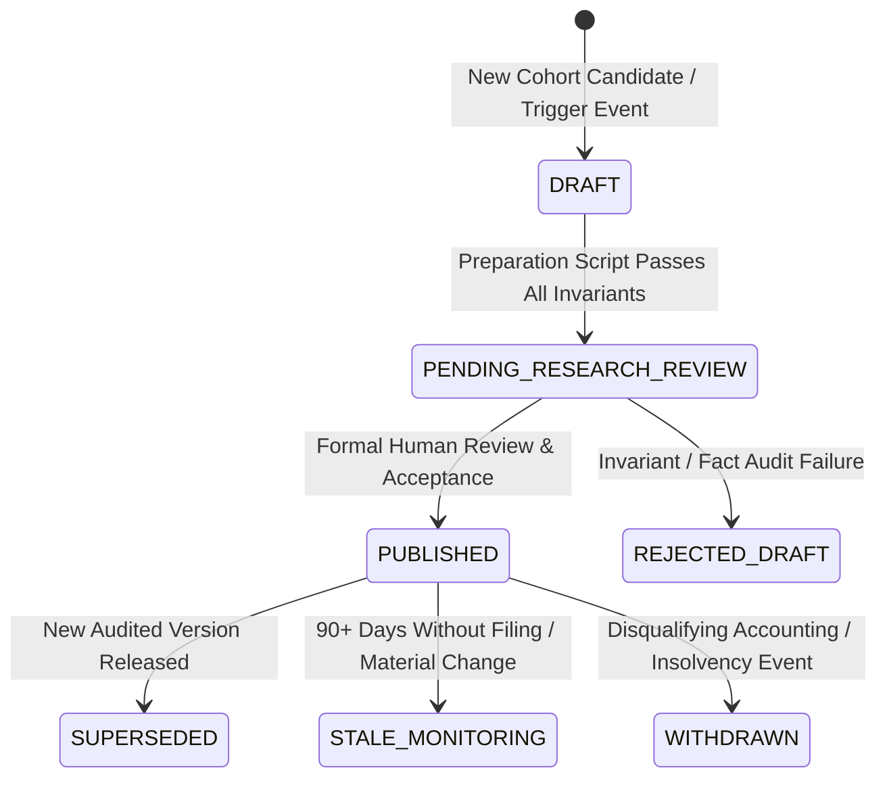

# ARX TERMINAL — OPPORTUNITY DOSSIER MAINTENANCE & FRESHNESS POLICY

**Document Version:** 1.0.0  
**Effective Date:** 2026-10-21  
**Governing Authority:** CONTRACT-ARX-OPP-PILOT-SCALING-V1  
**Scope:** Research Dossier Lifecycle, Invariant Re-assessment, and Staged Publication Protocol

---

## 1. Objective and Operating Boundary

This policy establishes the operational lifecycle, update triggers, decoupling rules, and fail-closed integrity boundaries for ARX Opportunity Dossiers as coverage expands from the 5-company baseline to the 20-company pilot cohort.

### Explicit Prohibitions:
- **No Automated Unattended Ingestion:** New filings do not automatically publish to production without prior independent human research review.
- **No In-Place Partial Mutation:** An incomplete or ongoing research assessment cannot overwrite or partially mutate an accepted historical publication.
- **No Dynamic Price Solver in Production Client:** Client surfaces display immutable, verified snapshots. Solvers run exclusively in offline audited pipelines.

---

## 2. Five Operational Lifecycle States

Every dossier within the ARX ecosystem maintains an explicit lifecycle state:

1. `DRAFT`: Automated extraction, schema validation, and valuation solving in staging storage (`pilot_scaling_ledger.json`).
2. `PENDING_RESEARCH_REVIEW`: Draft dossier meets all cryptographic, provenance, and accounting invariants; staged for peer research audit.
3. `PUBLISHED`: Formally accepted by human research authority and bundled into immutable production snapshot (`opportunityDossierSnapshot.json`).
4. `SUPERSEDED`: A historical published release replaced by a newly audited publication. Historical commits and blobs remain immutable.
5. `STALE_MONITORING`: An active dossier exceeding 90 days from latest fiscal quarter without an updated 10-Q/10-K, prompting a required review check.
6. `WITHDRAWN`: A company experiencing financial restatement, delisting, or fraudulent disclosure, immediately transitioned to an explicit withdrawn state with explanatory postmortem.

---

## 3. Decoupling Market Price Refreshes from Fundamental Research Assumptions

A fundamental tenet of the ARX Opportunity Dossier architecture is the strict decoupling of **market price observation** from **fundamental operational assumptions**:

1. **Market Price Tape Decoupling:**
   - Market reference prices (e.g. 2026-10-16 regular close) can refresh on a scheduled trading session cadence.
   - A price refresh recalculates the implied 5-year revenue CAGR holding fixed research assumptions constant (WACC, terminal growth, normalized operating margins, tax rate, reinvestment rate, and share count).
   - This prevents market price volatility from contaminating audited operational estimates.

2. **Fundamental Model Reassessment Decoupling:**
   - Changes to operational assumptions (e.g., revising normalized operating margin or terminal growth) require a formal research version increment (`v1.0.0` -> `v1.1.0`).
   - Every revision requires documented provenance in `material_claims_provenance`.

---

## 4. Trigger Events Requiring Mandatory Research Reassessment

The occurrence of any of the following material events mandates a transition of a published dossier to `DRAFT` for reassessment:

| Trigger Class | Event Description | Required Action |
|---|---|---|
| **Periodic Filing** | Release of Form 10-K, 10-Q, or 20-F by the issuer on SEC EDGAR. | Re-run TTM extraction, update share counts, verify debt / lease obligations, solve new implied growth. |
| **Capital Structure Shift** | Senior note issuance, debt refinancing, significant share repurchase, or equity offering >2% shares. | Recompute Net Debt Bridge and selected share basis. |
| **Material M&A Event** | Transformational acquisition or divestiture exceeding 10% of revenue or enterprise value (e.g. Synopsys/Ansys). | Transition valuation status to `COMPUTED_QUALIFIED` or `VALUATION_SUPPRESSED` pending pro forma audited accounts. |
| **Accounting Invalidation** | Restatement (Form 8-K Item 4.02), auditor change, or material internal control weakness disclosure. | Transition immediately to `WITHDRAWN` or `VALUATION_SUPPRESSED`. |
| **Price Watch Breach** | Market price crosses the stated `price_watch_condition` or `observable_invalidation_trigger`. | Research notification emitted for fundamental reassessment. |

---

## 5. Atomic Publication & Version Preservation Rules

1. **Reproducibility Guarantee:**
   - Every published release is tied to a canonical git commit hash, tree hash, and SHA-256 digest of the underlying research ledger.
   - Historical versions must be 100% reproducible offline without internet access.

2. **Fail-Closed Partial Update Prevention:**
   - If an automated pipeline fails during batch processing (e.g., 18 of 20 pass, 2 fail), the entire batch publication is aborted.
   - Partial replacement of the publication dataset is strictly prevented by cryptographic digest verification.

3. **Explicit Labeling:**
   - Preview surfaces must visibly display `[DRAFT — PENDING INDEPENDENT RESEARCH REVIEW]` for any non-production record.

---

## 6. Decision-Focused Research Process Standard Integration

In accordance with Product Owner Directive (October 22, 2026), all ongoing dossier maintenance, re-assessments triggered under Section 4, and candidate intake evaluations prospectively adhere to the canonical **Decision-Focused Research Process Standard** ([`docs/research/DECISION_FOCUSED_RESEARCH_PROCESS.md`](file:///docs/research/DECISION_FOCUSED_RESEARCH_PROCESS.md)):

1. **Triggered Review Execution:** When a Section 4 event triggers a transition to `DRAFT`, the reassessment executes the 6 canonical steps:
   - *Step A (Define Decision):* State whether the action is to maintain, revise, or withdraw the dossier.
   - *Step B (Decisive Uncertainties):* Isolate the specific material question altered by the trigger event.
   - *Step C (Connect Outcomes):* Trace consequences to cash flow, capital structure, debt service, and dilution.
   - *Step D (Investigate Proportionately):* Verify against primary Form 10-K/10-Q/8-K disclosures; seek counter-evidence.
   - *Step E (Make Assessment):* Record supported findings, unresolved questions, and the resulting lifecycle state.
   - *Step F (Review Triggers & Stop):* Define next observable falsification checkpoint and cease investigation.

2. **Prospective Adoption Invariant:**
   - New research immediately uses this decision process.
   - Existing published dossiers adopt it prospectively during their next material review or Section 4 trigger.
   - Completed releases (PR #39, PR #41) remain immutable and are **not** reopened solely for template compliance.
   - No retrospective decision records may be fabricated.

3. **Governance & Performance Disclaimer:**
   - Different research decisions require different depths of evidence.
   - Deterministic technical verification (cryptographic hashes, schema compliance) confirms evidence integrity, but does **not** establish investment performance, predictive skill, or investment alpha.
   - No fixed asset-count publication quota applies.
