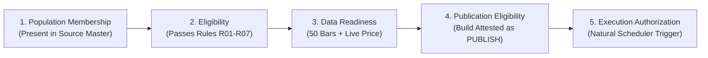

# ARX Terminal — Contract-to-Source Matrix
**Backlog Reference:** `BACKLOG-VCP-PROD-UNIVERSE-003` (Research Investigation)  
**Execution Worktree:** `C:\Users\akara\Documents\Projects\finance-vcp-universe-inputs`  
**Contract Reference Commit:** `6c9b5b00de26545239616ac46f78b35a343ee3dd` (Candidate 004, Tree: `3ef8ead46c34754724cfdc5e906af66271fa2ed2`)  
**Production Reference Commit:** `2eb032b2aec18ac4fea0f654eee8fb6c028466fe` (PR #5; zero diff on universe contracts)  
**Base Commit:** `787c1977b0071f2b31c4ad3d36a7f872147ad59e` (PR #4)  
**Status:** AUTHORITATIVE RESEARCH MATRIX — VERIFIED IDENTICAL ACROSS CANDIDATE 004 & PRODUCTION PR #5  
**Companion Documents:**  
- [FIELD_EVIDENCE_REQUIREMENTS.md](file:///C:/Users/akara/Documents/Projects/finance-vcp-universe-inputs/docs/research/vcp-production-universe-inputs/FIELD_EVIDENCE_REQUIREMENTS.md) (Contract evidence specifications & silent default-filling analysis)  
- [GAP_RESOLUTION_OPTIONS.md](file:///C:/Users/akara/Documents/Projects/finance-vcp-universe-inputs/docs/research/vcp-production-universe-inputs/GAP_RESOLUTION_OPTIONS.md) (Source family qualification, field options, policy questions)  
- [POLICY_DECISION_PROPOSALS.md](file:///C:/Users/akara/Documents/Projects/finance-vcp-universe-inputs/docs/research/vcp-production-universe-inputs/POLICY_DECISION_PROPOSALS.md) (Formal policy decision proposals for Product Owner review)  
- [INPUT_VALIDATION_SPEC.md](file:///C:/Users/akara/Documents/Projects/finance-vcp-universe-inputs/docs/research/vcp-production-universe-inputs/INPUT_VALIDATION_SPEC.md) (Fail-closed input validation boundary and default-filling mitigation)  
- [PUBLICATION_TOOLING_SPEC.md](file:///C:/Users/akara/Documents/Projects/finance-vcp-universe-inputs/docs/research/vcp-production-universe-inputs/PUBLICATION_TOOLING_SPEC.md) (Requirements for future 6-phase atomic CLI publication tool)  
- [IMPLEMENTATION_PLAN.md](file:///C:/Users/akara/Documents/Projects/finance-vcp-universe-inputs/docs/research/vcp-production-universe-inputs/IMPLEMENTATION_PLAN.md) (Sequence, dependencies, acceptance test scenarios, and effort estimates)  

---

## 1. Five Distinct Operational States

To prevent conflation between data availability, algorithmic suitability, and runtime authorization, the universe lifecycle enforces five strictly separated boundaries:

1. **Source-Population Membership:** The instrument exists in the authoritative security master snapshot (`SourcePopulationSnapshot`).
2. **Eligibility:** The instrument satisfies all seven canonical rules (`R01_ASSET_CLASS` through `R07_NOT_DELISTED`) for the target session.
3. **Market-Data Readiness:** An eligible instrument has verified historical and real-time market data in `market_db` (valid live quote + $\ge 50$ historical daily bars as of the target session).
4. **Publication Eligibility:** The universe build achieves mathematical closure ($S = E + I + U$ and $E = DR + DU + U$), passes drift reconciliation, and is attested with `publication_decision: "PUBLISH"` and `construction_status: "COMPLETE"` in SQLite `universe_builds`.
5. **Execution Authorization:** A separate runtime authorization by the Product Owner or natural cron scheduler to trigger an execution run against the scannable membership during an open, settled market window.

---

## 2. Field-by-Field Contract-to-Source Mapping & Evidence Audit

Every field of `SourceSecurity` and canonical rule (R01 through R07) is evaluated below against actual source evidence. Assumptions are explicitly marked as unvalidated candidate hypotheses rather than qualified proofs.

### 2.1 `security_id` (Primary Entity Key)
- **Contract Requirement:** Non-empty immutable string identifying the individual security.
- **Exact Source Field:** SEC EDGAR `cik` (numeric integer) in `company_tickers_exchange.json`.
- **Transformation:** Formatted as `CIK_{int(cik):010d}`.
- **What that Evidence Establishes:** Identifies the *issuer / registrant legal entity* registered with the SEC.
- **What Remains Unknown:** CIK is an *issuer identifier*, **not a unique security identifier**. An issuer can issue multiple classes of common stock (e.g., Alphabet Inc. CIK 0001652044 issues both `GOOG` and `GOOGL`), preferred stocks, warrants, rights, units, or ADRs. Therefore, CIK alone cannot uniquely identify a security issue. Formatting `CIK_{cik}` causes direct primary-key collisions whenever an issuer has multiple listings. Neither SEC nor Nasdaq directory provides a unique security master identifier (such as FIGI or CUSIP).
- **Required Handling When Absent or Colliding:** Multiple securities sharing an issuer CIK cannot be deduplicated by CIK alone. In a strict contract, collisions fail closed as `EligibilityDecision.UNRESOLVED` (`UNRESOLVED_CRITICAL_IDENTITY`) unless an explicit compound key (e.g. `CIK_{cik}_{symbol}`) is formally authorized by contract amendment.
- **Qualification Assessment:** **UNQUALIFIED AS UNIQUE SECURITY IDENTIFIER** (Valid only as issuer entity ID).

### 2.2 `symbol` (Exchange Trading Ticker)
- **Contract Requirement:** Non-empty, uppercase ASCII string matching `[A-Z0-9.-]+`.
- **Exact Source Field:** SEC EDGAR `ticker` field; Nasdaq Trader `Symbol` (in `nasdaqlisted.txt`) / `ACT Symbol` (in `otherlisted.txt`).
- **Transformation:** Upper-casing, whitespace stripping, and dialect normalization (e.g. converting Nasdaq dot notation `AAC.U` to CQS symbol conventions).
- **What that Evidence Establishes:** Current trading ticker symbol on that venue at directory publication time (~03:00 ET).
- **What Remains Unknown:** Historical ticker symbol renames, corporate re-organizations, and symbology dialect differences across downstream market data feeds.
- **Required Handling When Absent:** Fails closed as `EligibilityDecision.UNRESOLVED` (`UNRESOLVED_CRITICAL_IDENTITY`).
- **Qualification Assessment:** **PROVISIONALLY QUALIFIED FOR CURRENT VENUE SYMBOL**.

### 2.3 `exchange` (Primary Venue Key / Rule R04)
- **Contract Requirement:** `exchange in ["NASDAQ", "NYSE", "ARCA", "BATS"]`.
- **Exact Source Field:** SEC EDGAR `exchange` field (`Nasdaq`, `NYSE`, `OTC`, etc.); Nasdaq Trader `Exchange` column in `otherlisted.txt` (`N`=NYSE, `P`=ARCA, `Z`=BATS, `A`=AMEX, `V`=IEX).
- **Transformation:** Normalization mapping `{"NASDAQ": "NASDAQ", "N": "NYSE", "P": "ARCA", "Z": "BATS", "A": "AMEX"}`.
- **What that Evidence Establishes:** Primary listing market venue code reported by the directory.
- **What Remains Unknown:** Unlisted Trading Privileges (UTP), dual-listing nuances, or intraday routing venues.
- **Required Handling When Absent / Non-Canonical:** Fails rule R04 closed as `EligibilityDecision.INELIGIBLE` (`INELIGIBLE_EXCHANGE`).
- **Qualification Assessment:** **QUALIFIED FOR REPORTED VENUE MAPPING**.

### 2.4 `security_type` (Rule R02)
- **Contract Requirement:** `security_type == "COMMON_STOCK"`.
- **Exact Source Field:** **No dedicated enumerated `security_type` field exists** in SEC `company_tickers_exchange.json` or Nasdaq Trader directories.
- **Proposed Transformation:** An **unvalidated candidate classifier** that checks Nasdaq Trader `ETF == 'N'` and `Test Issue == 'N'`, combined with regex substring matching on `Security Name` to exclude keywords (`Preferred`, `Pref`, `Warrant`, `Wts`, `Unit`, `Units`, `Right`, `Rights`, `ADR`, `Depositary`).
- **What that Evidence Establishes:** Only that Nasdaq Trader did not tag the row as an ETF or Test Issue, and that the issue name lacks common derivative keywords.
- **What Remains Unknown:** **Does NOT prove that the security is legal Common Stock**. This heuristic cannot distinguish common stock from other corporate equities such as tracking stocks, REITs, limited partnership units, royalty trusts, business development companies, or closed-end funds with ambiguous corporate names.
- **Required Handling When Absent / Unvalidated:** This method is strictly an **unvalidated candidate classifier**. Without an authoritative security master specifying share class structure, security type is unverified. Under a strict fail-closed contract, unverified types must be marked `INELIGIBLE` (`INELIGIBLE_SECURITY_TYPE`) or `UNRESOLVED`.
- **Qualification Assessment:** **UNVALIDATED CANDIDATE CLASSIFIER (NOT QUALIFIED)**.

### 2.5 `listing_status` & `trading_suspension_date` (Rule R03)
- **Contract Requirement:** `listing_status == "ACTIVE"` and not suspended on or before target date.
- **Exact Source Field:** Nasdaq Trader `Financial Status` column in `nasdaqlisted.txt` (`N`=Normal, `D`=Deficient, `E`=Delinquent; missing in `otherlisted.txt`). No suspension date exists in directories.
- **Transformation:** Active file presence at morning extraction (~03:00 ET).
- **What that Evidence Establishes:** The security was admitted to trading and present in the venue's morning directory.
- **What Remains Unknown:** **Intraday trading suspensions, regulatory halts (e.g. SEC 12(k)), or LULD halts**. A stock present in the morning directory may be halted during the day; the daily directory does NOT reflect intraday halt status or supply `trading_suspension_date`.
- **Required Handling When Absent:** Daily directory presence cannot prove unsuspended status throughout the session. If an intraday suspension or halt is detected, reject under R03 as `EligibilityDecision.INELIGIBLE` (`INELIGIBLE_SUSPENDED` / `INELIGIBLE_LISTING_STATUS`).
- **Qualification Assessment:** **PARTIALLY OBSERVED (MORNING DIRECTORY ONLY; INTRADAY SUSPENSION UNKNOWN)**.

### 2.6 `currency` (Rule R05)
- **Contract Requirement:** `currency == "USD"`.
- **Exact Source Field:** **None**. Neither SEC `company_tickers_exchange.json` nor Nasdaq Trader directories contain a currency column.
- **Transformation:** Codified Venue Rulebook Convention (Option 2A). Positive pricing (`price > 0`) is **strictly rejected as evidence of USD denomination** (foreign assets also have positive prices in CAD/EUR/GBp).
- **What that Evidence Establishes:** Authoritative venue rulebooks (e.g. Nasdaq Rule 4618, NYSE Rule 440B) mandate that standard US common equities quote and settle exclusively in USD.
- **What Remains Unknown:** Explicit trade settlement currency attribute is absent from source payloads. Dual-currency listings, debt tranches, and cross-border Canadian equities represent exceptions requiring explicit quote currency checking.
- **Required Handling When Absent:** Prohibit silent dataclass defaulting. Input validator applies convention strictly within defined scope and attaches explicit provenance tag `currency_source: "US_EXCHANGE_RULEBOOK_CONVENTION"`.
- **Qualification Assessment:** **QUALIFIED UNDER CODIFIED VENUE RULEBOOK CONVENTION (DEFINED SCOPE & EXCEPTIONS)**.

### 2.7 `primary_listing` (Rule R06)
- **Contract Requirement:** `primary_listing is True`.
- **Exact Source Field:** **None** in SEC `company_tickers_exchange.json`. (In `otherlisted.txt`, `ACT Symbol` / `CQS Symbol` indicates tape symbology, not primary share class).
- **Transformation:** Semantics remain **`UNRESOLVED`**. Allowed-exchange membership alone does **not** resolve secondary or cross-listing status (e.g. Canadian interlisted issues trading on NYSE while TSX serves as primary listing market).
- **What that Evidence Establishes:** Presence in primary national securities exchange directory (i.e. the exchange is the listing venue).
- **What Remains Unknown:** Does NOT distinguish primary common equity lines from secondary share classes, dual listings, cross-listings, or foreign primary lines.
- **Required Handling When Absent:** Cannot set `primary_listing = True` from raw directory alone. Requires a binding Product Owner policy determination among venue directory proxy, strict operating MIC filtering, or contract waiver.
- **Qualification Assessment:** **STATUS: UNRESOLVED (AWAITING PRODUCT OWNER POLICY DETERMINATION)**.

### 2.8 `asset_class` (Rule R01)
- **Contract Requirement:** `asset_class == "EQUITY"`.
- **Exact Source Field:** **None** in `company_tickers_exchange.json` or Nasdaq directories. (Prior claims of SEC SIC mapping are retracted; `company_tickers_exchange.json` contains only 4 fields: `cik`, `name`, `ticker`, `exchange`).
- **Transformation:** Inferred from directory title ("exchange tickers").
- **What that Evidence Establishes:** Entity is listed on an exchange.
- **What Remains Unknown:** Whether the instrument is equity vs debt, structured note, or index product, except where name or ETF flag indicates.
- **Required Handling When Absent:** Must rely on verified security classification or fail closed under R01 as `INELIGIBLE_ASSET_CLASS`.
- **Qualification Assessment:** **SOURCE FIELD ABSENT (SIC CLAIM RETRACTED)**.

### 2.9 `listing_date` (Admission Date)
- **Contract Requirement:** ISO-8601 date string or `None`.
- **Exact Source Field:** **None** in daily directories.
- **Transformation:** `None`.
- **What that Evidence Establishes:** Nothing.
- **What Remains Unknown:** Admission date is not provided.
- **Required Handling When Absent:** Permitted `None` in `SourceSecurity` contract.
- **Qualification Assessment:** **OPTIONAL FIELD (ABSENT IN PRIMARY FEEDS)**.

### 2.10 `delisting_date` (Terminal Tombstone / Rule R07)
- **Contract Requirement:** If present: `target_date < delisting_date`. If `target_date >= delisting_date` $\rightarrow$ `INELIGIBLE`.
- **Exact Source Field:** **None** in daily exchange directories. Delisted securities are silently omitted from the next day's file.
- **Transformation:** None.
- **What that Evidence Establishes:** Absence from today's file establishes that the security is not in today's active directory.
- **What Remains Unknown:** Historical `delisting_date`. Past delistings cannot be reconstructed from today's file.
- **SEC Form 25 Status:** SEC Form 25 is a **proposed candidate input** that records official removal from listing. It is NOT yet qualified, ingested, or integrated.
- **Required Handling When Absent:** For current-day builds, absence of delisting date allows proceeding only if current listing is active. For historical builds, R07 cannot be evaluated without survivorship bias.
- **Qualification Assessment:** **CRITICAL GAP (HISTORICAL TIMESTAMPS ABSENT; FORM 25 IS PROPOSED ONLY)**.

---

## 3. Data Readiness Contract Matrix & Session Guard Execution Check

### 3.1 Universe Build Time Evaluation (`builder.py`)
At universe build time, `DeterministicUniverseBuilder` partitions the eligible universe $E$ into readiness states:

$$E = DR + DU + DU_{unresolved}$$

| Readiness Field | Type / Requirement | Verification Contract Authority | Validation Rule | Behavior When Unmet |
| :--- | :--- | :--- | :--- | :--- |
| `candle_count` | `int >= 50` | `builder.py#L186-L192`, `session_guard.py#L628` | Count of daily bars in `asset_ohlcv_daily` must be $\ge 50$. | `DATA_UNAVAILABLE` (`INSUFFICIENT_HISTORY`, `SEASONING_REQUIRED`). Excluded from scannable universe. |
| `has_live_price` | `bool == True` | `builder.py#L189-L192`, `analyst_dashboard/vcp/session_guard.py#L398` | Latest quote in `asset_ohlcv_daily` must have `currentPrice > 0`. | `DATA_UNAVAILABLE` (`MISSING_PRICE_DATA`). Excluded from scannable universe. |
| `data_as_of` | `str == target_session_date` | `builder.py#L190`, `analyst_dashboard/vcp/session_guard.py#L403` | Timestamp of latest candle must match the target session date (`YYYY-MM-DD`). | Fails natural session eligibility in `session_guard.py` with `INCOMPLETE_UNIVERSE_COVERAGE`. |
| `scannable_membership` | `List[str]` | `builder.py#L308`, `analyst_dashboard/universe/store.py#L210` | Set strictly equal to `DATA_READY` symbols ($DR$). | Scannable count matches $|DR|$. |

### 3.2 Runtime Execution Check (`analyst_dashboard/vcp/session_guard.py#L380-L475`)
At scheduled scan execution time, `session_guard.py` evaluates the scannable universe ($DR$):

- **Population Evaluated:** `resolved_scannable = universe_store.get_scannable_membership(build_id)`. This population consists **strictly of symbols marked $DR$ at build time**.
- **Numerator (`available_count`):** Number of symbols in `resolved_scannable` meeting:
  1. `get_latest_price(sym)` returns `currentPrice > 0`.
  2. `price_date == target_date_str` (fresh as of today's session).
  3. `get_daily_candles(sym, limit=60)` returns $\ge 50$ bars.
  4. Latest candle has valid OHLCV fields (`open > 0`, `high > 0`, `low > 0`, `close > 0`, `volume >= 0`).
- **Denominator (`total`):** $\text{total} = \text{len(resolved\_scannable)} = |DR|$.
- **Exclusions:** **Zero exclusions**. Every symbol in the scannable membership is checked.
- **Threshold:** **$100.0\%$ Full Universe Floor**. `coverage_ratio = available_count / total`. If `available_count < total`, execution is rejected with `INCOMPLETE_UNIVERSE_COVERAGE`. Zero missing symbols permitted.
- **Reconciliation Between $E = DR + DU$ and Runtime Coverage:**
  Symbols in $DU$ (data unavailable at build time) are **already excluded** from `resolved_scannable`. The runtime execution check does NOT re-evaluate $DU$; it enforces that $100\%$ of the already approved $DR$ set remains available and fresh at runtime execution.

---

## 4. Attestation & Accounting Invariant Matrix

| Invariant | Mathematical Formulation | Enforced In | Failure Behavior |
| :--- | :--- | :--- | :--- |
| **Arithmetic Source Closure** | $\text{source\_count} = \text{eligible} + \text{ineligible} + \text{unresolved}$ | `builder.py#L282-L290` | `ConstructionStatus.FAILED`, `PublicationDecision.QUARANTINE`. Halts build. |
| **Arithmetic Readiness Closure** | $\text{eligible\_count} = \text{data\_ready} + \text{data\_unavailable} + \text{data\_unresolved}$ | `builder.py#L292-L300` | `ConstructionStatus.FAILED`, `PublicationDecision.QUARANTINE`. Halts build. |
| **Scannable Equality** | $\text{scannable\_count} = \text{data\_ready\_count}$ | `builder.py#L302-L305` | `ConstructionStatus.FAILED`, `PublicationDecision.QUARANTINE`. Halts build. |
| **Deterministic Membership Hash** | $\text{hash} = \text{SHA256}(\text{sorted}(\text{symbols}))$ | `builder.py#L310-L315` | Any drift between guard and runner raises `MEMBERSHIP_HASH_MISMATCH`. |
| **Point-in-Time Anti-Lookahead** | $\text{source\_published\_at} \le \text{session\_cutoff\_timestamp}$ | Input Validation Layer | Rejects feed with `LOOKAHEAD_VIOLATION_FUTURE_SNAPSHOT`. |
| **Candidate Generation Alignment** | $\text{reconciliation\_summary.candidate\_generation\_id} == \text{target\_candidate}$ | `analyst_dashboard/vcp/session_guard.py` | Rejects scan trigger with `CANDIDATE_GENERATION_MISMATCH`. |
| **100% Scannable Floor** | $\text{coverage\_ratio} == 1.0$ (Zero missing scannable symbols) | `analyst_dashboard/vcp/session_guard.py#L454-L473` | Rejects scan trigger with `INCOMPLETE_UNIVERSE_COVERAGE`. |
| **Store Immutability** | `trg_ubuild_no_update/delete`, `trg_eligibility_no_update/delete` | `analyst_dashboard/universe/store.py#L160-L187` | SQLite aborts mutation with `CANONICAL_INVARIANT_VIOLATION`. |
