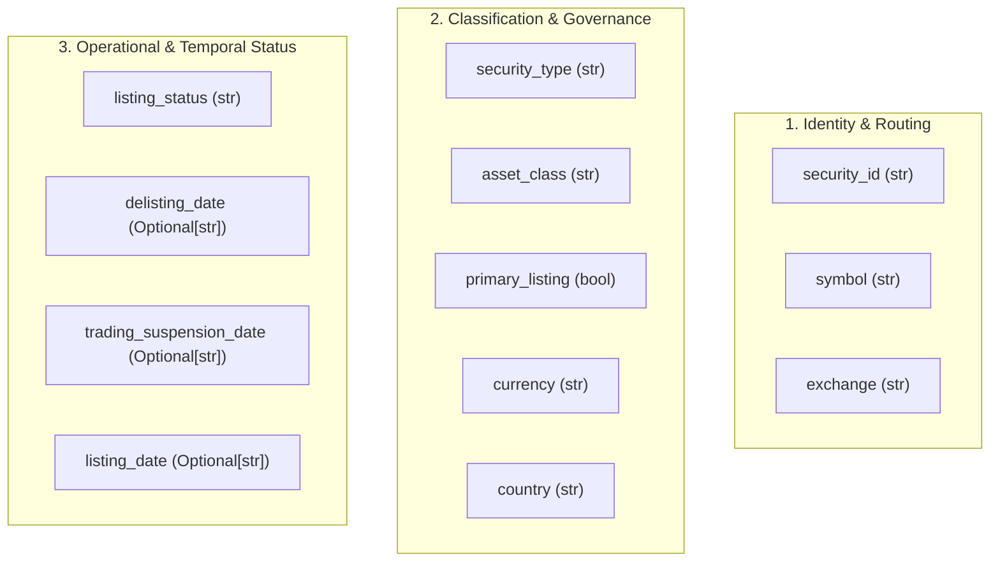

# ARX Terminal — Production-Universe Field Evidence Requirements
**Backlog Reference:** `BACKLOG-VCP-PROD-UNIVERSE-003` (Field-Gap Investigation)  
**Execution Worktree:** `C:\Users\akara\Documents\Projects\finance-vcp-universe-inputs`  
**Branch:** `research/vcp-production-universe-inputs`  
**Contract Reference Commit:** `6c9b5b00de26545239616ac46f78b35a343ee3dd` (Worktree A Candidate 004, Tree: `3ef8ead46c34754724cfdc5e906af66271fa2ed2`)  
**Base Commit:** `787c1977b0071f2b31c4ad3d36a7f872147ad59e` (PR #4)  
**Status:** SPECIFICATION COMPLETE — AWAITING PRODUCT OWNER POLICY REVIEW

---

## 1. Executive Summary & Context

This document establishes the authoritative contract evidence requirements for every field in the `SourceSecurity` data model and rules R01 through R07 of the ARX Terminal universe engine.

Rather than weakening contracts to match free directory files, this investigation derives the exact semantic expectations from repository code, invariants, and tests in Candidate 004 (`6c9b5b0`). It documents observed implementation behavior, intended contract semantics, missing-data vulnerabilities, and concrete policy ambiguities requiring Product Owner decisions.

---

## 2. Field-by-Field Evidence Requirement Specifications



---

### 2.1 `security_id` (Primary Security Key)
- **Field Name & Type:** `security_id: str` (Alphanumeric string).
- **Exact Code Consumers:** `builder.py#L141-L144`, `contracts.py#L117`, `store.py#L190`, `store.py#L225`.
- **Relevant Eligibility Rule:** `R00_CRITICAL_IDENTITY` (Built into builder failure checks; if missing, returns `EligibilityDecision.UNRESOLVED`).
- **Intended Semantic Meaning:** An immutable, collision-free identifier representing an individual tradeable financial instrument (security line), persistent across ticker renames.
- **Required vs Optional:** **Strictly Required**. Empty string or `None` triggers immediate terminal failure (`UNRESOLVED_CRITICAL_IDENTITY`).
- **Actual Missing / Default Behavior:** No default in dataclass (`contracts.py#L117`). Caller must supply a value.
- **Temporal Interpretation:** Permanent entity key valid across all historical renames.
- **Minimum Evidence Needed:** An authoritative **Listing-Level / Venue-Specific Instrument Identifier** (such as OpenFIGI Composite FIGI or Listing FIGI) or an explicitly authorized single-session compound surrogate key (`CIK_{cik:010d}_{symbol}`).
- **Observed Limitation / Ambiguity:** SEC EDGAR `cik` is an **issuer / entity identifier**, not a security identifier. An issuer with multiple listed share classes (e.g. Alphabet Inc. `GOOG` and `GOOGL`, Berkshire Hathaway `BRK.A` and `BRK.B`) shares a single CIK. Using `CIK_{cik}` collapses multiple share classes into a single key, violating database unique constraints. Furthermore, compound key `CIK+symbol` fails to resolve corporate ticker renames or historical ticker reuse across time.
- **FIGI Granularity Qualification:** Share Class FIGI is assigned globally across venues; achieving listing-level granularity requires Composite FIGI or Listing FIGI.

---

### 2.2 `symbol` (Exchange Trading Ticker)
- **Field Name & Type:** `symbol: str` (Uppercase ASCII string matching `[A-Z0-9.-]+`).
- **Exact Code Consumers:** `builder.py#L134`, `builder.py#L141`, `builder.py#L184-L192`, `analyst_dashboard/vcp/session_guard.py#L380-L475`.
- **Relevant Eligibility Rule:** `R00_CRITICAL_IDENTITY` (Empty symbol triggers `UNRESOLVED_CRITICAL_IDENTITY`).
- **Intended Semantic Meaning:** The official trading ticker assigned by the primary listing exchange for the target session day.
- **Required vs Optional:** **Strictly Required**.
- **Actual Missing / Default Behavior:** No default in dataclass (`contracts.py#L118`). Caller must supply a value.
- **Temporal Interpretation:** Point-in-time symbol valid on the session date $[t_{\text{start}}, t_{\text{end}}]$.
- **Minimum Evidence Needed:** Active symbol from the primary listing exchange directory.
- **Observed Limitation / Ambiguity:** Symbology dialect variations between exchange tapes (e.g. Nasdaq dot notation `AAC.U` vs CTA `AAC/U` vs CQS `AAC=`). Normalization dialect must be pinned.

---

### 2.3 `exchange` (Primary Listing Exchange)
- **Field Name & Type:** `exchange: str` (`NASDAQ`, `NYSE`, `ARCA`, `BATS`, `AMEX`, `OTC`, etc.).
- **Exact Code Consumers:** `builder.py#L95-L97`, `contracts.py#L76-L80`.
- **Relevant Eligibility Rule:** `R04_PRIMARY_EXCHANGE` (`exchange in ["NASDAQ", "NYSE", "ARCA", "BATS"]`).
- **Intended Semantic Meaning:** The primary national securities exchange on which the issuer's security is registered and listed under Section 12(b) of the Exchange Act.
- **Required vs Optional:** **Strictly Required**.
- **Actual Missing / Default Behavior:** No default in dataclass (`contracts.py#L119`). Caller must supply a value.
- **Temporal Interpretation:** Point-in-time listing venue. If an issue transfers venues (e.g. AMEX to NYSE), the exchange code reflects the venue on the session date.
- **Minimum Evidence Needed:** Official exchange venue assignment from SEC registration filings (Form 8-A, Form 10) or consolidated tape directories (`nasdaqlisted.txt`, `otherlisted.txt`).
- **Observed Limitation / Ambiguity:** Regional exchanges and Unlisted Trading Privileges (UTP) must not be confused with primary listing venues.

---

### 2.4 `security_type` (Instrument Classification)
- **Field Name & Type:** `security_type: str` (`COMMON_STOCK`, `ETF`, `PREFERRED_STOCK`, `WARRANT`, `UNIT`, `ADR`, `REIT`, etc.).
- **Exact Code Consumers:** `builder.py#L81-L83`, `contracts.py#L66-L70`.
- **Relevant Eligibility Rule:** `R02_SECURITY_TYPE` (`security_type == "COMMON_STOCK"`).
- **Contract Rule Description:** `"Security subtype must be Common Stock (no ETFs, ADRs, Warrants in stock VCP)"` (`contracts.py#L69`).
- **Intended Semantic Meaning:** The legal structural instrument type. Restricts the universe to true common equity in operating corporations.
- **Required vs Optional:** **Strictly Required**.
- **Actual Missing / Default Behavior:** No default in dataclass (`contracts.py#L120`). Caller must supply a value.
- **Temporal Interpretation:** Current legal instrument type.
- **Minimum Evidence Needed:** Explicit, authoritative security classification from a security master (e.g. OpenFIGI `securityType2 == 'Common Stock'`) or explicit regulatory charter evidence.
- **Observed Limitation / Ambiguity:** Neither SEC EDGAR `company_tickers_exchange.json` nor Nasdaq Trader directories contain an explicit `security_type` field. Heuristic name regex combined with `ETF == 'N'` is unvalidated. OpenFIGI provides deterministic taxonomy classification (`securityType2: "REIT"` vs `"Common Stock"`). Strategy eligibility (whether to admit or exclude common stock REITs/BDCs) is an open Product Owner policy decision, not an intrinsic instrument defect.

---

### 2.5 `listing_status` (Operational Listing Status)
- **Field Name & Type:** `listing_status: str` (`ACTIVE`, `SUSPENDED`, `DELISTED`, `INACTIVE`).
- **Exact Code Consumers:** `builder.py#L88-L93`, `builder.py#L114`, `contracts.py#L71-L75`.
- **Relevant Eligibility Rule:** `R03_LISTING_STATUS` (`listing_status == "ACTIVE"`).
- **Intended Semantic Meaning:** Admission to trading status on the exchange.
- **Required vs Optional:** **Strictly Required**.
- **Actual Missing / Default Behavior:** No default in dataclass (`contracts.py#L121`). Caller must supply a value.
- **Temporal Interpretation:** Status as of the morning session open.
- **Minimum Evidence Needed:** Morning symbol directory presence or exchange listing notification.
- **Observed Limitation / Ambiguity:** Daily directory presence confirms morning listing, but does **not** reflect intraday halts or regulatory suspensions.

---

### 2.6 `currency` (Trading / Quotation Currency)
- **Field Name & Type:** `currency: str` (ISO 4217 currency code, e.g. `USD`).
- **Exact Code Consumers:** `builder.py#L99-L101`, `contracts.py#L81-L85`.
- **Relevant Eligibility Rule:** `R05_CURRENCY` (`currency == "USD"`).
- **Contract Rule Description:** `"Trading currency must be USD"` (`contracts.py#L84`).
- **Intended Semantic Meaning:** The quotation and trading currency used on the exchange venue.
- **Required vs Optional:** Syntactically optional in dataclass (`currency: str = "USD"`); logically required by rule R05.
- **Actual Missing / Default Behavior:** **SILENT DEFAULT TO "USD"** (`contracts.py#L122`).
- **Temporal Interpretation:** Session trading currency.
- **Minimum Evidence Needed:** Explicit trading currency attribute from security master or codified venue rulebook convention (standard US common equities on NASDAQ/NYSE trade in USD). Positive pricing is strictly rejected as currency evidence.
- **Observed Limitation / Ambiguity:** Raw directory feeds contain no currency column. While US exchange rules prescribe USD for standard equity lines, relying on a silent dataclass default bypasses evidentiary verification. Dual-currency or cross-listed exceptions must be explicitly governed.

---

### 2.7 `primary_listing` (Primary Share Class / Venue Line)
- **Field Name & Type:** `primary_listing: bool` (`True` / `False`).
- **Exact Code Consumers:** `builder.py#L103-L105`, `contracts.py#L86-L90`.
- **Relevant Eligibility Rule:** `R06_PRIMARY_LISTING` (`primary_listing is True`).
- **Contract Rule Description:** `"Must be primary listing, not secondary or cross-listing"` (`contracts.py#L89`).
- **Intended Semantic Meaning:** Intended to exclude secondary cross-listings or non-primary share classes.
- **Required vs Optional:** Syntactically optional in dataclass (`primary_listing: bool = True`); logically required by rule R06.
- **Actual Missing / Default Behavior:** **SILENT DEFAULT TO TRUE** (`contracts.py#L124`).
- **Temporal Interpretation:** Persistent property of the listing line.
- **Minimum Evidence Needed:** Authoritative registry of primary vs secondary share classes.
- **Unresolved Policy Ambiguity:** **STATUS: UNRESOLVED.** Allowed-exchange membership alone does NOT resolve secondary or cross-listing status (e.g. Canadian interlisted equities). Does "primary listing" mean:
  1. *Listing venue authority:* The security's primary exchange (Network A/B/C) vs an Unlisted Trading Privileges (UTP) regional venue?
  2. *Global primary market:* A US company's domestic listing vs a foreign cross-listing?
  3. *Share-class seniority:* The issuer's primary equity line vs secondary/restricted lines?
  *This requires an explicit Product Owner policy determination before implementation.*

---

### 2.8 `asset_class` (Broad Asset Taxonomy)
- **Field Name & Type:** `asset_class: str` (`EQUITY`, `ETF`, `DEBT`, `COMMODITY`, etc.).
- **Exact Code Consumers:** `builder.py#L77-L80`, `contracts.py#L60-L65`.
- **Relevant Eligibility Rule:** `R01_ASSET_CLASS` (`asset_class == "EQUITY"`).
- **Intended Semantic Meaning:** Broad instrument classification distinguishing equity ownership from fixed income, funds, or derivatives.
- **Required vs Optional:** Syntactically optional in dataclass (`asset_class: str = "EQUITY"`); logically required by rule R01.
- **Actual Missing / Default Behavior:** **SILENT DEFAULT TO "EQUITY"** (`contracts.py#L125`).
- **Temporal Interpretation:** Invariant instrument taxonomy.
- **Minimum Evidence Needed:** Security master classification code.
- **Observed Limitation:** Absent from SEC and Nasdaq directory text files. Relying on dataclass default bypasses verification.

---

### 2.9 `delisting_date` (Terminal Delisting Tombstone)
- **Field Name & Type:** `delisting_date: Optional[str]` (ISO-8601 date string `YYYY-MM-DD` or `None`).
- **Exact Code Consumers:** `builder.py#L108-L115`, `contracts.py#L91-L95`.
- **Relevant Eligibility Rule:** `R07_NOT_DELISTED`.
- **Intended Semantic Meaning:** Date on which the security was formally delisted under Section 12(b).
- **Required vs Optional:** Optional in dataclass (`default = None`).
- **Actual Missing / Default Behavior:** If `None`, `builder.py#L114` falls back to `listing_status != "DELISTED"`.
- **Temporal Interpretation:** Historical terminal date.
- **Minimum Evidence Needed:** SEC Form 25 filing effective date or exchange delisting notices.
- **Observed Limitation:** Daily symbol directories drop delisted issues overnight with zero tombstone dates, creating severe survivorship bias in historical backtesting.

---

### 2.10 `trading_suspension_date` (Regulatory Halt / Suspension Date)
- **Field Name & Type:** `trading_suspension_date: Optional[str]` (ISO-8601 date string `YYYY-MM-DD` or `None`).
- **Exact Code Consumers:** `builder.py#L89-L93`.
- **Relevant Eligibility Rule:** `R03_LISTING_STATUS`.
- **Intended Semantic Meaning:** Date on which a regulatory halt or SEC 12(k) suspension was initiated.
- **Required vs Optional:** Optional in dataclass (`default = None`).
- **Actual Missing / Default Behavior:** If `None`, `builder.py#L92` falls back to `listing_status == "ACTIVE"`.
- **Temporal Interpretation:** Point-in-time intraday or multi-day suspension window.
- **Minimum Evidence Needed:** Real-time exchange trade halts feed (e.g. Nasdaq Trade Halts RSS) or SEC 12(k) suspension releases.

---

## 3. Critical Code-Path Vulnerability: Silent Default-Filling

### 3.1 The Vulnerability Path
Inspection of `analyst_dashboard/universe/contracts.py` lines 122–125 and `builder.py` lines 77–115 reveals that `SourceSecurity` dataclass attributes have permissive default values:

```python
# contracts.py#L122-L125
currency: str = "USD"
country: str = "USA"
primary_listing: bool = True
asset_class: str = "EQUITY"
listing_date: Optional[str] = None
delisting_date: Optional[str] = None
trading_suspension_date: Optional[str] = None
```

### 3.2 Concrete Trigger & Effect
- **Trigger:** An input pipeline instantiates `SourceSecurity` by supplying only the positional arguments:
  ```python
  SourceSecurity(
      security_id="ABC",
      symbol="XYZ",
      exchange="NASDAQ",
      security_type="COMMON_STOCK",
      listing_status="ACTIVE",
  )
  ```
- **Effect:**
  - `currency` silently becomes `"USD"` $\rightarrow$ **Rule R05 automatically passes**.
  - `primary_listing` silently becomes `True` $\rightarrow$ **Rule R06 automatically passes**.
  - `asset_class` silently becomes `"EQUITY"` $\rightarrow$ **Rule R01 automatically passes**.
  - `delisting_date` is `None` $\rightarrow$ `listing_status != "DELISTED"` evaluates to `True` $\rightarrow$ **Rule R07 automatically passes**.
  - `trading_suspension_date` is `None` $\rightarrow$ `listing_status == "ACTIVE"` evaluates to `True` $\rightarrow$ **Rule R03 automatically passes**.
- **Outcome:** The record receives `EligibilityDecision.ELIGIBLE` and is certified as passing all rules, even though the caller provided **zero empirical evidence** for currency, primary listing, broad asset class, delisting history, or regulatory halts.

### 3.3 Finding for Worktree A Release Assessment
- **Assessment Finding:** Candidate 004's data contracts allow missing attributes to be silently resolved into passing states via dataclass defaults. In `test_golden_universe.py` and `fixtures.py`, tests pass because synthetic fixtures rely on this behavior.
- **Production Impact:** In a live production ingestion pipeline, this creates the hazard that unverified source records will silently pass all rules.
- **Recommendation for Worktree A:** Worktree A should record a release-governance recommendation to evaluate removing default values from `SourceSecurity` or requiring explicit validation provenance flags in a future release milestone.
- **Worktree A Independence:** Worktree A is **not blocked** by this research finding; its current mission (remote Tier 2 verification) remains independent.
