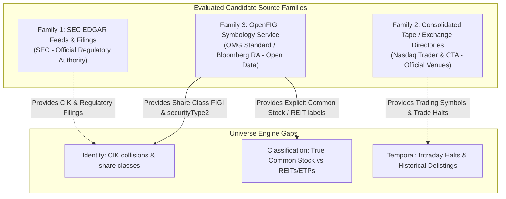

# ARX Terminal — Production-Universe Gap Resolution Options
**Backlog Reference:** `BACKLOG-VCP-PROD-UNIVERSE-003` (Field-Gap Investigation)  
**Execution Worktree:** `C:\Users\akara\Documents\Projects\finance-vcp-universe-inputs`  
**Branch:** `research/vcp-production-universe-inputs`  
**Base Commit:** `787c1977b0071f2b31c4ad3d36a7f872147ad59e` (PR #4)  
**Status:** OPTIONS ANALYSIS COMPLETE — PROPOSALS FOR PRODUCT OWNER REVIEW

---

## 1. Executive Summary

This investigation evaluates candidate primary sources to resolve the five critical empirical field gaps identified in the ARX Terminal production-universe builder:
1. Security-level identity (distinguishing share classes and preventing CIK collisions).
2. Instrument classification and asset class (authoritative isolation of Common Stock).
3. Trading currency (verifiable quotation currency).
4. Primary listing semantics (distinguishing primary market from secondary share classes).
5. Temporal operational status (point-in-time listing, suspension, and delisting history).

In accordance with Product Owner guidance, source qualification is strictly bounded to **three plausible source families**. Each source is evaluated across documented specifications, observed bounded samples, inferences, and remaining unknowns.

---

## 2. Qualification of Three Plausible Source Families

---

### 2.1 Source Family 1: SEC EDGAR Public Feeds & Filings
- **Publisher:** U.S. Securities and Exchange Commission (SEC).
- **Feeds Evaluated:**
  1. `company_tickers_exchange.json` (Exchange master list).
  2. `data.sec.gov/submissions/CIK{cik:010d}.json` (Submissions API).
  3. Form 25 EDGAR submissions (Notification of Removal from Listing).
- **Identifier Granularity:** **Issuer / Registrant Entity Level (CIK)**. Does not assign individual security identifiers.
- **Fields Actually Supplied:**
  - `company_tickers_exchange.json`: `cik`, `name`, `ticker`, `exchange`.
  - Submissions API: `cik`, `entityType`, `sic`, `sicDescription`, `name`, `tickers` (array), `exchanges` (array), filing history.
  - Form 25: Issuer name, CIK, title of class of securities, date of removal.
- **Current & Historical Coverage:** All SEC reporting issuers (~10,444 active listed entities; historical back to 1994 via EDGAR).
- **Effective / Availability Timestamps:** Real-time upon filing acceptance (06:00–22:00 ET).
- **Update Cadence & Documented Access Limits:** Daily for directory files; sub-second for filings. Rate limit: 10 requests per second. Mandatory custom `User-Agent`.
- **Authentication Requirements:** Unauthenticated HTTPS GET. Custom `User-Agent` header required by SEC policy.
- **Usage & Redistribution Terms:** Public domain (U.S. Government work). Redistribution permitted without fee under fair-access rules.
- **Status Classification:**
  - `DOCUMENTED`: CIK is an issuer number; rate limits; filing types; public domain status.
  - `OBSERVED_IN_BOUNDED_SAMPLE`: Probe `PROBE_SEC_SUBMISSIONS_MULTICLASS` confirmed Alphabet Inc. (CIK 0001652044) returns 4 tickers (`GOOGL`, `GOOG`, `GOOGM`, `GOOGN`) sharing a single CIK.
  - `INFERRED`: None.
  - `UNKNOWN`: Future changes to SEC fair access policies or directory file schemas.
- **Assessment for ARX Gaps:** Sourcing CIK establishes regulatory entity provenance, but **fails to resolve security-level identity** or provide `security_type` and `currency`. Form 25 is an essential prospective input for historical delistings, but requires a dedicated parser.

---

### 2.2 Source Family 2: Consolidated Tape & Exchange Directories
- **Publisher:** The Nasdaq Stock Market, Inc. / Consolidated Tape Association (CTA) / UTP Plan.
- **Feeds Evaluated:**
  1. `nasdaqlisted.txt` & `otherlisted.txt` (Morning symbol directories).
  2. `tradehalts.txt` & `rss.aspx?feed=tradehalts` (Real-time trade halts feed).
- **Identifier Granularity:** **Venue Trading Ticker (Listing Level)**.
- **Fields Actually Supplied:**
  - Symbol Directories: `Symbol` / `ACT Symbol`, `Security Name`, `Exchange`, `ETF` (Y/N), `Test Issue` (Y/N), `Financial Status` (Nasdaq only).
  - Trade Halts RSS: `IssueSymbol`, `IssueName`, `Market`, `HaltDate`, `HaltTime`, `ReasonCode`, `ResumptionDate`, `ResumptionTradeTime`.
- **Current & Historical Coverage:** All actively listed equities and ETPs on US national securities exchanges (~13,310 listings). Historical directories are **not archived**; current day only.
- **Effective / Availability Timestamps:** Symbol directories generated daily at ~03:00 ET. Trade halts updated continuously intraday.
- **Update Cadence & Documented Access Limits:** Daily snapshot for directories; continuous polling for halts. Unauthenticated, no stated request quotas.
- **Authentication Requirements:** Unauthenticated HTTP GET.
- **Usage & Redistribution Terms:** Terms of service and commercial redistribution restrictions are **unreviewed and undocumented in official feed headers**.
- **Status Classification:**
  - `DOCUMENTED`: File formats, pipe delimiters, exchange code mappings, trade halt reason codes (e.g. T1 = News Pending, LULD = Limit Up/Limit Down).
  - `OBSERVED_IN_BOUNDED_SAMPLE`: Probe `PROBE_NASDAQ_TRADE_HALTS` confirmed real-time halt events (`KNDI` halted at 19:50:00 ET with code `T1`).
  - `INFERRED`: That active presence in morning directory implies listing status `ACTIVE` at market open.
  - `UNKNOWN`: Commercial redistribution permissions; historical directory archive availability.
- **Assessment for ARX Gaps:** Authoritative for current venue symbols and intraday trade halts (Rule R03). **Fails to provide historical delistings (R07), explicit security types (R02), or currency (R05)**.

---

### 2.3 Source Family 3: OpenFIGI Symbology & Security Master
- **Publisher:** Object Management Group (OMG) standard / Bloomberg L.P. (Registration Authority).
- **Feeds Evaluated:** OpenFIGI v3 Mapping API (`https://api.openfigi.com/v3/mapping`).
- **Identifier Granularity:** **Multi-Tiered Hierarchical Identifiers**:
  1. *Global Share Class FIGI:* Identifies the equity share class across all global venues (e.g. `BBG009S39JY5` for Alphabet Class A).
  2. *Composite FIGI:* Identifies the instrument traded at the national composite level (e.g. `BBG009S39JX6` for US composite).
  3. *Listing FIGI:* Identifies the specific exchange listing line.
- **Fields Actually Supplied:** `figi`, `name`, `ticker`, `exchCode`, `compositeFIGI`, `shareClassFIGI`, `securityType`, `marketSector`, `securityType2`.
- **Current & Historical Coverage:** Global financial instruments (equities, funds, preferreds, debt, derivatives). Full historical coverage.
- **Effective / Availability Timestamps:** Real-time API mapping.
- **Update Cadence & Documented Access Limits:** API rate limit: 25 requests per minute unauthenticated; 250 requests per minute with free registered API key. Bulk daily data files available for download.
- **Authentication Requirements:** Unauthenticated for low volume; API key optional.
- **Usage & Redistribution Terms:** Open standard (OMG). Licensed under permissive terms (freely redistributable, no licensing fees for FIGI identifiers).
- **Status Classification:**
  - `DOCUMENTED`: Hierarchical levels (Share Class vs Composite vs Listing); OpenFIGI API documentation.
  - `OBSERVED_IN_BOUNDED_SAMPLE`: Probe `PROBE_OPENFIGI_DISAMBIGUATION` confirmed:
    - `GOOG` and `GOOGL` have distinct Share Class FIGIs (`BBG009S3NB21` vs `BBG009S39JY5`).
    - `O` (Realty Income Corp) is explicitly classified as `securityType: "REIT"`, `securityType2: "REIT"` (providing external taxonomy classification distinct from PO strategy eligibility policy).
    - `SPY` is explicitly classified as `securityType: "ETP"`, `securityType2: "Mutual Fund"`.
  - `INFERRED`: None.
  - `UNKNOWN`: Rate of latency during market opening bursts without paid infrastructure.
- **Assessment for ARX Gaps:** **Directly resolves listing-level identity (via Composite FIGI / Listing FIGI) and authoritative instrument classification (`securityType2`)**.

---

## 3. Field-by-Field Gap Resolution Options Matrix

| Gap / Field | Resolution Option A (Minimal / Heuristic) | Resolution Option B (Open Standard / Composite) | Resolution Option C (Authoritative / Extension) | Recommended Smallest Next Action |
| :--- | :--- | :--- | :--- | :--- |
| **1. Security Identity (`security_id`)** | **Compound Key:** Construct `CIK_{cik}_{symbol}`. *Pros:* Single-session multi-class resolution. *Cons:* Breaks on ticker renames; duplicates on historical ticker reuse. | **OpenFIGI Composite / Listing FIGI:** Map ticker + venue to unique listing-level FIGI. *Pros:* Listing-level granularity; immutable across ticker renames. *Cons:* Requires mapping layer. | **ARX Synthetic Master:** Internal surrogate UUID table mapping CIK + CUSIP/FIGI + historical aliases. *Pros:* Fully controlled. *Cons:* High operational overhead. | **Option B:** Adopt Composite / Listing FIGI as candidate listing-level identifier (with Option A as temporary bridging key). |
| **2. Security Type (`security_type`)** | **Candidate Regex Classifier:** `ETF=='N'` + `Test=='N'` + name keyword regex. *Pros:* Uses existing feeds. *Cons:* Fails on REITs, BDCs, and closed-end funds. | **OpenFIGI `securityType2`:** Query OpenFIGI API for explicit `Common Stock` enumeration. *Pros:* Separates taxonomy from PO strategy eligibility. *Cons:* External API dependency. | **SEC Form 10/8-A Parsing:** Parse registration filing titles. *Pros:* Direct regulatory source. *Cons:* Complex XBRL/text extraction pipeline. | **Option B:** Benchmark OpenFIGI `securityType2` against canonical test fixtures; PO decides REIT/BDC eligibility. |
| **3. Trading Currency (`currency`)** | **Exchange Rulebook Convention:** Formalize policy that US national exchanges quote exclusively in USD within defined scope. *Pros:* Zero feed overhead. *Cons:* Policy convention; positive pricing is not proof. | **Security Master Enrichment:** Populate currency from OpenFIGI / CTA tape attribute. *Pros:* Explicitly payload-verified. *Cons:* Requires feed enrichment. | **Trading Venue Quote API:** Read real-time quote currency attribute from market database. *Pros:* Mirrors execution reality. *Cons:* Couples builder to market store. | **Option A + Scope Definition:** Codify venue rulebook convention for US exchanges with explicit exceptions; reject positive pricing. |
| **4. Primary Listing (`primary_listing`)** | **Venue Listing Market Rule:** Designate issues listed on primary exchange as primary listings. *Pros:* Feasible from existing directory. *Cons:* Allowed-exchange membership alone does NOT resolve secondary/cross-listing status. | **Global Primary Register (MIC):** Verify US listing vs foreign home operating MIC. *Pros:* Accurately distinguishes primary from cross-listings. *Cons:* Requires international MIC data. | **Contract Waiver / Rule Retirement:** Waive R06 if technical VCP contraction patterns do not require primary listing. *Pros:* Removes unresolvable ambiguity. *Cons:* Requires PO policy waiver. | **STATUS: UNRESOLVED:** Awaiting binding PO policy determination among venue proxy, strict MIC, or waiver. |
| **5. Temporal Status (`R03` / `R07`)** | **Daily Prospective Snapshots:** Capture morning directory + query Nasdaq Trade Halts RSS for intraday suspensions. *Pros:* Unblocks live prospective runs. *Cons:* Zero historical depth; historical replay impossible. | **Form 25 Parser:** Automate ingestion of SEC EDGAR Form 25 filings for historical delisting dates. *Pros:* Solves R07 for historical backtesting. *Cons:* Requires building and auditing Form 25 parser. | **Commercial Delisting Master:** Ingest commercial historical tombstone database. *Pros:* Complete history. *Cons:* Paid commercial subscription. | **Option A (Current) + B (Proposed):** Use morning directory + trade halts for prospective runs; propose Form 25 parser as separate backlog item. |

---

## 4. Unresolved Policy Ambiguities for Product Owner Review

The following questions cannot be resolved by technical inspection and require formal Product Owner rulings:

1. **Policy Ambiguity 1 — Primary Listing Semantics (Rule R06):**
   - *Status:* **UNRESOLVED.** Allowed-exchange membership alone does not resolve secondary or cross-listing status.
   - *Question:* Does `primary_listing == True` require:
     - (a) Venue directory proxy on NASDAQ/NYSE/ARCA/BATS (accepting known cross-listing blind spots)?
     - (b) Strict Global Primary Market verification via Operating MIC (excluding Canadian/foreign cross-listings)?
     - (c) Contract waiver / retirement of Rule R06 if technical pattern validity does not depend on primary listing?
2. **Policy Ambiguity 2 — Currency Verification Standard (Rule R05):**
   - *Question:* Can Rule R05 be satisfied by a codified exchange rulebook convention with strictly defined scope and exceptions, with positive pricing explicitly rejected as evidence?
3. **Policy Ambiguity 3 — Identity Granularity & Multi-Class Disambiguation (Rule R00):**
   - *Question:* Should the candidate contract permit an explicit compound surrogate key `CIK_{cik}_{symbol}` for single-session bridging (with acknowledged inability to resolve ticker changes or historical ticker reuse), transitioning to OMG Composite/Listing FIGI in Phase 2?
4. **Policy Ambiguity 4 — Instrument Eligibility for REITs & BDCs (Rule R02):**
   - *Question:* Does the VCP strategy policy restrict Rule R02 strictly to operating common stock (`securityType2 == "Common Stock"`), or permit common stocks of REITs and BDCs that meet all liquidity and volatility contraction criteria?

---

## 5. Recommended Smallest Next Action

The smallest concrete, evidence-backed step to advance universe qualification without premature implementation is:

1. **Submit Policy Ambiguities:** Present the three policy questions above to the Product Owner.
2. **Offline FIGI Disambiguation Benchmark:** Author an isolated, offline research script that queries the free OpenFIGI mapping endpoint for the 50 SEC sample records to measure exact `securityType2` coverage and Share Class FIGI collision rates.
3. **Form 25 Schema Specification:** Author an offline sample extraction of SEC Form 25 XML/text filings to evaluate whether effective delisting dates can be extracted deterministically.
