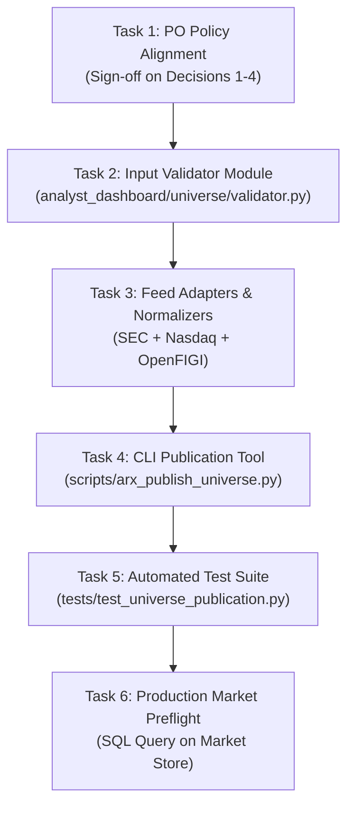
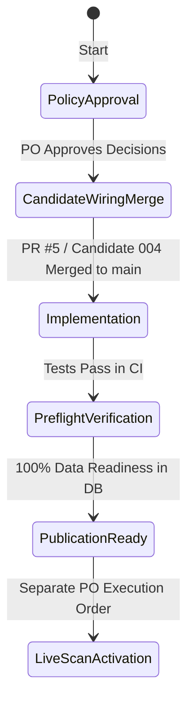

# ARX Terminal — Production-Universe Implementation Plan
**Backlog Reference:** `BACKLOG-VCP-PROD-UNIVERSE-003` (Implementation Package)  
**Execution Worktree:** `C:\Users\akara\Documents\Projects\finance-vcp-universe-inputs`  
**Branch:** `research/vcp-production-universe-inputs`  
**Base Commit:** `787c1977b0071f2b31c4ad3d36a7f872147ad59e` (PR #4)  
**Contract Reference Commit:** `6c9b5b00de26545239616ac46f78b35a343ee3dd` (Candidate 004 / PR #5, Tree: `3ef8ead46c34754724cfdc5e906af66271fa2ed2`)  
**Status:** SPECIFICATION COMPLETE — READY FOR IMPLEMENTATION PLANNING  

---

## 1. Executive Summary & Objective

This implementation plan defines the exact engineering roadmap required to advance from the current research package to an authorized production-universe build for the ARX Terminal VCP engine.

It establishes:
1. A compact gap-to-implementation mapping matrix.
2. A six-task sequential implementation roadmap.
3. Explicit prerequisites, gates, and stop conditions.
4. Six concrete acceptance test scenarios.
5. Evidence-based engineering effort estimates.

---

## 2. Compact Gap-to-Implementation Table

| Gap Category | Research Finding | Target Component | Target File | Acceptance Gate |
| :--- | :--- | :--- | :--- | :--- |
| **G1: Listing-Level Identity** | CIK is an issuer entity ID; multi-class issuers collide. Ticker renames break lineage. FIGI must be listing-level. | `ListingIdentityResolver` / Compound Key Formatter | `analyst_dashboard/universe/identity.py` | `test_multi_class_disambiguation` (Asserts distinct non-colliding keys; qualifies Phase 1 bridging vs Phase 2 Composite FIGI). |
| **G2: Taxonomy vs Strategy Eligibility** | Raw directories lack security type. External taxonomy (OpenFIGI `securityType2`) must separate classification from PO REIT/BDC eligibility policy. | `OpenFigiTaxonomyAdapter` | `analyst_dashboard/universe/adapters/openfigi.py` | `test_openfigi_taxonomy_mapping` (Asserts deterministic classification and enforces PO policy on common stock and REIT/BDC). |
| **G3: Quotation Currency** | Raw directory feeds omit currency; dataclass silently defaults "USD". Positive pricing is NOT currency proof. | `ExchangeRulebookNormalizer` + `InputValidator` | `analyst_dashboard/universe/validator.py` | `test_currency_validation` (Enforces rulebook scope and exceptions; rejects unverified currency without defaulting). |
| **G4: Primary Listing Semantics** | Semantics remain UNRESOLVED. Allowed-exchange membership alone does NOT resolve secondary or cross-listing status. | `PrimaryListingPolicyEvaluator` | `analyst_dashboard/universe/validator.py` | `test_primary_listing_qualification` (Evaluates R06 strictly under binding PO determination). |
| **G5: Temporal Evidence & Halts** | Daily directories omit intraday halts, mid-session resumptions, and historical delistings. Anti-lookahead alignment required. | `NasdaqHaltFeedAdapter` | `analyst_dashboard/universe/adapters/nasdaq_halts.py` | `test_regulatory_halt_and_resumption` (Handles pre-market and midday halts, and tests resumption back to active). |
| **G6: Silent Default Vulnerability** | `SourceSecurity` defaults allow unverified payloads to pass rules. | `FailClosedInputValidator` | `analyst_dashboard/universe/validator.py` | `test_silent_default_prevention` (Records omitting fields rejected before builder). |
| **G7: Production Tooling** | Tooling must operate strictly within verified `UniverseStore` capabilities and end at read-only publication handoff. | `ArxUniversePublisherCLI` | `scripts/arx_publish_universe.py` | `test_publication_cli_e2e` (Verified atomic commit, dry-run, and publication without activation). |

---

## 3. Concrete Implementation Sequence

### Task 1: Product Owner Policy Determination
- **Scope:** Review and determine the four policy proposals in [`POLICY_DECISION_PROPOSALS.md`](file:///C:/Users/akara/Documents/Projects/finance-vcp-universe-inputs/docs/research/vcp-production-universe-inputs/POLICY_DECISION_PROPOSALS.md):
  1. Primary Listing Semantics: Binding choice among venue proxy, strict MIC, or waiver.
  2. Currency Standard: Codified Venue Rulebook Convention with defined scope and exceptions.
  3. Security Identity Granularity: Listing-Level Identity (Phase 1 compound key bridging $\rightarrow$ Phase 2 Composite FIGI).
  4. Instrument Classification & Eligibility: OpenFIGI `securityType2` taxonomy; PO determination on REIT/BDC eligibility.
- **Prerequisites:** None.
- **Stop Condition:** Formal written determination of policy decisions by Product Owner.

### Task 2: Fail-Closed Input Validator Module
- **Scope:** Implement `analyst_dashboard/universe/validator.py` adhering to [`INPUT_VALIDATION_SPEC.md`](file:///C:/Users/akara/Documents/Projects/finance-vcp-universe-inputs/docs/research/vcp-production-universe-inputs/INPUT_VALIDATION_SPEC.md).
- **Deliverables:**
  - `ValidatedSecurityPayload` dataclass (strict, non-defaulting).
  - Schema assertion, regex validators, enum sets for fields F01–F12.
  - Batch identity and symbol collision detection.
  - Point-in-time anti-lookahead checks and temporal validation.
  - Structured rejection audit logger.
- **Stop Condition:** 100% unit test coverage of all failure modes in isolation.

### Task 3: Feed Adapters & Normalization Layer
- **Scope:** Implement isolated feed parsers and normalization logic:
  - `analyst_dashboard/universe/adapters/sec_edgar.py` (Parses `company_tickers_exchange.json`).
  - `analyst_dashboard/universe/adapters/nasdaq_trader.py` (Parses `nasdaqlisted.txt`, `otherlisted.txt`, and trade halts RSS).
  - `analyst_dashboard/universe/adapters/openfigi.py` (Enriches records with listing-level identifiers and `securityType2` taxonomy).
- **Stop Condition:** Clean integration test demonstrating multi-class disambiguation and deterministic taxonomy mapping.

### Task 4: CLI Publication Tool Implementation
- **Scope:** Author `scripts/arx_publish_universe.py` adhering strictly to verified `UniverseStore` capabilities in [`PUBLICATION_TOOLING_SPEC.md`](file:///C:/Users/akara/Documents/Projects/finance-vcp-universe-inputs/docs/research/vcp-production-universe-inputs/PUBLICATION_TOOLING_SPEC.md).
- **Deliverables:**
  - Subcommands: `snapshot`, `validate`, `build`, `publish`, `verify`, `reconcile`.
  - Atomic SQLite transaction via `UniverseStore.save_universe_build()`.
  - Invariant assertion checks ($S = E + I + U$ and $E = DR + DU$).
  - Drift calculation and read-only handoff report generation (`PUBLISHED_INACTIVE`).
  - Strict non-execution invariant: zero scan triggers or scheduler dispatch.
- **Stop Condition:** Successful `--dry-run` and atomic persistence test against temporary SQLite database fixtures.

### Task 5: End-to-End Automated Acceptance Test Suite
- **Scope:** Implement comprehensive test suite `tests/test_universe_publication_pipeline.py`.
- **Deliverables:** 12 automated test scenarios verifying all contract and failure paths (see Section 5).
- **Stop Condition:** All 12 acceptance scenarios passing with zero regressions in existing tests.

### Task 6: Production Market Store Preflight Verification
- **Scope:** Execute read-only SQL preflight check against `/root/.finance_market_store.db` for the scannable candidate population.
- **Prerequisites:** Tasks 1–5 complete; authorized database read credentials.
- **Stop Condition:** 100% data readiness verified ($\text{ready\_symbols} == \text{total\_candidate\_symbols}$).

---

## 4. Dependencies, Pre-conditions, and Stop Conditions

1. **Prerequisite 1: Candidate Wiring Baseline Merge:**
   - Worktree A Candidate 004 wiring (PR #5 / `2eb032b2aec18ac4fea0f654eee8fb6c028466fe`) must be approved and merged to `main`.
2. **Prerequisite 2: Zero Production Access During Implementation:**
   - Tasks 1 through 5 must be completed entirely within local development worktrees and tested against isolated temporary SQLite fixtures.
   - `/root/.finance_market_store.db` is accessed **only in Task 6** under read-only mode.
3. **Stop Condition:**
   - Any failure in arithmetic closure ($S \ne E + I + U$ or $E \ne DR + DU$) or drift $> 5.0\%$ halts the pipeline and triggers `QUARANTINE`.

---

## 5. Expanded Acceptance Test Scenarios

The test suite must verify all normal, edge, and failure operational scenarios across the complete lifecycle:

| Scenario ID | Test Name | Input / Condition | Expected Behavior |
| :--- | :--- | :--- | :--- |
| **SC-01** | `test_multi_class_disambiguation` | Ingest SEC records for Alphabet Inc. (`GOOGL` and `GOOG`, same CIK). | Distinct listing-level `security_id` generated; zero collisions; both records admitted to builder. |
| **SC-02** | `test_openfigi_taxonomy_mapping` | Ingest Realty Income Corp (`O`) with OpenFIGI `securityType2: "REIT"`. | External taxonomy captured deterministically; eligibility evaluated strictly under configured PO policy without synthetic regex. |
| **SC-03** | `test_silent_default_prevention` | Raw payload omitting `currency`, `country`, `primary_listing`, or `asset_class`. | `InputValidator` rejects record with `VALIDATION_ERROR_MISSING_FIELD`; builder is NOT invoked. |
| **SC-04** | `test_regulatory_halt_and_resumption` | Ticker subjected to midday regulatory halt, or morning halt with midday resumption. | Correct point-in-time transition of `listing_status` (`SUSPENDED` vs `ACTIVE`); halts evaluated under R03. |
| **SC-05** | `test_ambiguous_or_conflicting_mappings` | Feed returns multiple disparate or contradictory records for the same ticker/venue. | Fails closed with `MAPPING_CONFLICT_AMBIGUOUS`; batch rejected without corrupting store. |
| **SC-06** | `test_upstream_source_failure` | Upstream network timeout, HTTP 5xx, or missing required feed file. | Pipeline aborts cleanly with `SOURCE_ACQUISITION_FAILED`; zero partial or corrupted builds persisted. |
| **SC-07** | `test_temporal_point_in_time_alignment` | Ingest source snapshot published after session cutoff or with future listing date. | Rejected under anti-lookahead rules with `LOOKAHEAD_VIOLATION_FUTURE_SNAPSHOT` or `LOOKAHEAD_VIOLATION_FUTURE_LISTING`. |
| **SC-08** | `test_idempotent_publication_reexecution` | Execute `publish` twice with identical source snapshots and identical market data. | Computes identical membership SHA-256; detects existing complete build; exits 0 without duplicate writes or trigger violations. |
| **SC-09** | `test_partial_write_atomic_rollback` | Database constraint failure or process termination midway through Phase 5 commit. | SQLite transaction rolls back 100% atomically; zero orphan rows in `universe_builds`, `universe_eligibility_ledger`, or `universe_readiness_ledger`. |
| **SC-10** | `test_publication_without_activation` | Successful build persistence with status `COMPLETE` and `PUBLISH`. | Emits read-only handoff report (`PUBLISHED_INACTIVE`); scheduler remains disabled; zero scans dispatched. |
| **SC-11** | `test_session_guard_100pct_floor` | Eligible universe of 100 symbols, but only 99 have valid OHLCV candles in market store. | `session_guard.py` rejects scan execution with `INCOMPLETE_UNIVERSE_COVERAGE`. |
| **SC-12** | `test_invariant_accounting_closure` | Synthetic build where one record is dropped during evaluation ($S \ne E + I + U$). | Build fails with `CANONICAL_INVARIANT_VIOLATION`; transaction rolled back; status `FAILED`. |

---

## 6. Partitioned Schedule & Effort Estimates

> [!IMPORTANT]
> **Schedule Decoupling:** Hands-on engineering effort must be strictly decoupled from external and operational calendar dependencies. The hour ranges below represent **engineering task effort**, NOT a continuous elapsed time or production release schedule.

### 6.1 Engineering Effort Track (Hands-On Code & Tests)

| Task | Component / Milestone | Hands-On Hours | Confidence |
| :--- | :--- | :--- | :--- |
| **Task 2** | Fail-Closed Input Validator Module (`validator.py`) | 4–6 hrs | High (Specification complete) |
| **Task 3** | Feed Adapters & Normalization (`sec_edgar`, `nasdaq`, `openfigi`) | 4–6 hrs | High (Probes verified) |
| **Task 4** | CLI Publication Tool (`scripts/arx_publish_universe.py`) | 3–4 hrs | High (Architecture specified) |
| **Task 5** | Automated Test Suite (12 Scenarios, SC-01 to SC-12) | 3–4 hrs | High (Scenarios defined) |
| **Subtotal** | **Core Hands-On Engineering Effort** | **14–20 hrs** | **~2–2.5 Focused Engineering Days** |

### 6.2 External & Operational Dependency Tracks (Independent Calendar Time)

1. **Product Owner Policy Determinations (Task 1):**
   - *Nature:* Asynchronous governance decision.
   - *Dependency:* PO review and formal sign-off on Decisions 1 through 4 in [`POLICY_DECISION_PROPOSALS.md`](file:///C:/Users/akara/Documents/Projects/finance-vcp-universe-inputs/docs/research/vcp-production-universe-inputs/POLICY_DECISION_PROPOSALS.md).
   - *Calendar Impact:* Governed by PO calendar availability, independent of engineering build time.
2. **Source Qualification & API Onboarding:**
   - *Nature:* External vendor/licensing lead time.
   - *Dependency:* OpenFIGI API key registration, rate limit tier configuration, and automated exchange directory fetch cadence authorization.
   - *Calendar Impact:* Governed by vendor response and licensing agreements.
3. **Production Preflight & Operational Verification (Task 6):**
   - *Nature:* Operational staging on production host.
   - *Dependency:* Authorized read-only SQL preflight check on `/root/.finance_market_store.db`, shadow dry-run execution, and Gate 6 verification.
   - *Effort:* 2–3 operational hours scheduled during off-market maintenance windows.

---

## 7. Recommended Next Step

Upon Product Owner review of [`POLICY_DECISION_PROPOSALS.md`](file:///C:/Users/akara/Documents/Projects/finance-vcp-universe-inputs/docs/research/vcp-production-universe-inputs/POLICY_DECISION_PROPOSALS.md):
1. Provide binding policy determinations on the four proposals (especially Primary Listing semantics and REIT/BDC eligibility).
2. Authorize opening an engineering workstream on a dedicated feature branch (`feature/vcp-production-universe-tooling`) to execute the smallest implementation slice (Tasks 2 & 3: Input Validator & Adapters).
