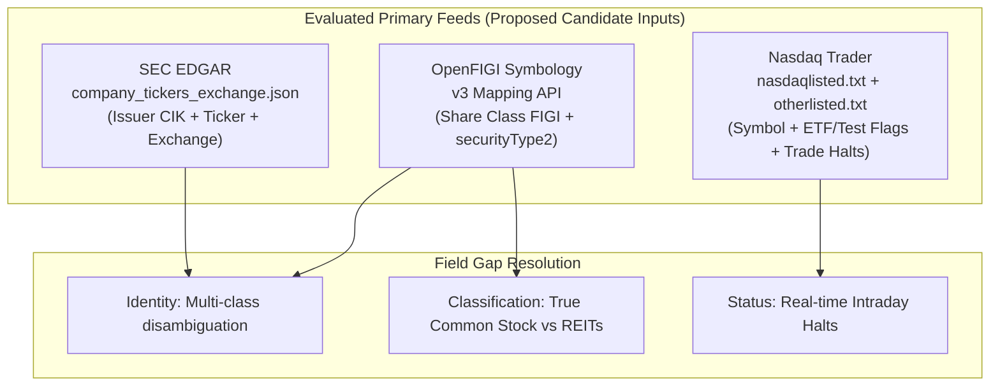

# ARX Terminal — Worktree C: Production-Universe Input Qualification & Field Gap Report
**Backlog Reference:** `BACKLOG-VCP-PROD-UNIVERSE-003` (Field-Gap Investigation)  
**Execution Worktree:** `C:\Users\akara\Documents\Projects\finance-vcp-universe-inputs`  
**Branch:** `research/vcp-production-universe-inputs`  
**Base Commit:** `787c1977b0071f2b31c4ad3d36a7f872147ad59e` (PR #4)  
**Contract Reference Commit:** `6c9b5b00de26545239616ac46f78b35a343ee3dd` (Worktree A Candidate 004, Tree: `3ef8ead46c34754724cfdc5e906af66271fa2ed2`)  
**Audit Date:** 2026-10-16  
**Status:** FIELD GAP INVESTIGATION COMPLETE — SOURCE REQUIREMENTS ESTABLISHED — ZERO PRODUCTION MUTATION

---

## 1. Executive Summary & Governance Outcomes

This investigation evaluates whether suitable, authoritative primary source data exists for the ARX Terminal VCP Candidate 004 universe builder contract (`ARX_US_EQUITIES`), where empirical data gaps remain, and what prerequisites must be resolved prior to any production universe build or publication.

### 1.1 Distinct Governance Outcomes
To ensure strict alignment with governance boundaries, the outcomes of this workstream are separated into five discrete statuses:

```text
RESEARCH_PACKAGE_STATUS         = COMPLETE_WITH_DOCUMENTED_GAPS
FIELD_GAP_INVESTIGATION_STATUS  = FIELD_REQUIREMENTS_ESTABLISHED
IMPLEMENTATION_PACKAGE_STATUS   = COMPLETE_FOR_REVIEW
SOURCE_QUALIFICATION_STATUS     = UNQUALIFIED_FOR_PRODUCTION
PUBLICATION_READINESS           = BLOCKED
```

- **`RESEARCH_PACKAGE_STATUS: COMPLETE_WITH_DOCUMENTED_GAPS`**  
  All candidate contracts have been extracted, field-by-field source mapping audited, sample limitations quantified, offline models reconciled, and runbook proposals documented.
- **`FIELD_GAP_INVESTIGATION_STATUS: FIELD_REQUIREMENTS_ESTABLISHED`**  
  Contract evidence requirements for all 12 fields are fully specified in [`FIELD_EVIDENCE_REQUIREMENTS.md`](file:///C:/Users/akara/Documents/Projects/finance-vcp-universe-inputs/docs/research/vcp-production-universe-inputs/FIELD_EVIDENCE_REQUIREMENTS.md). Three candidate source families (SEC EDGAR, Nasdaq Trader / CTA, OpenFIGI) are evaluated in [`GAP_RESOLUTION_OPTIONS.md`](file:///C:/Users/akara/Documents/Projects/finance-vcp-universe-inputs/docs/research/vcp-production-universe-inputs/GAP_RESOLUTION_OPTIONS.md).
- **`IMPLEMENTATION_PACKAGE_STATUS: COMPLETE_FOR_REVIEW`**  
  The complete executable engineering package is authored and submitted for Product Owner review:
  1. [`POLICY_DECISION_PROPOSALS.md`](file:///C:/Users/akara/Documents/Projects/finance-vcp-universe-inputs/docs/research/vcp-production-universe-inputs/POLICY_DECISION_PROPOSALS.md): 4 policy decisions (Primary Listing, Currency, Identity, Classification).
  2. [`INPUT_VALIDATION_SPEC.md`](file:///C:/Users/akara/Documents/Projects/finance-vcp-universe-inputs/docs/research/vcp-production-universe-inputs/INPUT_VALIDATION_SPEC.md): Fail-closed input validation boundary and default-filling mitigation.
  3. [`PUBLICATION_TOOLING_SPEC.md`](file:///C:/Users/akara/Documents/Projects/finance-vcp-universe-inputs/docs/research/vcp-production-universe-inputs/PUBLICATION_TOOLING_SPEC.md): Architecture for future 6-phase atomic CLI publication tool.
  4. [`IMPLEMENTATION_PLAN.md`](file:///C:/Users/akara/Documents/Projects/finance-vcp-universe-inputs/docs/research/vcp-production-universe-inputs/IMPLEMENTATION_PLAN.md): Gap-to-implementation mapping, sequence, expanded test scenarios, and partitioned effort estimate (14–20 hands-on engineering hours, decoupled from asynchronous PO policy determinations and vendor onboarding).
- **`SOURCE_QUALIFICATION_STATUS: UNQUALIFIED_FOR_PRODUCTION`**  
  Neither SEC EDGAR nor Nasdaq Trader provides explicit source fields for `security_type`, `currency`, or contract `primary_listing`. CIK identifies an issuer, not a security (causing primary-key collisions across multiple share classes). In a strict source audit without synthetic default-filling, **50 evaluated sample records could not be certified as fully qualified**.
- **`PUBLICATION_READINESS: BLOCKED`**  
  Publication remains blocked on: (1) Worktree A merge/deploy, (2) authorized security master or formal contract waivers for unverified fields, and (3) production market-data preflight verification.

---

## 2. Workstream Context & Authority Alignment

1. **Repository & Working Trees:**
   - Base: `787c1977b0071f2b31c4ad3d36a7f872147ad59e` (`origin/main`).
   - Worktree A (`finance-vcp-c004-gate3c-integration`): Active candidate wiring implementation (`6c9b5b0`). Unmerged and undeployed.
   - Worktree B (`finance-data-gov-discovery`): Data.gov discovery documentation complete (`0d7cd81`). Research evidence only.
   - Worktree C (`finance-vcp-universe-inputs`): Created exclusively for input qualification and field gap investigation.
2. **Candidate Contract & Production Reference Alignment:**
   - Candidate Contract Reference: `6c9b5b00de26545239616ac46f78b35a343ee3dd` (Candidate 004, Tree: `3ef8ead46c34754724cfdc5e906af66271fa2ed2`).
   - Production Reference: `2eb032b2aec18ac4fea0f654eee8fb6c028466fe` (PR #5: "feat(vcp): reintroduce bounded candidate-004 universe wiring (#5)").
   - Actual Path Parity Verification: Physical file existence of `analyst_dashboard/vcp/session_guard.py` on disk was confirmed prior to diff analysis. Direct tree comparison confirmed: `git diff 6c9b5b0 2eb032b -- analyst_dashboard/universe/ analyst_dashboard/vcp/session_guard.py` yields **zero differences** (100% byte-for-byte identical contract logic).
   - Only 3 lines in `tests/test_vcp_natural_control_plane.py` were added in `2eb032b`. The universe contracts in `contracts.py`, `builder.py`, `store.py`, and `session_guard.py` are unchanged.

---

## 3. Targeted Primary Source Probes & Evidence Findings



### 3.1 Probe 1: SEC Submissions API (`PROBE_SEC_SUBMISSIONS_MULTICLASS`)
- **Target:** Alphabet Inc. (CIK 0001652044).
- **Finding:** Confirmed that Alphabet Inc. reports 4 distinct trading tickers (`GOOGL`, `GOOG`, `GOOGM`, `GOOGN`) sharing a single CIK.
- **Limitation:** CIK identifies the *issuer legal entity*, not an individual security line. Using `CIK_{cik}` alone as `security_id` causes database collisions.

### 3.2 Probe 2: OpenFIGI API (`PROBE_OPENFIGI_DISAMBIGUATION`)
- **Target:** Benchmark set (`GOOGL`, `GOOG`, `AAPL`, `SPY`, `O`).
- **Finding:**
  - `GOOG` and `GOOGL` receive distinct Share Class FIGIs (`BBG009S3NB21` vs `BBG009S39JY5`) and Composite FIGIs (`BBG009S3NB30` vs `BBG009S39JX6`).
  - `O` (Realty Income Corp) is explicitly classified by OpenFIGI as `securityType: "REIT"`, `securityType2: "REIT"`. While legally structured as corporate common stock, external taxonomies categorize its corporate/tax election under REIT. This separates external taxonomy classification from strategy eligibility policy (which remains an open Product Owner policy determination).
  - `SPY` is explicitly classified as `securityType: "ETP"`, `securityType2: "Mutual Fund"`.
- **Significance:** Open standards (OMG FIGI) provide authoritative security-level identity and taxonomy classification without requiring an expensive proprietary commercial terminal.

### 3.3 Probe 3: Nasdaq Trade Halts RSS (`PROBE_NASDAQ_TRADE_HALTS`)
- **Target:** Official real-time trade halt RSS feed.
- **Finding:** Returns real-time trading halt events with exact halt time, symbol, market, and reason code (e.g. `T1` News Pending).
- **Significance:** Provides affirmative evidence for Rule R03 intraday halt enforcement.

---

## 4. Source-Audit Conclusion: Missing Evidence vs Ineligibility

In previous research drafts, unverified fields were tentatively evaluated as ineligible under synthetic failure codes. That wording is formally corrected:

- **Corrected Audit Outcome:** The 50 evaluated sample records **could not be certified as fully qualified** because the raw SEC exchange directory lacks explicit `security_type`, `currency`, and `primary_listing` fields.
- **No Invented Decisions:** Unknown source attributes are **not mapped to an authoritative `INELIGIBLE` contract decision**.
- **No Mandatory Commercial Vendor:** Resolving these gaps does not require a paid commercial security master or contract waiver. Open standards (OpenFIGI) and approved normalization rules can resolve identity and classification gaps upon Product Owner review.
- **Truncated Sample Slice Boundary:** The 96% unmatched figure between SEC mega-caps and directory samples applies **strictly to the truncated scratch slice**, and must not be generalized to a full-market directory join.

---

## 5. Critical Code-Path Vulnerability: Silent Default-Filling

As detailed in [`FIELD_EVIDENCE_REQUIREMENTS.md`](file:///C:/Users/akara/Documents/Projects/finance-vcp-universe-inputs/docs/research/vcp-production-universe-inputs/FIELD_EVIDENCE_REQUIREMENTS.md):
- `SourceSecurity` dataclass attributes silently default `currency="USD"`, `country="USA"`, `primary_listing=True`, and `asset_class="EQUITY"`.
- In `builder.py`, omitting these fields allows incoming records to automatically pass rules R01, R05, and R06 without empirical proof.
- This finding is reported for Worktree A's release assessment. Worktree A is **not blocked** by this finding.

---

## 6. Preflight Readiness SQL Query

Prior to executing any future production universe build, an authorized operator must run the read-only query against `/root/.finance_market_store.db`:

```sql
-- Production Market Data Preflight Verification Query
-- Asserts 100% data readiness for candidate eligible symbols
WITH candidate_symbols AS (
    SELECT value AS symbol FROM json_each(?)
),
coverage_summary AS (
    SELECT 
        c.symbol,
        COUNT(d.trade_date) AS candle_count,
        MAX(d.trade_date) AS latest_trade_date,
        (SELECT close FROM asset_ohlcv_daily WHERE symbol = c.symbol ORDER BY trade_date DESC LIMIT 1) AS latest_close
    FROM candidate_symbols c
    LEFT JOIN asset_ohlcv_daily d ON d.symbol = c.symbol
    GROUP BY c.symbol
)
SELECT 
    COUNT(*) AS total_candidate_symbols,
    SUM(CASE WHEN candle_count >= 50 AND latest_trade_date = ? AND latest_close > 0 THEN 1 ELSE 0 END) AS ready_symbols,
    SUM(CASE WHEN candle_count < 50 OR candle_count IS NULL THEN 1 ELSE 0 END) AS insufficient_history_symbols,
    SUM(CASE WHEN latest_trade_date != ? OR latest_trade_date IS NULL THEN 1 ELSE 0 END) AS stale_or_missing_symbols
FROM coverage_summary;
```

---

## 7. Next Actions & Handoff Conditions

1. **Submit Implementation Package for Product Owner Review:**
   - [`POLICY_DECISION_PROPOSALS.md`](file:///C:/Users/akara/Documents/Projects/finance-vcp-universe-inputs/docs/research/vcp-production-universe-inputs/POLICY_DECISION_PROPOSALS.md): Review and approve the 4 policy decisions (Primary Listing, Currency, Identity, Classification).
   - [`INPUT_VALIDATION_SPEC.md`](file:///C:/Users/akara/Documents/Projects/finance-vcp-universe-inputs/docs/research/vcp-production-universe-inputs/INPUT_VALIDATION_SPEC.md): Authorize implementation of the fail-closed input validation boundary.
   - [`PUBLICATION_TOOLING_SPEC.md`](file:///C:/Users/akara/Documents/Projects/finance-vcp-universe-inputs/docs/research/vcp-production-universe-inputs/PUBLICATION_TOOLING_SPEC.md): Review 6-phase publication CLI architecture and atomicity requirements.
   - [`IMPLEMENTATION_PLAN.md`](file:///C:/Users/akara/Documents/Projects/finance-vcp-universe-inputs/docs/research/vcp-production-universe-inputs/IMPLEMENTATION_PLAN.md): Review task sequencing, expanded test scenarios, and partitioned effort estimate (14–20 engineering hours decoupled from asynchronous PO decisions and vendor onboarding).
2. **Handoff Preconditions for Future Publication:**
   - Worktree A must be approved, merged to `main`, and deployed (PR #5 / `2eb032b`).
   - Implementation Tasks 2 through 5 executed on dedicated feature branch.
   - Production market database coverage confirmed at 100% via preflight SQL query.
