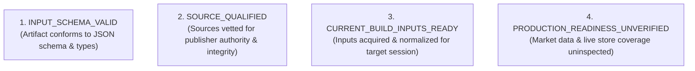

# ARX Terminal — Proposed Universe Input Specification (Candidate Model)
**Backlog Reference:** `BACKLOG-VCP-PROD-UNIVERSE-003` (Research Specification)  
**Target Universe:** `ARX_US_EQUITIES` (`arx-universe-v1.0`)  
**Proposed Eligibility Rule Version:** `eligibility-rule-v1.0`  
**Proposed Normalization Version:** `norm-v1.0`  
**Execution Worktree:** `C:\Users\akara\Documents\Projects\finance-vcp-universe-inputs`  
**Status:** PROPOSED RESEARCH SPECIFICATION — NOT AN APPROVED PRODUCTION CONTRACT

---

## 1. Governance State Classification

To prevent false claims of production readiness, this specification distinguishes four discrete qualification levels:



> [!IMPORTANT]
> **Boundary Invariance:**
> `INPUT_SCHEMA_VALID` does **not** imply `SOURCE_QUALIFIED`.  
> `SOURCE_QUALIFIED` does **not** imply `CURRENT_BUILD_INPUTS_READY`.  
> `CURRENT_BUILD_INPUTS_READY` does **not** imply `PRODUCTION_READINESS_UNVERIFIED` has been cleared.  
> As established by this investigation, current public directory feeds are **UNQUALIFIED FOR PRODUCTION** without an authoritative security master or contract waivers for missing source attributes.

---

## 2. Proposed Acquisition Protocol & Source Metadata

### 2.1 Feed 1: SEC EDGAR Exchange Master (Proposed Input)
- **Endpoint:** `https://www.sec.gov/files/company_tickers_exchange.json`
- **Transport:** HTTPS GET with custom `User-Agent`.
- **Mandatory Header:** `User-Agent: ARXTerminalResearch/1.0 (research@arx-terminal.local)`
- **Rate Limit Floor:** Maximum 10 requests per second (SEC fair access policy).
- **Format:** JSON with top-level keys `fields: ['cik', 'name', 'ticker', 'exchange']` and `data: List[List[Any]]`.
- **Known Limitations:**
  - CIK identifies the *issuer entity*, not a unique security. Multiple listings for one CIK (e.g. `GOOG` and `GOOGL`) collide if CIK alone is used as `security_id`.
  - Lacks `security_type`, `currency`, `primary_listing`, and `listing_status`.
  - Unauthenticated endpoint; download SHA-256 only hashes local file bytes, not an authoritative publisher signature.

### 2.2 Feed 2: Nasdaq Trader Symbol Directory — NASDAQ Listed (Proposed Input)
- **Endpoint:** `http://www.nasdaqtrader.com/dynamic/SymDir/nasdaqlisted.txt`
- **Transport:** Unencrypted HTTP GET (`http://`).
- **Cadence:** Regenerated daily at ~03:00 ET prior to market open.
- **Format:** Pipe-delimited text (`|`).
- **Header:** `Symbol|Security Name|Market Category|Test Issue|Financial Status|Round Lot Size|ETF|NextShares`
- **Footer:** `File Creation Time: MMDDYYYYHH:MM|||||||`
- **Known Limitations:**
  - Snapshot only; drops delistings overnight without historical `delisting_date`.
  - Financial Status reflects morning state, not real-time intraday suspensions.
  - Unencrypted transport subject to in-flight tampering. Usage rights and redistribution terms are unreviewed.

### 2.3 Feed 3: Nasdaq Trader Symbol Directory — Other Listed (Proposed Input)
- **Endpoint:** `http://www.nasdaqtrader.com/dynamic/SymDir/otherlisted.txt`
- **Transport:** Unencrypted HTTP GET (`http://`).
- **Cadence:** Regenerated daily at ~03:00 ET.
- **Format:** Pipe-delimited text (`|`).
- **Header:** `ACT Symbol|Security Name|Exchange|CQS Symbol|ETF|Round Lot Size|Test Issue|NASDAQ Symbol`
- **Exchange Code Mapping:**
  - `N` $\rightarrow$ `NYSE`
  - `P` $\rightarrow$ `ARCA`
  - `Z` $\rightarrow$ `BATS`
  - `A` $\rightarrow$ `AMEX` (NYSE American)
  - `V` $\rightarrow$ `IEX` (Excluded by R04)
- **Known Limitations:** Same snapshot, transport, and usage-rights limitations as Feed 2.

---

## 3. Proposed Candidate Normalization & Disambiguation Model

> [!WARNING]
> **Heuristic Classification Disclaimer:**
> The code below represents an **unvalidated candidate normalization model**, not an authoritative implementation.
> Filtering by `ETF == 'N'`, `Test Issue == 'N'`, and name regex does **not** prove that an issue is legal Common Stock.
> Fields not present in the raw source (such as `currency` and `primary_listing`) are explicitly flagged as unverified.

```python
# Illustrative Candidate Normalization Model
def normalize_candidate_record(
    cik: Any,
    ticker: str,
    name: str,
    raw_exchange: str,
    is_etf: bool,
    is_test: bool,
    has_directory_match: bool,
) -> Dict[str, Any]:
    # 1. Exchange Normalization
    exch_map = {
        "NASDAQ": "NASDAQ", "N": "NYSE", "NYSE": "NYSE",
        "P": "ARCA", "ARCA": "ARCA", "Z": "BATS", "BATS": "BATS",
        "A": "AMEX", "OTC": "OTC"
    }
    norm_exchange = exch_map.get((raw_exchange or "").strip().upper(), "UNKNOWN")
    
    # 2. Security Subtype Disambiguation (Unvalidated Candidate Classifier)
    clean_name = (name or "").strip()
    if not has_directory_match:
        # Without directory cross-reference, subtype is completely unverified
        sec_type = "UNKNOWN"
    elif is_etf:
        sec_type = "ETF"
    elif is_test:
        sec_type = "TEST_ISSUE"
    elif re.search(r"\b(Preferred|Pref|Pfd|Pr)\b", clean_name, re.I):
        sec_type = "PREFERRED_STOCK"
    elif re.search(r"\b(Warrant|Wts|Wt)\b", clean_name, re.I):
        sec_type = "WARRANT"
    elif re.search(r"\b(Unit|Units)\b", clean_name, re.I):
        sec_type = "UNIT"
    elif re.search(r"\b(Depositary|ADR|ADS)\b", clean_name, re.I):
        sec_type = "ADR"
    elif re.search(r"\b(Right|Rights)\b", clean_name, re.I):
        sec_type = "RIGHT"
    else:
        # Unvalidated heuristic assumption
        sec_type = "CANDIDATE_COMMON_STOCK"

    # 3. Security ID Resolution Note
    # CIK identifies issuer entity. In production, compound key CIK_{cik}_{symbol}
    # or true security master ID (e.g. FIGI) is required to prevent collisions.
    sec_id = f"CIK_{int(cik):010d}" if cik else "UNKNOWN"

    return {
        "security_id": sec_id,
        "symbol": (ticker or "").strip().upper(),
        "exchange": norm_exchange,
        "security_type": sec_type,
        "listing_status": "MORNING_ACTIVE",
        "currency": "UNVERIFIED",        # Absent in primary source feeds
        "country": "USA",
        "primary_listing": False,         # Unverified in primary source feeds
        "asset_class": "EQUITY",
        "listing_date": None,
        "delisting_date": None,
        "trading_suspension_date": None
    }
```

---

## 4. Input Schema & Accounting Constraints

### 4.1 Schema Definition: `SourcePopulationSnapshot`
```json
{
  "$schema": "http://json-schema.org/draft-07/schema#",
  "title": "SourcePopulationSnapshot",
  "type": "object",
  "required": ["snapshot_id", "source_authority", "as_of", "count", "source_hash", "securities"],
  "properties": {
    "snapshot_id": { "type": "string" },
    "source_authority": { "type": "string" },
    "as_of": { "type": "string", "format": "date-time" },
    "count": { "type": "integer", "minimum": 1 },
    "source_hash": { "type": "string", "pattern": "^[a-f0-9]{64}$" },
    "securities": {
      "type": "array",
      "items": {
        "type": "object",
        "required": [
          "security_id", "symbol", "exchange", "security_type",
          "listing_status", "currency", "country", "primary_listing", "asset_class"
        ],
        "properties": {
          "security_id": { "type": "string" },
          "symbol": { "type": "string" },
          "exchange": { "type": "string" },
          "security_type": { "type": "string" },
          "listing_status": { "type": "string" },
          "currency": { "type": "string" },
          "country": { "type": "string" },
          "primary_listing": { "type": "boolean" },
          "asset_class": { "type": "string" },
          "listing_date": { "type": ["string", "null"] },
          "delisting_date": { "type": ["string", "null"] },
          "trading_suspension_date": { "type": ["string", "null"] }
        }
      }
    }
  }
}
```

### 4.2 Accounting Invariants
Before submitting a snapshot to `DeterministicUniverseBuilder.build_universe()`, the pipeline must assert:
1. **Uniqueness:** All `security_id` entries are distinct within the snapshot (requires Listing-Level Instrument Identity; Phase 1 compound CIK+symbol bridging or Phase 2 Composite FIGI).
2. **Deterministic Hashing:** `source_hash == compute_sha256([s.to_dict() for s in securities])`.
3. **Count Equality:** `count == len(securities)`.
4. **No Synthetic Fallbacks:** No mocked, synthetic, or placeholder symbols permitted in production builds.

---

## 5. Proposed Artifact Layout & Storage Architecture

If authorized for future implementation, production universe input artifacts are proposed to be organized under:

```text
/data/universe/ (Proposed Volume Storage)
├── snapshots/
│   └── YYYY-MM-DD/
│       ├── sec_company_tickers_exchange_raw.json
│       ├── nasdaqlisted_raw.txt
│       ├── otherlisted_raw.txt
│       ├── source_population_snapshot.json
│       └── source_population_snapshot.json.sha256
└── stores/
    └── .finance_universe_store.db  (WAL mode, immutable SQLite triggers)
```

- **Large Datasets Excluded from Git:** Raw feeds and full population JSON files (>500KB) must **never** be committed to the Git repository. They belong exclusively in local or Railway persistent volume storage.
