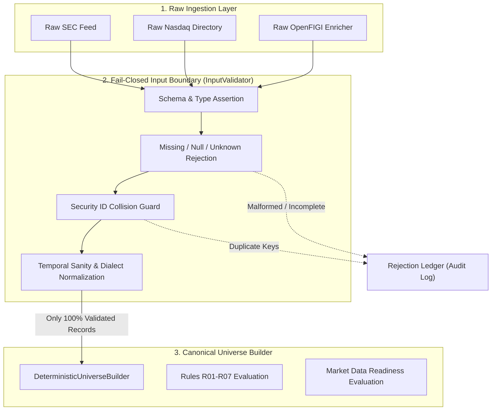
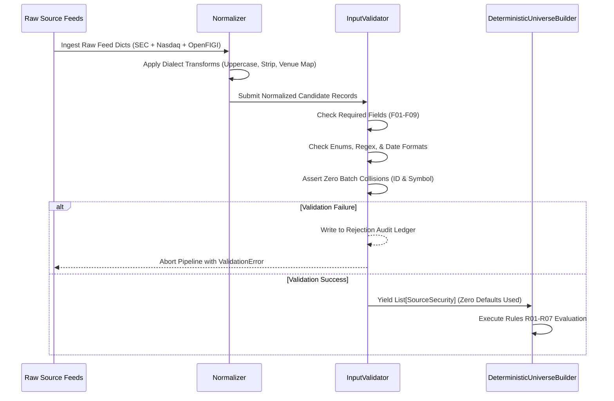

# ARX Terminal — Fail-Closed Input Validation Specification
**Backlog Reference:** `BACKLOG-VCP-PROD-UNIVERSE-003` (Implementation Package)  
**Execution Worktree:** `C:\Users\akara\Documents\Projects\finance-vcp-universe-inputs`  
**Branch:** `research/vcp-production-universe-inputs`  
**Base Commit:** `787c1977b0071f2b31c4ad3d36a7f872147ad59e` (PR #4)  
**Contract Reference Commit:** `6c9b5b00de26545239616ac46f78b35a343ee3dd` (Candidate 004 / PR #5, Tree: `3ef8ead46c34754724cfdc5e906af66271fa2ed2`)  
**Status:** SPECIFICATION COMPLETE — READY FOR IMPLEMENTATION PLANNING  

---

## 1. Executive Summary & Boundary Placement

### 1.1 The Vulnerability: Silent Default-Filling
In Candidate 004 (`contracts.py#L115-L127`), the `SourceSecurity` dataclass defines default values for critical governance fields:
```python
@dataclass
class SourceSecurity:
    security_id: str
    symbol: str
    exchange: str
    security_type: str
    listing_status: str
    currency: str = "USD"               # SILENT DEFAULT
    country: str = "USA"                # SILENT DEFAULT
    primary_listing: bool = True        # SILENT DEFAULT
    asset_class: str = "EQUITY"         # SILENT DEFAULT
    delisting_date: Optional[str] = None
    trading_suspension_date: Optional[str] = None
    listing_date: Optional[str] = None
```
When raw records from external feeds are instantiated into `SourceSecurity` objects without pre-validation, records omitting `currency`, `country`, `primary_listing`, or `asset_class` silently inherit passing values. In `builder.py#L77-L115`, these unverified records automatically satisfy rules `R01_ASSET_CLASS`, `R05_CURRENCY`, and `R06_PRIMARY_LISTING`, bypassing governance evaluation.

### 1.2 The Solution: Fail-Closed Input Boundary
This specification establishes a **fail-closed input validation boundary** (`InputValidator`) situated immediately upstream of `DeterministicUniverseBuilder`:



No raw dictionary or unvalidated payload may be passed to `DeterministicUniverseBuilder`. Every incoming record must be validated, type-asserted, and converted into an explicit `ValidatedSecurityPayload` before constructing `SourceSecurity`.

---

## 2. Field-by-Field Specification & Validation Rules

| # | Field Name | Canonical Type | Nullable? | Permitted Values / Pattern | Normalization Rule | Failure Behavior |
| :--- | :--- | :--- | :--- | :--- | :--- | :--- |
| **F01** | `security_id` | `str` | **NO** | `^[A-Za-z0-9._-]+$` (Length 3–64) | Strip whitespace. Requires **Listing-Level Granularity**. Phase 1 bridging: format `CIK_{cik:010d}_{symbol}` (single-session surrogate; cannot resolve ticker changes/reuse). Phase 2: OpenFIGI **Composite/Listing FIGI**. | Fail closed: `REJECT_MISSING_OR_INVALID_SECURITY_ID` |
| **F02** | `symbol` | `str` | **NO** | `^[A-Z0-9.-]+$` (Length 1–16) | Uppercase; strip whitespace; normalize exchange tape punctuation (e.g., replace `/` with `.`). | Fail closed: `REJECT_INVALID_SYMBOL` |
| **F03** | `exchange` | `str` | **NO** | `{"NASDAQ", "NYSE", "ARCA", "BATS", "AMEX", "OTC"}` | Map raw venue codes (e.g. `N` $\rightarrow$ `NYSE`, `P` $\rightarrow$ `ARCA`, `Z` $\rightarrow$ `BATS`, `A` $\rightarrow$ `AMEX`). | Fail closed: `REJECT_UNKNOWN_EXCHANGE` |
| **F04** | `security_type` | `str` | **NO** | `{"COMMON_STOCK", "ETF", "PREFERRED_STOCK", "WARRANT", "UNIT", "ADR", "REIT", "CEF", "OTHER"}` | Uppercase; derive from OpenFIGI `securityType2` (map `"Common Stock"` $\rightarrow$ `"COMMON_STOCK"`). Separates external classification taxonomy from strategy eligibility (PO determines REIT/BDC eligibility). | Fail closed: `REJECT_UNMAPPED_SECURITY_TYPE` |
| **F05** | `listing_status` | `str` | **NO** | `{"ACTIVE", "SUSPENDED", "DELISTED", "INACTIVE"}` | Uppercase; derive from morning directory presence and trade halt register. | Fail closed: `REJECT_INVALID_LISTING_STATUS` |
| **F06** | `currency` | `str` | **NO** | ISO 4217: `{"USD"}` (for US equity universe) | Uppercase. Derived under Codified Venue Rulebook Convention for qualified US exchanges within defined scope. Positive pricing is strictly rejected as currency evidence. | Fail closed: `REJECT_INVALID_CURRENCY` |
| **F07** | `country` | `str` | **NO** | ISO 3166-1 alpha-3: `^[A-Z]{3}$` (e.g. `USA`, `CAN`, `GBR`) | Uppercase. Must be populated from SEC registrant country or security master. | Fail closed: `REJECT_MISSING_COUNTRY` |
| **F08** | `primary_listing` | `bool` | **NO** | `{True, False}` | Boolean coercion strictly prohibited. Semantics remain **`UNRESOLVED`** pending PO determination; allowed-exchange membership alone does not resolve secondary/cross-listing. | Fail closed: `REJECT_INVALID_PRIMARY_LISTING` |
| **F09** | `asset_class` | `str` | **NO** | `{"EQUITY", "ETF", "DEBT", "COMMODITY", "DERIVATIVE"}` | Uppercase. Explicit taxonomy assignment; prohibited from defaulting. | Fail closed: `REJECT_MISSING_ASSET_CLASS` |
| **F10** | `listing_date` | `Optional[str]` | **YES** | `^\\d{4}-\\d{2}-\\d{2}$` or `None` | Assert valid Gregorian date string $\le$ `target_session_date`. | Fail closed: `REJECT_MALFORMED_DATE` |
| **F11** | `delisting_date` | `Optional[str]` | **YES** | `^\\d{4}-\\d{2}-\\d{2}$` or `None` | Assert valid Gregorian date string. If present, assert `delisting_date > listing_date`. | Fail closed: `REJECT_MALFORMED_DATE` |
| **F12** | `trading_suspension_date`| `Optional[str]` | **YES** | `^\\d{4}-\\d{2}-\\d{2}$` or `None` | Assert valid Gregorian date string. | Fail closed: `REJECT_MALFORMED_DATE` |

---

## 3. Semantic Handling: Missing vs Null vs Unknown

To prevent data corruption, the validation layer enforces precise semantic distinctions across missing keys, null values, and unmapped tokens:

### 3.1 Missing Attributes (`MISSING`)
- **Definition:** The required attribute key does not exist in the raw source dictionary.
- **Handling:** **Immediate rejection**. The validator does NOT substitute default values.
- **Error Code:** `VALIDATION_ERROR_MISSING_FIELD` (includes field name and source record identifier).

### 3.2 Null Attributes (`NULL`)
- **Definition:** The key exists, but its value is `None`, `null`, `""` (empty string), or whitespace.
- **Mandatory Fields (F01–F09):** **Immediate rejection**. Nulls are strictly forbidden. Error code: `VALIDATION_ERROR_NULL_NOT_PERMITTED`.
- **Optional Fields (F10–F12):** Normalized to Python `None`.

### 3.3 Unknown / Unmapped Attributes (`UNKNOWN`)
- **Definition:** The attribute value is non-null, but does not match any token in the allowed canonical vocabulary (e.g., exchange code `XYZ`, security type `STRUCTURED_EQUITY_NOTE`, currency `EUR`).
- **Handling:** **Immediate rejection**. Unrecognized values are never coerced to a default category.
- **Error Code:** `VALIDATION_ERROR_UNRECOGNIZED_ENUM_VALUE`.

---

## 4. Temporal Evidence Requirements & Lookahead Prevention

The validator enforces rigorous temporal evidence requirements to protect against lookahead bias and survivorship distortion, without imposing unsupported convenience constraints:

1. **Point-in-Time Anti-Lookahead Assertion:**
   - Every input payload must include a root metadata header recording the source publication timestamp: `source_published_at: "YYYY-MM-DDTHH:MM:SSZ"`.
   - The validator asserts that the source snapshot was published prior to the target session trading cutoff:
     $$\text{source\_published\_at} \le \text{session\_cutoff\_timestamp}$$
   - Any payload published after the session cutoff leaks future market-structure information and is immediately rejected with `LOOKAHEAD_VIOLATION_FUTURE_SNAPSHOT`.

2. **Effective Window Assertions on Target Date:**
   - **Listing Date:** If `listing_date` is present in the record:
     $$\text{listing\_date} \le \text{target\_session\_date}$$
     Future listing dates trigger `LOOKAHEAD_VIOLATION_FUTURE_LISTING`.
   - **Delisting Date:** If `delisting_date` is present:
     If $\text{delisting\_date} \le \text{target\_session\_date}$, `listing_status` must NOT be `ACTIVE`. An active status for a delisted security triggers `CONTRADICTORY_TEMPORAL_STATUS`.
   - **Trading Suspensions:** If `trading_suspension_date` is present and $\le \text{target\_session\_date}$, `listing_status` must reflect `SUSPENDED` or `INACTIVE`.

3. **Source Freshness Cadence (PO Policy Decision):**
   - Security master directories and exchange listing files are published on varied cadences (T-1 nightly, weekly, or periodic batches).
   - An artificial constraint requiring `source_population_as_of == target_session_date` is **strictly rejected as unsupported by operational source realities**.
   - The maximum allowable directory lag ($\Delta t_{\text{max}}$, e.g. $\le 24$ hours for exchange directories, $\le 7$ days for CIK entity maps) is submitted to the Product Owner as an explicit policy decision. The validator asserts:
     $$\text{target\_session\_date} - \text{source\_as\_of\_date} \le \Delta t_{\text{max}}$$
     Exceeding $\Delta t_{\text{max}}$ raises `STALE_SOURCE_POPULATION`.

---

## 5. Security Identity Collision Assertion

A critical vulnerability identified in SEC feeds is that multiple share classes share a single issuer CIK. The validator enforces global batch-level identity uniqueness:

```python
def assert_no_identity_collisions(records: List[ValidatedSecurityPayload]) -> None:
    seen_ids = set()
    seen_symbols = set()
    for r in records:
        if r.security_id in seen_ids:
            raise ValidationError(
                f"SECURITY_ID_COLLISION: Duplicate security_id '{r.security_id}' detected."
            )
        seen_ids.add(r.security_id)
        
        # Primary listing venue symbols must also be unique per target session
        if r.symbol in seen_symbols:
            raise ValidationError(
                f"SYMBOL_COLLISION: Duplicate trading symbol '{r.symbol}' detected in batch."
            )
        seen_symbols.add(r.symbol)
```

If duplicate security keys or duplicate trading symbols exist in the input batch, the **entire batch is rejected** with `BATCH_COLLISION_DETECTED`. No silent deduplication or last-write-wins is permitted.

---

## 6. Normalization & Transformation Pipeline

The validation layer executes in four sequential, isolated pipeline stages:



### 6.1 Audit Ledger Requirements
Every rejected record is persisted to a structured rejection log (`universe_input_rejections.jsonl`) with:
- `timestamp_utc`: ISO 8601 UTC timestamp.
- `raw_identifier`: Raw symbol or row index.
- `rejected_field`: Name of the failing attribute.
- `error_code`: Specific failure code (e.g. `REJECT_MISSING_COUNTRY`).
- `raw_payload_snippet`: Truncated, sanitized snippet of the raw payload for auditability.
