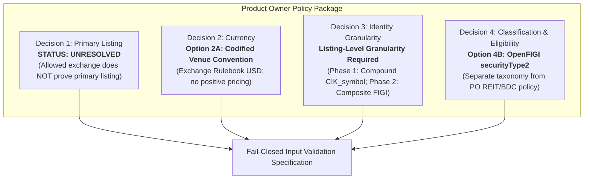

# ARX Terminal — Production-Universe Policy Decision Proposals
**Backlog Reference:** `BACKLOG-VCP-PROD-UNIVERSE-003` (Implementation Package)  
**Execution Worktree:** `C:\Users\akara\Documents\Projects\finance-vcp-universe-inputs`  
**Branch:** `research/vcp-production-universe-inputs`  
**Base Commit:** `787c1977b0071f2b31c4ad3d36a7f872147ad59e` (PR #4)  
**Contract Reference Commit:** `6c9b5b00de26545239616ac46f78b35a343ee3dd` (Candidate 004 / PR #5, Tree: `3ef8ead46c34754724cfdc5e906af66271fa2ed2`)  
**Status:** PROPOSALS FORMULATED — REQUIRING PRODUCT OWNER POLICY DETERMINATION  

---

## 1. Purpose & Context

Technical inspection of candidate source feeds (SEC EDGAR, Nasdaq Trader / CTA, OpenFIGI) in Worktree C established that four fundamental contract requirements cannot be resolved by code inspection alone:
1. **Primary Listing Semantics** (`Rule R06_PRIMARY_LISTING`)
2. **Trading Currency Verification Standard** (`Rule R05_CURRENCY`)
3. **Security-Level Identity & Multi-Class Disambiguation** (`Rule R00_CRITICAL_IDENTITY`)
4. **Instrument Classification & Common Stock Isolation** (`Rule R02_SECURITY_TYPE`)

Rather than encoding speculative assumptions into application code or relying on dataclass default values, this document formalizes the decision space into four structured proposals. Each proposal presents:
- The exact contract rule and observed ambiguity.
- Concrete alternative policy choices.
- Tradeoffs (operational complexity, market coverage, failure risk).
- An explicit, evidence-backed recommendation tagged `PROPOSED_FOR_PO_REVIEW`.

---

## 2. Policy Decision 1: Primary Listing Semantics (Rule R06)

### 2.1 The Issue
`contracts.py#L86-L90` defines:
```python
EligibilityRule(
    rule_id="R06_PRIMARY_LISTING",
    name="Primary Listing Requirement",
    description="Must be primary listing, not secondary or cross-listing",
    evaluator=lambda s: s.primary_listing is True,
)
```
In `contracts.py#L124`, `SourceSecurity` defines `primary_listing: bool = True` as a default. However, free raw exchange directories (`company_tickers_exchange.json`, `nasdaqlisted.txt`, `otherlisted.txt`) contain no boolean `primary_listing` column. 

The phrase "primary listing" has three conflicting interpretations in market microstructure:
1. **Venue Listing Authority:** The national securities exchange that acts as the primary listing venue (Network A, B, or C) where the security is registered under Section 12(b) of the Exchange Act, as opposed to regional exchanges trading under Unlisted Trading Privileges (UTP).
2. **Global Primary Market:** The security's primary worldwide quotation venue, excluding foreign dual-listed equities or cross-listings (e.g. Canadian or European issuers whose primary liquid market is TSX or LSE, but maintain a secondary listing on NASDAQ).
3. **Share-Class Seniority:** The issuer's primary equity line, excluding secondary voting classes, non-voting lines, or restricted classes (e.g., Alphabet Class A `GOOGL` vs Class C `GOOG`).

### 2.2 Policy Alternatives

| Dimension | Option 1A: Venue Directory Proxy | Option 1B: Global Primary Market (MIC) | Option 1C: Primary Share Class Only |
| :--- | :--- | :--- | :--- |
| **Definition** | Any security present in NASDAQ, NYSE, ARCA, or BATS exchange directory is tentatively designated `primary_listing = True`. | Only issuers whose global primary listing venue (operating MIC) or home country is in the US are designated `primary_listing = True`. | Only the primary voting common share class for each issuer is designated `primary_listing = True`. |
| **Evidence Required** | Presence in exchange directory (`nasdaqlisted.txt` or `otherlisted.txt`). | ISO 10383 Market Identifier Code (MIC), SEC Form 10-K vs 20-F/40-F status, or global volume analysis. | Share-class seniority lookup, voting-rights register, or security master ranking. |
| **Coverage Impact** | Standard US exchange directory (~4,500 active tickers). | Excludes foreign cross-listings and interlisted shares (~300–500 tickers). | Excludes secondary share classes (e.g. excludes `GOOG`, `BRK.B`, `FOX`). |
| **Microstructure Tradeoff** | **Blind Spot:** Allowed-exchange membership alone does NOT resolve secondary/cross-listing status. Interlisted Canadian equities (e.g. TSX primary) appear indistinguishable from domestic US primaries. | Accurately isolates US primary markets; requires external MIC or SEC registration data. | Arbitrarily eliminates liquid, tradeable market leaders like `GOOG` or `BRK.B`. |

### 2.3 Status: UNRESOLVED (Requiring Product Owner Policy Determination)
> **`STATUS: UNRESOLVED — REQUIRING PRODUCT OWNER POLICY DETERMINATION`**  
> 1. **Semantic Ambiguity:** Existing technical authority does not establish the intended business meaning of `primary_listing`. Allowed-exchange membership alone does **not** resolve secondary or cross-listing status.
> 2. **Operational Proxy Limitations:** Option 1A is an operational convenience proxy, not a source-grounded determination of primary vs cross-listing status. It cannot detect foreign dual-listed equities (such as Canadian interlisted issues trading on NYSE while TSX serves as the primary listing market).
> 3. **Open Policy Decision:** The Product Owner must formally determine whether:
>    - **Choice A (Broad Venue Proxy):** Accept venue directory presence on NASDAQ/NYSE/ARCA/BATS as satisfying R06, accepting that secondary/cross-listings are governed by other filters (e.g. country, ADR exclusion).
>    - **Choice B (Strict Primary Market):** Require external Market Identifier Code (MIC) or regulatory filing data to exclude secondary cross-listings where the US venue is secondary to an international primary exchange.
>    - **Choice C (Contract Waiver / Rule Retirement):** Retire or waive Rule R06 if VCP technical pattern validity does not depend on primary listing status.
>
> Until a binding determination is made by the Product Owner, primary-listing semantics remain **`UNRESOLVED`**. Neither implementation code nor input validators may assume Option 1A as established policy.

---

## 3. Policy Decision 2: Trading Currency Verification Standard (Rule R05)

### 3.1 The Issue
`contracts.py#L81-L85` defines:
```python
EligibilityRule(
    rule_id="R05_CURRENCY",
    name="USD Currency",
    description="Trading currency must be USD",
    evaluator=lambda s: s.currency == "USD",
)
```
In `contracts.py#L122`, `SourceSecurity` defines `currency: str = "USD"` as a default. However, neither SEC EDGAR directory files nor Nasdaq Trader directory files contain a `currency` column. 

Relying on a silent dataclass default creates a critical vulnerability: any invalid or unverified record automatically passes Rule R05 without empirical verification.

### 3.2 Policy Alternatives

| Dimension | Option 2A: Codified Venue Rulebook Convention (Recommended) | Option 2B: Strict External Master Verification | Option 2C: Database Pricing Proxy (REJECTED) |
| :--- | :--- | :--- | :--- |
| **Definition** | Adopt official exchange rulebook policy: standard equity securities admitted to trading on US national exchanges quote and settle exclusively in USD. Document authoritative scope and exceptions in build provenance. | Require an explicit, payload-level ISO 4217 `currency` field from an external security master (e.g. OpenFIGI, CTA tape feed), failing closed if absent. | **REJECTED:** Infer USD denomination from the existence of positive prices (`close > 0`) in the market database. |
| **Evidence Required** | SEC/Exchange Rulebook citations (Nasdaq Rule 4618, NYSE Rule 440B) and qualified venue code stored in build metadata. | External API response or enterprise data feed containing explicit ISO 4217 string (`"USD"`). | Historical OHLCV records. |
| **Why Option 2C is Defective** | N/A | N/A | **Fatal Flaw:** Positive pricing is NOT evidence of USD denomination. Foreign assets also trade at positive prices in CAD, EUR, or GBP. A non-zero price proves transaction activity, never currency denomination. |
| **Implementation Complexity** | Zero external network calls; deterministic provenance tag generated during input normalization. | Requires continuous external API queries and rate-limit handling. | Unsound heuristic coupling market prices to legal currency. |
| **Failure Risk** | Low within defined scope; governed by explicit exception rules. | Operational fragility if external master API is unreachable. | High risk of admitting non-USD or dual-currency assets. |

### 3.3 Recommendation & Authoritative Scope Definition
> **`STATUS: PROPOSED_FOR_PO_REVIEW`**  
> **Adopt Option 2A (Codified Venue Rulebook Convention) with Strictly Defined Scope & Exceptions:**  
> 1. **Authoritative Scope:**  
>    This convention applies **strictly and exclusively** to standard common equity issues whose primary listing venue is a US registered national securities exchange (NASDAQ, NYSE, NYSE American, Cboe BZX). Under established venue rulebooks (e.g. Nasdaq Rule 4618, NYSE Rule 440B), standard equity quotation, trade matching, and clearinghouse settlement occur exclusively in USD.  
> 2. **Explicit Exceptions & Boundaries (Where Rulebook Inference Does NOT Apply):**  
>    - *Dual-Currency / Multi-Currency Quotes:* Any security traded on multiple currency books or foreign ordinary shares quoted on OTC/grey markets must not infer USD.  
>    - *Non-Equity Instruments:* Debt instruments, preferred share tranches, or structured products trading in alternative units are excluded from this inference.  
>    - *Interlisted / Cross-Border Equities:* Canadian interlisted equities or dual-listed foreign securities require explicit quote-currency verification in the market feed.  
>    - *Absence of Positive Pricing as Proof:* Positive pricing (`price > 0`) is **strictly rejected as evidence of currency**. A positive price indicates trading volume and liquidity depth, but provides zero legal proof of currency denomination.  
> 3. **Input Normalization Standard:**  
>    The input validator must assert that the listing exchange is qualified before assigning `currency = "USD"`, attach the explicit provenance tag `currency_source: "US_EXCHANGE_RULEBOOK_CONVENTION"`, and assert that the security falls within the authoritative scope. If an incoming record provides an explicit ISO 4217 currency field, that field must be asserted equal to `"USD"`.

---

## 4. Policy Decision 3: Security Identity & Multi-Class Disambiguation (Rule R00)

### 4.1 The Issue
`builder.py` enforces `R00_CRITICAL_IDENTITY`: `security_id` must be non-empty and unique.  
Previous experimental scripts derived `security_id` as `f"CIK_{int(cik):010d}"`.

**Critical Finding:** SEC EDGAR `cik` is a **corporate entity / issuer identifier**, not an instrument identifier. When an issuer has multiple listed equity classes (e.g., Alphabet Inc. CIK 0001652044 issues `GOOGL`, `GOOG`, `GOOGM`, `GOOGN`; Berkshire Hathaway CIK 0001067983 issues `BRK.A` and `BRK.B`), using CIK alone causes:
- Immediate database constraint violations (`UNIQUE constraint failed: universe_memberships.security_id`).
- Silent dropping or arbitrary overwriting of valid market leaders.

### 4.2 Required Identity Granularity Definition
Before selecting an identifier, the required granularity must be formally defined:
- **Scanner Execution Requirement:** The VCP scanner operates on venue-specific market data (daily OHLCV bars, exchange trading sessions, halts, and ticker quote streams).
- **Required Identity Granularity:** **Listing-Level / Venue-Specific Instrument Identity** (identifying an individual quotation and trading line on a specific national securities exchange).
- **Insufficient Granularities:**
  - *Issuer Level (e.g. CIK, LEI):* Identifies the legal corporation; cannot distinguish multiple share classes (`GOOG` vs `GOOGL`, `BRK.A` vs `BRK.B`).
  - *Global Share-Class Level (e.g. Share Class FIGI):* Identifies the share class globally; does NOT distinguish individual venue listings (e.g., cross-listings or dual-venue quotes share the same Share Class FIGI).

### 4.3 Policy Alternatives & Detailed Qualifications

| Dimension | Option 3A: Compound Surrogate Key (Qualified for Single-Session Bridging) | Option 3B: OpenFIGI Composite / Listing FIGI (Recommended for Target State) | Option 3C: Dedicated Security Master Service |
| :--- | :--- | :--- | :--- |
| **Definition** | Construct deterministic compound key: `CIK_{cik:010d}_{symbol}` (e.g., `CIK_0001652044_GOOGL`). | Ingest authoritative **Composite FIGI** or **Listing-Level FIGI** (e.g. `BBG000BLNNH6` for AAPL). | Maintain internal security master mapping CUSIP, SEDOL, ISIN, FIGI, and historical ticker renames. |
| **Granularity Achieved** | Issuer + Symbol (pseudo-listing level within single session). | True Listing-Level / Venue-Specific Instrument Identity. | Full temporal and corporate lineage. |
| **Evidence Required** | SEC CIK + Exchange Symbol. Zero new external dependencies. | OpenFIGI v3 API query or bulk mapping snapshot. | Enterprise security master team and data licensing. |
| **Multi-Class Disambiguation** | **PASSES** for single session: `GOOG` and `GOOGL` produce distinct non-colliding keys. | **PASSES:** Distinct composite/listing FIGIs assigned per listed line. | **PASSES.** |
| **Critical Vulnerabilities & Limitations** | 1. **Symbol Changes:** Corporate renames (e.g. `FB` $\rightarrow$ `META`) break lineage across time.<br/>2. **Historical Symbol Reuse:** Does not resolve symbol reuse across different issuers over time.<br/>3. **Corporate Actions:** Cannot track spin-offs, mergers, or CIK migrations. | **Share Class FIGI Qualification:** Note that *Share Class FIGI* is global to the equity class, NOT listing-specific. Target state must explicitly use *Composite FIGI* or *Listing FIGI* to achieve venue-specific identity. | Substantial operational and financial overhead. |

### 4.4 Recommendation & Phased Identity Standard
> **`STATUS: PROPOSED_FOR_PO_REVIEW`**  
> 1. **Identity Granularity Standard:** Establish that the required granularity for ARX Terminal universe persistence and scanner dispatch is **Listing-Level / Venue-Specific Instrument Identity**.  
> 2. **Phase 1 (Bounded Single-Session Candidate 004 Bridging):**  
>    Authorize the deterministic compound key `CIK_{cik:010d}_{symbol}` *strictly as a single-session surrogate key*.  
>    *Qualification:* It resolves multi-class CIK collisions within a single trading day's snapshot, but is formally acknowledged as incapable of resolving ticker symbol changes or historical symbol reuse over time.  
> 3. **Phase 2 (Target Production Architecture):**  
>    Adopt the Object Management Group (OMG) standard **Composite FIGI / Listing FIGI** (e.g. `BBG000BLNNH6`), rather than Share Class FIGI, to provide immutable, permanent, listing-level identity that survives ticker renames and corporate restructuring.

---

## 5. Policy Decision 4: Instrument Classification & Separation of Taxonomy from Eligibility (Rule R02)

### 5.1 The Issue
`contracts.py#L66-L70` defines:
```python
EligibilityRule(
    rule_id="R02_SECURITY_TYPE",
    name="Common Stock Only",
    description="Security subtype must be Common Stock (no ETFs, ADRs, Warrants, etc.)",
    evaluator=lambda s: s.security_type == "COMMON_STOCK",
)
```
Free directory feeds (`company_tickers_exchange.json`, `nasdaqlisted.txt`) do not contain an enumerated `security_type` field.  
Prior research explored using Nasdaq `ETF == 'N'` combined with regex title matching (`Preferred|Warrant|Unit|Right|ADR`).

**Critical Finding on Classification Taxonomy vs Eligibility:**
1. **Corporate Common Stocks with Specialized Tax/Regulatory Status:**  
   Realty Income Corp (`O`) is a corporate common stock whose corporate election is an equity Real Estate Investment Trust (REIT) under IRC Subchapter M. Similarly, Business Development Companies (BDCs) like Ares Capital (`ARCC`) or Main Street Capital (`MAIN`) are registered investment companies whose publicly listed equity lines trade as common stock on NASDAQ/NYSE.
2. **External Classification Taxonomy:**  
   In OpenFIGI, `O` is tagged with `securityType: "REIT"` / `securityType2: "REIT"`. In GICS, it is classified under the Real Estate sector. This reflects tax election and industry classification, not an invalid equity instrument.
3. **Core Governance Principle: Separate Taxonomy from Strategy Eligibility:**  
   - External classification taxonomy accurately maps instrument metadata (`security_type2="Common Stock"`, `"REIT"`, `"ETP"`, etc.).
   - Strategy eligibility (whether VCP trading logic excludes REITs and BDCs or permits them alongside other common equities) is a **Product Owner trading policy decision**, not an intrinsic instrument defect.

### 5.2 Policy Alternatives

| Dimension | Option 4A: Heuristic Regex Filter (Rejected for Production) | Option 4B: OpenFIGI `securityType2` Taxonomy Mapping (Recommended) | Option 4C: SEC Regulatory Filing Classification (Form 8-A/10) |
| :--- | :--- | :--- | :--- |
| **Definition** | Reject if `ETF == 'Y'` or title matches derivative regex (`Preferred`, `Warrant`, `Unit`, `ADR`). | Ingest OpenFIGI `securityType2` attribute to deterministically distinguish `Common Stock`, `REIT`, `ETP`, and derivative classes. | Parse SEC registration filings (Form 8-A, 10-12B) to extract exact regulatory class. |
| **Evidence Required** | Directory file strings only. | OpenFIGI API response / offline cached mapping file. | SEC EDGAR XBRL / filing headers. |
| **Taxonomy Separation** | **FAILS:** Conflates instrument type with name strings; cannot distinguish REITs or closed-end funds from operating companies. | **PASSES:** Cleanly identifies exact instrument and corporate subtype without conflating classification with eligibility. | **PASSES:** Regulatory registration reflects exact statutory status. |
| **ETP / CEF Filtering** | Partial: Catches explicit ETFs; misses closed-end funds and complex vehicles. | **PASSES:** Explicitly identifies ETPs, Mutual Funds, and CEFs. | **PASSES.** |
| **Operational Feasibility** | Trivial; high risk of non-conforming universe. | High; open standard, deterministic, batchable offline. | Very complex natural language/XBRL processing. |

### 5.3 Recommendation & Policy Decision Handoff
> **`STATUS: PROPOSED_FOR_PO_REVIEW`**  
> 1. **Ingestion & Taxonomy Standard:** Adopt Option 4B (OpenFIGI `securityType2`) to provide deterministic, open-standard classification taxonomy across all candidate securities.  
> 2. **PO Strategy Determination on REITs & BDCs:**  
>    The Product Owner must formally decide between two eligibility policies:  
>    - **Policy 4.1 (Strict Operating Common Stock Only):** Restrict Rule R02 strictly to `securityType2 == "Common Stock"`, excluding REITs and BDCs from equity VCP scans.  
>    - **Policy 4.2 (Inclusive Common Equity):** Permit common stocks of REITs and BDCs (`securityType2 in {"Common Stock", "REIT"}`) provided they trade as corporate common equities on qualified US exchanges and meet all liquidity/volatility requirements.  
> 3. **Fail-Closed Default:** In the absence of an explicit PO election, the input validator captures the exact taxonomy attribute and fails closed on unmapped or non-equity types (ETFs, warrants, units, preferreds, rights).

---

## 6. Summary of Policy Decisions for Product Owner Determination



| Decision # | Subject | Proposed Choice / Status | Authority Status |
| :--- | :--- | :--- | :--- |
| **Decision 1** | Primary Listing Semantics | **UNRESOLVED:** Allowed-exchange membership alone does NOT resolve secondary/cross-listing status. Requires binding PO determination among venue proxy, strict MIC, or waiver. | `UNRESOLVED (Pending PO Determination)` |
| **Decision 2** | Quotation Currency | **Option 2A:** Codified Venue Rulebook Convention (USD) with strictly defined scope and exceptions. Positive pricing is strictly rejected as currency evidence. | `PROPOSED_FOR_PO_REVIEW` |
| **Decision 3** | Security Identity Granularity | **Listing-Level Granularity Required:** Authorize `CIK_{cik}_{symbol}` as temporary single-session bridging key; transition to OMG **Composite/Listing FIGI** in Phase 2. | `PROPOSED_FOR_PO_REVIEW` |
| **Decision 4** | Instrument Classification & Eligibility | **Option 4B:** OpenFIGI `securityType2` for taxonomy. Separate external classification from PO decision on REIT/BDC eligibility. | `PROPOSED_FOR_PO_REVIEW` |
