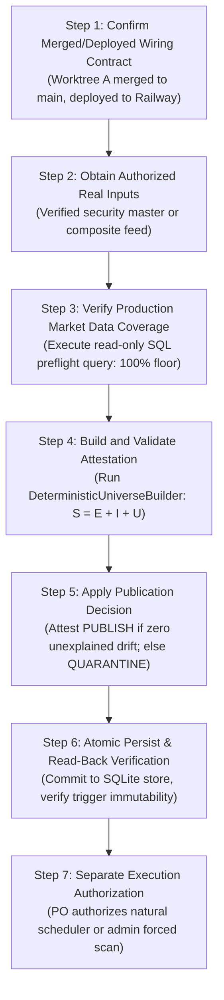

# ARX Terminal — Production Universe Publication Handoff & Governance Runbook
**Backlog Reference:** `BACKLOG-VCP-PROD-UNIVERSE-003` (Research Investigation)  
**Execution Worktree:** `C:\Users\akara\Documents\Projects\finance-vcp-universe-inputs`  
**Status:** PROPOSED RUNBOOK — PUBLICATION PROHIBITED IN CURRENT TASK

---

## 1. Proposed 7-Step Publication Sequence (Candidate Runbook)

To ensure mathematical closure, zero prospective contamination, and clean operator boundaries, any future production universe build and publication is proposed to proceed through seven sequenced gates:

---

## 2. Gate-by-Gate Specification

### Gate 1: Confirm Merged & Deployed Wiring Contract
- **Prerequisite:** Worktree A (`fix/vcp-universe-wiring-reintroduction`) must be reviewed, approved, merged to `main`, and deployed to Railway production. The production container must run a commit $\ge \text{candidate HEAD}$.
- **Side Effects:** Zero. Read-only release verification.
- **Acceptance Criteria:** `git branch --contains <candidate_sha>` confirms merge; Railway deployment health returns 200 with matching git revision.

### Gate 2: Obtain Authorized Real Inputs
- **Prerequisite:** Input sources authorized, with verified security type classification and resolution of CIK multi-share class collisions.
- **Action:** Execute the approved input acquisition script to fetch official source feeds. Construct `SourcePopulationSnapshot`.
- **Side Effects:** Writes raw feed files and snapshot JSON to isolated persistent volume `/data/universe/snapshots/YYYY-MM-DD/`.
- **Acceptance Criteria:** `source_hash == compute_sha256(securities)`. All `security_id` entries unique. Schema validation passes.

### Gate 3: Verify Production Market-Data Coverage
- **Prerequisite:** Read-only access to production SQLite store `/root/.finance_market_store.db`.
- **Action:** Execute the preflight SQL query across all candidate eligible symbols.
- **Side Effects:** Zero database writes.
- **Acceptance Criteria:** `ready_symbols == total_candidate_symbols` ($100.0\%$ coverage ratio). Zero symbols with `candle_count < 50`. Zero symbols with stale dates.
- **Failure Behavior:** If coverage $< 100\%$, publication must be deferred or non-covered symbols flagged before build.

### Gate 4: Build and Validate Attestation
- **Prerequisite:** Gate 2 snapshot and Gate 3 verified market data.
- **Action:** Invoke `DeterministicUniverseBuilder.build_universe()`.
- **Side Effects:** Pure in-memory computation.
- **Acceptance Criteria:**
  - Arithmetic closure verified: $\text{source} == \text{eligible} + \text{ineligible} + \text{unresolved}$.
  - Readiness closure verified: $\text{eligible} == \text{data\_ready} + \text{data\_unavailable} + \text{data\_unresolved}$.
  - Scannable equality: $\text{scannable\_count} == \text{data\_ready\_count}$.
  - Construction status equals `ConstructionStatus.COMPLETE`.

### Gate 5: Apply Publication Decision
- **Prerequisite:** Gate 4 attestation completed.
- **Action:** Compare build against previous published build. Reconcile added, removed, and retained membership.
- **Acceptance Criteria:** If all drift is explained by source listings/delistings, assign `PublicationDecision.PUBLISH`. If unexplained drift exceeds threshold or unresolvable identities occur, assign `PublicationDecision.QUARANTINE`.
- **Failsafe:** Quarantined builds are never scannable by the natural scheduler.

### Gate 6: Atomic Persist & Read-Back Verification
- **Prerequisite:** Validated Gate 5 attestation.
- **Action:** Call `UniverseStore.save_universe_build()` within a single SQLite transaction.
- **Side Effects:** Inserts records into `universe_builds`, `universe_eligibility_ledger`, and `universe_readiness_ledger` in `/root/.finance_universe_store.db`.
- **Acceptance Criteria:** Read-back via `UniverseStore.get_universe_build()` matches byte-for-byte. `get_scannable_membership()` matches `scannable_membership_hash`. Triggers `trg_ubuild_no_update` and `trg_ubuild_no_delete` prevent any subsequent mutation.

### Gate 7: Separate Execution Authorization
- **Prerequisite:** Published, complete universe build on production disk.
- **Action:** Independent Product Owner or governance authorization to activate the natural scheduler cron job or dispatch a manual scan.
- **Governance Invariance:** **Publication does not equal execution.** A published universe remains passive until an authorized execution event occurs within an open, settled trading session window.

---

## 3. Data Readiness Reconciliation: Build Time vs Runtime Execution

A critical distinction exists between build-time readiness partitioning and runtime execution gating:

1. **Build-Time Partitioning ($E = DR + DU$):**
   - The builder partitions eligible securities $E$ into Data Ready ($DR$) and Data Unavailable ($DU$).
   - Symbols in $DU$ (missing price or $< 50$ bars) are recorded in `universe_readiness_ledger` but are **excluded** from the scannable membership.
   - The scannable universe is set strictly equal to $DR$ ($\text{scannable\_count} = |DR|$).
2. **Runtime Execution Gating (`analyst_dashboard/vcp/session_guard.py`):**
   - The session guard inspects the scannable membership ($DR$). It does NOT re-evaluate $DU$.
   - **Numerator:** Count of scannable symbols with live quote $> 0$, target session date, and $\ge 50$ valid OHLCV bars.
   - **Denominator:** Total scannable count ($|DR|$).
   - **Exclusions:** Zero exclusions.
   - **Threshold:** $100.0\%$ floor. If even 1 scannable symbol is stale or missing, execution fails with `INCOMPLETE_UNIVERSE_COVERAGE`.
3. **Reconciliation Summary:**
   There is zero conflict between $E = DR + DU$ and the $100\%$ runtime floor. $DU$ symbols were already pruned during build. The runtime guard ensures that $100\%$ of the accepted scannable set remains fully ready at execution time.

---

## 4. Tooling Governance: Rejection of Unvetted Scripts & Proposed CLI Tool

> [!WARNING]
> **Tooling Status of `scripts/publish_universe.py`:**
> Any standalone script named `scripts/publish_universe.py` that bypassed attestation triggers, hardcoded symbol fixtures, or executed outside `UniverseStore` transaction boundaries is **strictly rejected**.
> 
> **Supported CLI Publication Tool Specification:**
> Complete architectural requirements for the supported CLI publication tool (`scripts/arx_publish_universe.py`) are detailed in [`PUBLICATION_TOOLING_SPEC.md`](file:///C:/Users/akara/Documents/Projects/finance-vcp-universe-inputs/docs/research/vcp-production-universe-inputs/PUBLICATION_TOOLING_SPEC.md) and [`INPUT_VALIDATION_SPEC.md`](file:///C:/Users/akara/Documents/Projects/finance-vcp-universe-inputs/docs/research/vcp-production-universe-inputs/INPUT_VALIDATION_SPEC.md). It enforces:
> 1. Strict separation across 6 lifecycle phases (Snapshot $\rightarrow$ Validate $\rightarrow$ Evaluate $\rightarrow$ Stage $\rightarrow$ Publish $\rightarrow$ Read-Only Handoff).
> 2. Fail-closed input validation boundary preventing silent default-filling.
> 3. Single atomic SQLite transaction for master and ledger persistence via `UniverseStore.save_universe_build()`.
> 4. Full SQLite trigger immutability compliance (`trg_ubuild_no_update/delete`, `trg_eligibility_no_update/delete`).
> 5. Deterministic dry-run mode and forward-only revocation via quarantine builds.
> 6. Non-execution invariant: publication does NOT authorize execution or activate schedulers.

---

## 5. Tombstones & Revocation Semantics

1. **No Silent Tombstones:** A security dropped from a daily feed must not be assumed delisted without verifiable evidence (Form 25 filing or official regulatory halt notice).
2. **Build Revocation Policy:** If a published universe is found to contain corrupted data post-publication, it cannot be deleted or updated in place due to SQLite triggers. Revocation must occur by publishing a new, attested successor build with `reconciliation_summary.supersedes_build_id` and quarantine flags, or setting active pointer to a known good prior build.
3. **No Speculative Signing:** Cryptographic signing of universe builds is not required by Candidate 004 and must not be speculatively implemented. The existing SHA-256 attestation digest hierarchy provides complete cryptographic integrity.
