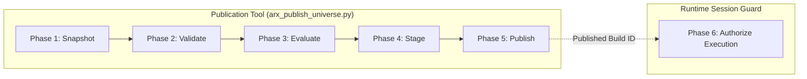

# ARX Terminal — Production-Universe Publication Tooling Specification
**Backlog Reference:** `BACKLOG-VCP-PROD-UNIVERSE-003` (Implementation Package)  
**Execution Worktree:** `C:\Users\akara\Documents\Projects\finance-vcp-universe-inputs`  
**Branch:** `research/vcp-production-universe-inputs`  
**Base Commit:** `787c1977b0071f2b31c4ad3d36a7f872147ad59e` (PR #4)  
**Contract Reference Commit:** `6c9b5b00de26545239616ac46f78b35a343ee3dd` (Candidate 004 / PR #5, Tree: `3ef8ead46c34754724cfdc5e906af66271fa2ed2`)  
**Status:** SPECIFICATION COMPLETE — AWAITING IMPLEMENTATION AUTHORIZATION  

---

## 1. Scope & Architectural Boundaries

### 1.1 Strict Exclusion of Legacy Prototype Scripts
The untracked script `scripts/publish_universe.py` present in Worktree A is an unvetted prototype lacking:
- Fail-closed input validation.
- Cryptographic provenance tracking.
- Transactional atomicity across multi-table writes.
- Formal attestation signing.
- Dry-run validation capabilities.

`scripts/publish_universe.py` is **strictly excluded** from production consideration. This specification defines the requirements for a newly architected, supported CLI publication tool: `scripts/arx_publish_universe.py`.

### 1.2 Separation of Concerns
The publication tool operates exclusively as an **orchestration client**. It does NOT modify engine contracts, bypass SQLite database triggers, or activate live scanner executions.



---

## 2. Six Distinct Lifecycle Phases

The tool executes a strict sequential state machine across six isolated phases. Any failure in an earlier phase immediately aborts execution without modifying production state:

```mermaid
sequenceDiagram
    participant CLI as CLI Tool
    participant Ingest as Feeds / Snapshot
    participant Valid as InputValidator
    participant Build as DeterministicUniverseBuilder
    participant DB as SQLite Market Store
    participant Guard as SessionGuard

    Note over CLI: Phase 1: Ingest & Snapshot
    CLI->>Ingest: Capture raw SEC + Nasdaq + OpenFIGI feeds
    Ingest-->>CLI: Persist raw snapshots with SHA-256 hashes

    Note over CLI: Phase 2: Validate & Normalize
    CLI->>Valid: Submit raw snapshots to InputValidator
    Valid-->>CLI: Return ValidatedSecurityPayload (or abort with rejection log)

    Note over CLI: Phase 3: Evaluate Eligibility & Readiness
    CLI->>Build: Execute rules R01-R07 + query market_db OHLCV
    Build-->>CLI: UniverseBuildResult (Counts, Memberships, Hashes)

    Note over CLI: Phase 4: Stage Candidate Record
    CLI->>CLI: Verify mathematical closure (S = E + I + U and E = DR + DU)
    CLI->>CLI: Perform drift reconciliation against prior session

    Note over CLI: Phase 5: Attest & Commit to UniverseStore
    CLI->>CLI: Compute canonical SHA-256 digests (membership, decisions, readiness)
    CLI->>DB: Atomic COMMIT to universe_builds + eligibility & readiness ledgers

    Note over CLI,Guard: Phase 6: Read-Only Handoff Report
    CLI-->>Guard: Emit build summary (PUBLISHED_INACTIVE; zero execution authorized)
```

### 2.1 Phase 1: Ingest & Snapshot Raw Feeds
- **Inputs:** Target session date (`--as-of-date YYYY-MM-DD`).
- **Operation:**
  1. Downloads authoritative directory snapshots from SEC EDGAR and Nasdaq Trader.
  2. Queries or loads cached OpenFIGI security classification mappings.
  3. Writes raw files to an immutable snapshot directory: `data/universe_snapshots/{as_of_date}/`.
  4. Computes SHA-256 digests for all raw inputs and generates `snapshot_manifest.json`.

### 2.2 Phase 2: Validate & Normalize Inputs
- **Inputs:** Raw snapshot files and `snapshot_manifest.json`.
- **Operation:**
  1. Executes `InputValidator` adhering strictly to [`INPUT_VALIDATION_SPEC.md`](file:///C:/Users/akara/Documents/Projects/finance-vcp-universe-inputs/docs/research/vcp-production-universe-inputs/INPUT_VALIDATION_SPEC.md).
  2. Asserts zero missing required fields (F01–F09).
  3. Normalizes symbology dialects, exchange venues, and applies approved policy mappings.
  4. Asserts zero `security_id` or `symbol` collisions across the batch.
  5. Outputs rejection log `universe_input_rejections.jsonl`.
  6. Aborts immediately if any fatal batch collision or unhandled schema error occurs.

### 2.3 Phase 3: Evaluate Universe & Data Readiness
- **Inputs:** Validated `List[SourceSecurity]` and read-only connection to `market_db`.
- **Operation:**
  1. Invokes `DeterministicUniverseBuilder.build()`.
  2. Evaluates rules `R01_ASSET_CLASS` through `R07_NOT_DELISTED`.
  3. Partitions eligible securities into `DATA_READY` ($DR$) vs `DATA_UNAVAILABLE` ($DU$) based on $\ge 50$ daily bars and fresh price as of target date.
  4. Computes deterministic SHA-256 membership hashes:
     $$\text{membership\_hash} = \text{SHA256}(\text{sorted}(\text{scannable\_symbols}))$$

### 2.4 Phase 4: Verify Accounting Invariants & Stage Candidate Record
- **Inputs:** `UniverseBuildResult`.
- **Operation:**
  1. Asserts **Arithmetic Source Closure**: $\text{source} == \text{eligible} + \text{ineligible} + \text{unresolved}$.
  2. Asserts **Arithmetic Readiness Closure**: $\text{eligible} == \text{data\_ready} + \text{data\_unavailable} + \text{data\_unresolved}$.
  3. Asserts **Scannable Equality**: $\text{scannable\_count} == \text{data\_ready\_count}$.
  4. Runs drift reconciliation against the previous session's published build (computing additions, removals, and churn ratio).
  5. If churn ratio exceeds drift threshold (e.g. $> 5.0\%$) or unresolvable mapping conflicts occur, assigns `PublicationDecision.QUARANTINE`.

### 2.5 Phase 5: Attest & Commit to UniverseStore
- **Inputs:** Verified `UniverseBuildAttestation` and ledger rows.
- **Operation:**
  1. Relies strictly on verified `UniverseStore` capabilities:
     - Formats canonical SHA-256 digests (`source_population_hash`, `eligible_membership_hash`, `scannable_membership_hash`, `per_security_decision_hash`, `readiness_decision_hash`).
     - Speculative digital signatures (HMAC/ECDSA) are **strictly omitted**; data integrity is anchored by SHA-256 hashes, SQLite ACID transactions, and store immutability triggers.
  2. Invokes `UniverseStore.save_universe_build()` within an isolated SQLite transaction.
  3. Writes atomically to:
     - `universe_builds` (master record)
     - `universe_eligibility_ledger` (per-security rule evaluation rows)
     - `universe_readiness_ledger` (per-security market readiness rows)
  4. Commits transaction atomically.

### 2.6 Phase 6: Emit Read-Only Publication Handoff Report
- **Inputs:** Published `universe_build_id`.
- **Operation:**
  1. Emits structured JSON build report recording publication status (`PUBLISHED_INACTIVE`).
  2. **Non-Execution Invariant:** **Publication does NOT authorize execution or activate schedulers.**
  3. The published build remains passive and inert in SQLite store until a separate, authorized execution event is scheduled under operational governance.
  4. At scheduled execution time, `session_guard.py` independently verifies the scannable membership and enforces the 100% full-universe data readiness floor.

---

## 3. CLI Interface Specification

The tool exposes an explicit, subcommand-driven command line interface:

```text
Usage: arx-universe [OPTIONS] COMMAND [ARGS]...

Commands:
  snapshot     Download and hash raw upstream source directories.
  validate     Run fail-closed input validation on raw snapshot.
  build        Execute universe rules and data readiness evaluation.
  publish      Execute full pipeline (Phases 1-5) and commit to store.
  verify       Verify integrity and invariants of an existing published build.
  reconcile    Compute drift and churn between two published builds.
```

### 3.1 Global & Subcommand Options

| Option Flag | Type | Description | Mandatory? |
| :--- | :--- | :--- | :--- |
| `--as-of-date` | `YYYY-MM-DD` | Target session trading date. | **YES** |
| `--market-db` | `Path` | Path to SQLite market database (`/root/.finance_market_store.db`). | **YES** |
| `--universe-db` | `Path` | Path to SQLite universe store database (`/root/.finance_universe_store.db`). | Optional |
| `--dry-run` | `Flag` | Executes Phases 1–4, verifies invariants, and prints JSON report without modifying database. | Optional (Default: False) |
| `--output-dir` | `Path` | Directory to store snapshots, rejection ledgers, and build reports. | Optional (Default: `./artifacts`) |
| `--max-drift-pct` | `Float` | Maximum allowable churn percentage before halting publication (default: `5.0`). | Optional |
| `--force-quarantine` | `Flag` | Overrides publication decision to `QUARANTINE` for testing or anomalous sessions. | Optional |

---

## 4. Database Transaction Boundaries & Store Immutability

### 4.1 Atomicity Guarantees via `UniverseStore`
Database mutation in Phase 5 is delegated strictly to verified `UniverseStore` transaction capabilities (`analyst_dashboard/universe/store.py`):

```python
# Atomic transaction managed by UniverseStore.save_universe_build()
store = UniverseStore(db_path=universe_db_path)
store.save_universe_build(
    attestation=build_attestation,         # UniverseBuildAttestation -> universe_builds
    eligibility_rows=eligibility_rows,     # List[EligibilityLedgerRow] -> universe_eligibility_ledger
    readiness_rows=readiness_rows,         # List[DataReadinessLedgerRow] -> universe_readiness_ledger
)
```

The write is wrapped in a single, exclusive SQLite transaction across all three tables:
1. `universe_builds`: Master build record, canonical SHA-256 hashes, counts, and status (`COMPLETE`).
2. `universe_eligibility_ledger`: Per-security rule evaluation decisions and hashes.
3. `universe_readiness_ledger`: Per-security market data readiness states and hashes.

If any constraint fails or process interruption occurs, SQLite rolls back the entire transaction atomically, leaving zero orphan rows.

### 4.2 Verified SQLite Store Immutability Triggers
`analyst_dashboard/universe/store.py#L160-L187` enforces strict database immutability via four active triggers:
- `trg_ubuild_no_update`: Any `UPDATE` on `universe_builds` raises SQLite exception `CANONICAL_INVARIANT_VIOLATION`.
- `trg_ubuild_no_delete`: Any `DELETE` on `universe_builds` raises SQLite exception `CANONICAL_INVARIANT_VIOLATION`.
- `trg_eligibility_no_update`: Any `UPDATE` on `universe_eligibility_ledger` raises SQLite exception `CANONICAL_INVARIANT_VIOLATION`.
- `trg_eligibility_no_delete`: Any `DELETE` on `universe_eligibility_ledger` raises SQLite exception `CANONICAL_INVARIANT_VIOLATION`.

**Tooling Compliance:**
- The CLI publication tool **never executes `UPDATE` or `DELETE` statements** against any universe table.
- Every build creates a new, immutable `universe_build_id`.

---

## 5. Dry-Run & Idempotency Guarantees

1. **Deterministic Idempotency:**
   - If `publish` is executed multiple times with identical source snapshots and identical market data for the same `as_of_date`, it computes identical membership and ledger SHA-256 hashes.
   - If a build record for `(universe_id, as_of_date)` already exists with status `COMPLETE`, the tool detects the existing build, reports its details, and exits with code 0 without attempting duplicate writes or violating primary key constraints.
2. **Dry-Run Safety:**
   - In `--dry-run` mode, the tool performs all validation, builder evaluation, data readiness queries, and invariant checks.
   - It outputs a comprehensive `UniverseDryRunReport.json` summarizing:
     - Total source records, validated count, rejected count.
     - Eligibility counts ($E, I, U$) and readiness counts ($DR, DU$).
     - Membership SHA-256 hash.
     - Drift analysis vs prior published session.
   - Zero database mutations occur in dry-run mode.

---

## 6. Forward-Only Revocation & Quarantine Runbook

Because SQLite triggers (`trg_ubuild_no_update/delete`, `trg_eligibility_no_update/delete`) prohibit updating or deleting existing published records, the publication tooling supports a strictly forward-only revocation model using verified `UniverseStore` capabilities:

1. **Detection of Defect:** An operator discovers that a published build `universe_build_id: "BUILD_20261016_001"` contains corrupted upstream feed data or unverified listings.
2. **Forward-Only Revocation via Quarantine:**
   - An operator executes a quarantine build for the target session:
     ```bash
     arx-universe publish --as-of-date 2026-10-16 --force-quarantine --reason "CORRUPTED_RAW_FEED"
     ```
   - This atomically commits a new build record with `publication_decision: "QUARANTINE"`.
   - `session_guard.py` checks `publication_decision == "PUBLISH"`. Quarantined builds are permanently non-scannable.
3. **Successor Build Supersession:**
   - When corrected source data is available, the operator publishes a corrected successor build (`BUILD_20261016_002`).
   - The successor build includes `reconciliation_summary.supersedes_build_id = "BUILD_20261016_001"`, establishing an immutable provenance trail of replacement.
4. **No Speculative Schema Alterations:**
   - Speculative tables (such as `universe_revocations`) and speculative cryptographic signing systems (HMAC/ECDSA) are strictly excluded from the publication tooling. All operational safeguards operate within verified `UniverseStore` capabilities.
