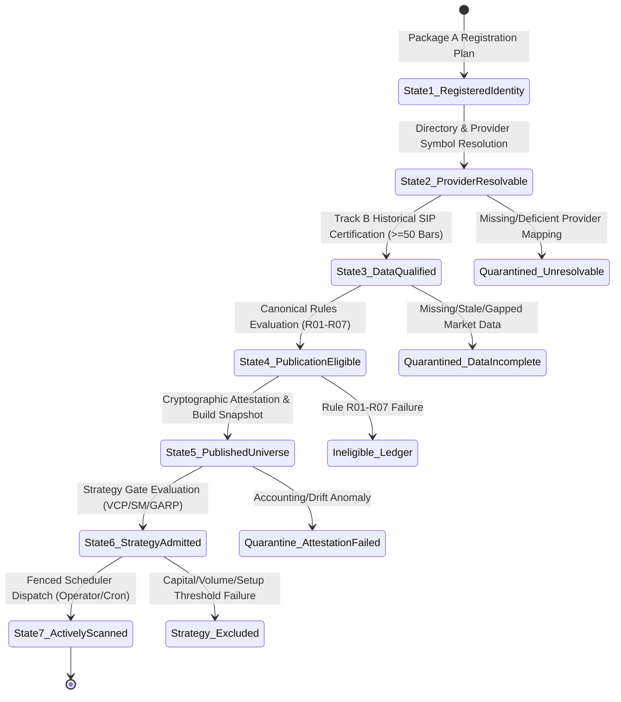

# ARX TERMINAL — SPRINT 2 / TRACK C
# PUBLICATION STATE MODEL & TRANSITION DEPENDENCY SPECIFICATION

**Document Identifier:** `C_PUBLICATION_STATE_MODEL.md`  
**Governing Authority:** ARX Closure Model v2 (Track C Ownership Boundary)  
**Track Responsibility:** State Transition Architecture & Epistemic Anti-Inference Invariants  
**Target Milestone:** Sprint 2 / Package C Architecture & Readiness Review  
**Current Baseline:** Package A (`133` Registered Entities & Associations) @ State 1  
**Status:** COMPLETE / CANONICAL SPECIFICATION  

---

## 1. Architectural Philosophy: The Seven Lifecycle States

In legacy financial platforms, identity registration, market data presence, and strategy actionability are frequently conflated, causing unseasoned or unverified assets to leak into production trading pipelines. 

Under the **ARX Closure Model v2**, the lifecycle of an asset is decomposed into **seven strictly distinct, sequential, and non-overlapping lifecycle states**.

### The Inviolable Epistemic Anti-Inference Law
> **No lifecycle state $S_{n+1}$ may be inferred from state $S_n$ without the affirmative, cryptographically verifiable presence of the required evidence artifact for that transition.**

Specifically:
- **Registration $\nRightarrow$ Resolvability:** Having an `ARX_SEC` entity does not guarantee Alpaca, Polygon, or SEC knows how to route orders or bars.
- **Resolvability $\nRightarrow$ Historical Data:** Being listed in a broker directory does not mean 50 clean sessions of OHLCV data exist in the database.
- **Historical Data $\nRightarrow$ Eligibility:** Having 50 candles does not mean the asset is a primary US common equity (it could be an ETF, ADR, or secondary listing).
- **Eligibility $\nRightarrow$ Universe Publication:** Satisfying Rules R01-R07 does not publish an asset into a scannable production namespace without an authorized, versioned, and attested build.
- **Universe Publication $\nRightarrow$ Strategy Admission:** Being a published common stock does not mean an asset qualifies for Minervini VCP compression or Smart Money insider flow.
- **Strategy Admission $\nRightarrow$ Active Scanning:** Being admissible does not trigger scanner runners while schedulers remain dormant and Gate 12 remains locked.

---

## 2. Detailed State Definitions & Evidence Requirements

### State 1: Registered Identity (`STATE_REGISTERED_IDENTITY`)
- **Definition:** The legal entity issuer and its operating listing locators are cryptographically allocated and durably stored in the authoritative identity master (`identity.db`).
- **Store Table:** `internal_securities` and `listing_associations`.
- **Identity Schema:** Opaque internal identifier (`ARX_SEC_<12_HEX>`) bound to issuer CIK, share class, primary symbol, and effective-dated listing associations (`ASSOC_<12_HEX>`).
- **Authority:** Package A (`PACKAGE_A_PRODUCTION_EXECUTION_CLOSED_QUALIFIED`).
- **Required Evidence:** Applied adoption plan signed and audited in `applied_plan_audit_ledger` (`PLAN_ADOPT_9A2E4E04E878`).
- **Exact Production Count:** **133 securities and 133 listing associations** (3 baseline pilots + 130 candidate additions).
- **Prohibitions:** **Zero authority to publish, scan, trade, or ingest market data.**

---

### State 2: Provider-Resolvable Instrument (`STATE_PROVIDER_RESOLVABLE`)
- **Definition:** The listing association (`symbol`, `operating_mic`) has been unambiguously mapped to a recognized provider ticker, asset identifier, and exchange routing code in third-party provider feeds (e.g., SEC EDGAR, Nasdaq Listed Directory, Other Listed Directory, Alpaca Markets asset master, Polygon reference tickers).
- **Store Table:** Provider mapping catalog or cross-reference directory.
- **Required Evidence:** Positive match receipt across $\ge 2$ authoritative market directories, returning matching operating MIC, active trading status, and confirmed currency `USD`.
- **Failure State:** If unmapped or conflicting, transitions to `QUARANTINED_UNRESOLVABLE_PROVIDER_MAPPING`.

---

### State 3: Historical-Data Qualified Instrument (`STATE_DATA_QUALIFIED`)
- **Definition:** Authoritative historical market data has been ingested, validated, and persisted in `market.db` satisfying all quality, continuity, and seasonality requirements.
- **Required Evidence Artifact:** **Package B Data-Quality Certification** issued by Track B (`PKG-EXPANSION-150-B-MARKET-DATA-INGESTION`).
- **Quality Gates:**
  1. Minimum session depth: $\ge 50$ consecutive valid trading sessions (sufficient for 50-day SMA and ATR-14 computation).
  2. Zero interior calendar gaps: All NYSE/NASDAQ trading calendar sessions present between start date and cutoff date.
  3. No unhandled corporate actions: Verified split adjustment factors applied.
  4. Non-zero turnover and live quote: Latest closing price $> \$0.00$ with verified volume.
- **Current Status:** **BLOCKED & DORMANT** (`account_entitlement_status: VERIFIED_DEFICIENT_CREDENTIALS`). Zero new candidate securities have attained State 3 in production.

---

### State 4: Publication-Eligible Instrument (`STATE_PUBLICATION_ELIGIBLE`)
- **Definition:** The asset has been evaluated by `DeterministicUniverseBuilder` against the canonical ruleset (`eligibility-rule-v1.0`) and affirmatively passed all seven eligibility predicates:
  - `R01_ASSET_CLASS`: `"EQUITY"`
  - `R02_SECURITY_TYPE`: `"COMMON_STOCK"`
  - `R03_LISTING_STATUS`: `"ACTIVE"`
  - `R04_PRIMARY_EXCHANGE`: $\in \{"\text{NASDAQ}", "\text{NYSE}", "\text{ARCA}", "\text{BATS}"\}$
  - `R05_CURRENCY`: `"USD"`
  - `R06_PRIMARY_LISTING`: `True`
  - `R07_NOT_DELISTED`: `None`
- **Store Table:** `universe_eligibility_ledger` where `eligibility_decision == 'ELIGIBLE'`.
- **Required Evidence Artifact:** Signed `EligibilityLedgerRow` containing deterministic `rule_evaluation_hash` and `decision_hash`.
- **Failure State:** Any failed rule commits an immutable `INELIGIBLE` row with specific reason code (`INELIGIBLE_ASSET_CLASS`, `INELIGIBLE_SECURITY_TYPE`, etc.) to the permanent audit ledger.

---

### State 5: Published-Universe Instrument (`STATE_PUBLISHED_UNIVERSE`)
- **Definition:** An eligible, data-qualified instrument has been formally incorporated into a sealed, immutable, and attested universe build snapshot published to a designated universe namespace.
- **Store Table:** `universe_builds` where `publication_decision == 'PUBLISH'` and `construction_status == 'COMPLETE'`.
- **Target Namespaces:**
  - `ARX_US_EQUITIES`: Active baseline trading universe (**currently restricted to the 3 historical pilots: AAPL, GOOG, GOOGL**).
  - `ARX_US_EQUITIES_EXPANSION_150`: Proposed isolated expansion namespace (**currently specification-only; non-executable**).
- **Required Evidence Artifact:** Signed `UniverseBuildAttestation` record verifying Merkle hashes:
  - `eligible_membership_hash`
  - `scannable_membership_hash`
  - `per_security_decision_hash`
  - `readiness_decision_hash`
  - Mathematical accounting closure: $\text{source} = \text{eligible} + \text{ineligible} + \text{unresolved}$.

---

### State 6: Strategy-Admitted Instrument (`STATE_STRATEGY_ADMITTED`)
- **Definition:** The published instrument has been evaluated by a dedicated quantitative strategy domain engine and confirmed to satisfy domain-specific entry hurdles.
- **Strategy Gating Criteria (e.g., Minervini VCP):**
  1. Minimum Market Capitalization: $\ge \$500\text{M}$ USD.
  2. 20-Day Median Dollar Volume: $\ge \$5\text{M}$ USD/day (ensuring institutional execution liquidity without market impact).
  3. Price Floor: Closing price $\ge \$5.00$ (excludes microcap penny stocks and reverse-split anomalies).
  4. Seasoning: Minimum 60 trading days from IPO date.
- **Strategy Gating Criteria (e.g., Smart Money):**
  1. SEC CIK Binding: Valid 10-digit CIK registered in `internal_securities`.
  2. Form 4 Reporting History: Verified XML/XBRL filing activity on SEC EDGAR.
- **Required Evidence Artifact:** Strategy Admission Evaluation Record recorded in strategy-specific memory or database cache.

---

### State 7: Actively Scanned Instrument (`STATE_ACTIVELY_SCANNED`)
- **Definition:** The instrument is an authorized target of active scanner runner execution in production, processed by background workers to compute trade setups, pattern detections, and conviction scores.
- **Execution Mechanism:** Dispatched by `VCPScannerRunner.execute_market_wide_scan()` or `SmartMoneyScannerRunner.execute_market_wide_scan()`.
- **Prerequisites for State 7 Activation:**
  1. Strategy Admission (State 6) verified.
  2. Distributed Lease Acquired via `DurableRunCoordinator`.
  3. Fenced Publisher Sequence Validated.
  4. Production Operator Token or Validated Scheduler Secret Supplied.
  5. **Gate 12 Release Formally Unlocked** (Currently **LOCKED**).
- **Required Evidence Artifact:** Immutable `scanner_snapshots` row signed with `semantic_fingerprint` and `implementation_release_sha`.

---

## 3. Transition Predicates & Evidence Matrix

| Transition | From State | To State | Gatekeeper Engine | Transition Predicate | Required Verifiable Artifact |
| :---: | :---: | :---: | :---: | :--- | :--- |
| **$T_{1\to 2}$** | State 1 | State 2 | `SourceResolver` | Symbol/MIC matches provider master | Multi-directory cross-reference receipt |
| **$T_{2\to 3}$** | State 2 | State 3 | `Track B Certification` | $\ge 50$ continuous sessions, zero gaps | Package B Quality Certificate JSON |
| **$T_{3\to 4}$** | State 3 | State 4 | `UniverseBuilder` | Evaluates TRUE across Rules R01-R07 | `EligibilityLedgerRow` (decision=ELIGIBLE) |
| **$T_{4\to 5}$** | State 4 | State 5 | `UniverseStore` | Merkle hashes match; accounting closes | `UniverseBuildAttestation` (decision=PUBLISH)|
| **$T_{5\to 6}$** | State 5 | State 6 | Strategy Sizing Engines | Liquidity $\ge \$5\text{M}$/day, Cap $\ge \$500\text{M}$ | Strategy Admission Record |
| **$T_{6\to 7}$** | State 6 | State 7 | `DurableRunCoordinator`| Gate 12 Unlocked, lease granted | Fenced Snapshot Run Record |

---

## 4. Formal Proof: Package A Registration Confers Zero Publication Authority

A common operational defect in distributed systems is "privilege inheritance," where registering an entity automatically makes it visible to downstream consumers. 

Under Track C governance, this is mathematically and architecturally impossible:

1. **Schema Decoupling:** `internal_securities` in `identity.db` has **no foreign key, trigger, or projection** into `universe_builds` or `scanner_snapshots`.
2. **Namespace Isolation:** The active scanner runner (`VCPScannerRunner`) queries `UniverseStore.get_latest_published_universe(universe_id="ARX_US_EQUITIES")`. 
3. **Absence of Build:** The database `.finance_universe_store.db` currently contains **0 rows** in `universe_builds`. 
4. **Fallback Containment:** Because `universe_builds` is empty, `VCPScannerRunner` falls back strictly to `CANONICAL_VCP_UNIVERSE = HISTORICAL_VCP_35_REGRESSION_FIXTURE`.
5. **No Route for Package A:** The 130 candidate securities registered by Package A reside solely in `identity.db`. They do NOT appear in `HISTORICAL_VCP_35_REGRESSION_FIXTURE`, they do NOT appear in any `universe_builds` row, and they have NO Package B historical data.

**Conclusion:** Package A reference identity registration establishes State 1 entity authority only. It confers **zero authority, zero technical capability, and zero path** to appear in published universes or active scanner runs.
