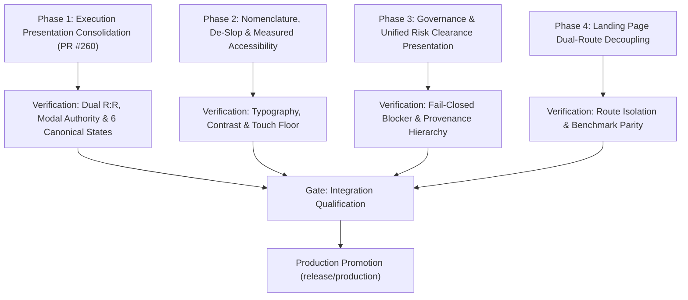

# SPRINT PLAN: ARX Terminal UI/UX Distillation & Anti-Slop Remediation

**Sprint Directive:** `ARX-SPRINT-UI-DISTILL-015`  
**Target:** Clean, high-conviction, institutional-grade decision platform  
**Guiding Principle:** Maximum quantitative density with zero cognitive ambiguity (`UI-0 > UI-1 > UI-2 > UI-3 > UI-4`)  
**Safety Invariants:** Strict preservation of fail-closed risk controls (`HOLD_SEC_001`, `HOLD_SCAN_001`, `HOLD_EXEC_001`, `PHASE_3_HOLD`)  
**Phase 1 PR Status:** [PR #260](https://github.com/daakara/finance/pull/260) (Draft, branch `feat/ui-execution-presentation-consolidation`, commit `1cad6e5f`)

---

## 1. Executive Summary & Architectural Grounding

This sprint plan defines the phased engineering execution roadmap for distilling ARX Terminal's interface. The objective is to eliminate cognitive clutter, eliminate duplicate modal handlers and layout blowouts, normalize financial terminology to institutional standards, and elevate decision clarity without altering backend quantitative models, trading mathematics, or risk clearance invariants.

### Core Architectural Principles:
1. **Three-Tier Separation of State**:
   - **Data Feed & Source Availability**: Live market tape connectivity, session state, SEC ingestion readiness, and data freshness.
   - **Analytical Confluence & Factor Scoring**: Multi-model thesis alignment, Minervini stage classification, Piotroski financial solvency, and technical momentum.
   - **Execution Permission & Clearance**: Binary, fail-closed risk clearance derived strictly from authoritative decision gates (Location, Dynamic Trigger, Risk/Macro Buffer, Liquidity Defense, PIT Certification).
2. **Authoritative Actionability**:
   - Actionability is never derived from a "pass count" (e.g. "4/5 gates passed"). A single failed mandatory gate strictly blocks execution clearance. Missing optional feeds affect coverage disclosure without manufacturing false negative signals.
3. **Evidence Domain Integrity**:
   - Preserve all 9 discrete evidence domains for provenance auditing and coverage tracking. They must not be conflated or artificially collapsed into scoring pillars.
4. **Measured Accessibility**:
   - Accessibility is verified through measured physical touch targets ($\ge 44\text{px} \times 44\text{px}$), verified contrast ratios ($\ge 4.5:1$ for normal text, $\ge 3:1$ for graphical objects/large text), keyboard focus rings, and screen reader semantic landmarks.

---

## 2. Phased Epic Breakdown & Work Packages

---

### Phase 1: Execution Presentation Consolidation
**Goal:** Establish a single authoritative execution plan presentation, consolidating redundant modal handlers and level calculations while preserving distinct summary (Cockpit HUD) and operational detail (Execution Desk) responsibilities.

- **WP 1.1: Position Sizer Modal Handler Unification**
  - **Component:** [`frontend/components/terminal/StandardTerminalView.tsx`](file:///Users/iDavid/Documents/finance/frontend/components/terminal/StandardTerminalView.tsx) & [`frontend/components/OptimalEntryExitCard.tsx`](file:///Users/iDavid/Documents/finance/frontend/components/OptimalEntryExitCard.tsx)
  - **Action:** Propagate the parent `onOpenSizer` handler from `AdaptiveTerminal` through `StandardTerminalView` to the `planSlot` via `React.cloneElement`.
  - **Deduplication:** Suppress internal duplicate `<PositionSizerModal>` mounting inside `OptimalEntryExitCard` when `onOpenSizer` is provided by the parent terminal view.
  - **Fallback Guarding:** Guard the standalone fallback modal mount to correctly receive authoritative live spot and analysis reference price props (`entryPrice`, `liveSpotPrice`, `analysisReferencePrice`, `liveFreshness`).

- **WP 1.2: Dual-Basis R:R and Price Reference Consistency**
  - **Components:** [`frontend/components/terminal/SharedExecutionLadder.tsx`](file:///Users/iDavid/Documents/finance/frontend/components/terminal/SharedExecutionLadder.tsx) & [`frontend/components/OptimalEntryExitCard.tsx`](file:///Users/iDavid/Documents/finance/frontend/components/OptimalEntryExitCard.tsx)
  - **Integrity Rule:** Strictly maintain the distinction between:
    - **Base Model Authority**: Planned R:R calculated from structural Pivot to Stop Loss.
    - **Live Observation Authority**: Prospective Spot R:R calculated from live market spot price to Stop Loss.
  - **Safety Check:** Prevent any ad-hoc parallel R:R calculations; both components consume authoritative properties from `OptimalExecutionPlan` and `KeyLevels`.

- **WP 1.3: Mobile Touch Targets & Container Robustness**
  - **Action:** Enforce `min-h-[44px]` touch target minimum on execution action buttons (`Pre-Flight Checklist`, `Size Position`, `Set Trigger Alert`, `Log Plan to Portfolio`).
  - **Layout:** Add `min-w-0 overflow-hidden` to `data-testid="conditional-trade-plan"` container to prevent flex/grid blowout on narrow mobile viewports (375px–412px).

*Status:* **IMPLEMENTED & VERIFIED** in [PR #260](https://github.com/daakara/finance/pull/260) (Branch `feat/ui-execution-presentation-consolidation`, Commit `1cad6e5f`).

---

### Phase 2: Nomenclature, De-Slop & Measured Accessibility
**Goal:** Eliminate consumer gimmicks, decorative emojis, and ambiguous marketing labels; normalize terminology to institutional financial standards; enforce measured WCAG AA accessibility.

- **WP 2.1: Onboarding Guidance De-Slop**
  - **Location:** [`frontend/components/synthesis/SynthesisGuideBanner.tsx`](file:///Users/iDavid/Documents/finance/frontend/components/synthesis/SynthesisGuideBanner.tsx) & [`frontend/app/page.tsx`](file:///Users/iDavid/Documents/finance/frontend/app/page.tsx)
  - **Action:** Retire the static 5-step banner pinned to the top of `page.tsx`. Relocate persistent guidance to a dedicated help modal and the `/guide` reference documentation.
  - **Reconciliation:** Reconcile existing product documentation workflows (`Find → Evaluate → Risk Gate → Position Sizing`) rather than inventing arbitrary pipelines.

- **WP 2.2: Decorative Glyph Sanitation**
  - **Standard:** Zero decorative emojis in navigation bars, headers, cards, or button controls.
  - **Replacements:**
    - `🎯 ARX Bottom Line` $\rightarrow$ `ARX BOTTOM LINE VERDICT`
    - `✈️ Pre-Flight Execution Readiness` $\rightarrow$ Lucide `ShieldCheck` icon + `PRE-FLIGHT RISK CLEARANCE`
    - `💡 Unlisted Search Query` $\rightarrow$ Lucide `Search` icon + `Asset Search`
    - `🚀 Switch to Ticker` $\rightarrow$ Plain text button `Switch to Ticker →`
  - **Preservation:** Retain semantic data glyphs strictly within tabular feed rows and chart markers where they denote distinct data channels (e.g. Congressional trades, insider transactions, options flow).

- **WP 2.3: Measured Accessibility & Typography Hardening**
  - **Typography Floor:** Audit all text elements. Ensure critical financial metrics, badges, and table values meet the `12px` (`text-xs`) legible floor. Reserve sub-12px text strictly for non-critical secondary timestamps.
  - **Tabular Numerals:** Enforce `tabular-nums` on all price, volume, percentage, and ratio displays to eliminate layout jitter during live updates.
  - **Contrast Floor:** Measure dark-mode contrast ratios to guarantee $\ge 4.5:1$ on text against surface backgrounds (`#0b1019`, `#111827`).
  - **Keyboard Focus Rings:** Ensure all interactive elements expose visible, high-contrast focus rings (`focus-visible:ring-2 focus-visible:ring-cyan-500`).

*Status:* **IMPLEMENTED & VERIFIED** in [PR #260](https://github.com/daakara/finance/pull/260) (Branch `feat/ui-execution-presentation-consolidation`, Commit `60f8cd13`).

---

### Phase 3: Governance & Unified Risk Clearance Presentation
**Goal:** Present risk clearance, data availability, and operational holds in a clear, unified clearance deck without hiding blocking reasons or falsifying gate states.

- **WP 3.1: Unified Risk Clearance Deck Architecture**
  - **Components:** [`frontend/components/terminal/StandardTerminalView.tsx`](file:///Users/iDavid/Documents/finance/frontend/components/terminal/StandardTerminalView.tsx) & [`frontend/components/preflight/PreFlightReadinessBar.tsx`](file:///Users/iDavid/Documents/finance/frontend/components/preflight/PreFlightReadinessBar.tsx)
  - **Actionability Contract:**
    - Actionability is binary: `CLEARED` or `BLOCKED`.
    - Derive status strictly from `isExecutionReady && !hasActiveBlockers`.
    - Never display or calculate a "pass score" or "4 of 5 gates passed". If Location fails (extended > 2%), the setup is unequivocally `BLOCKED: EXTENDED_PAST_BUY_ZONE`.
  - **Operational Hold Visibility:**
    - Explicitly render active operational holds (`HOLD_SEC_001: STANDBY`, `HOLD_SCAN_001`, `HOLD_EXEC_001`).
    - Explicitly render stale price warnings (`STALE_MARKET_TAPE`) with timestamp and session context.

- **WP 3.2: Evidence Domain Provenance & Coverage Decoupling**
  - **Integrity Rule:** Do NOT collapse or force the 9 discrete evidence domains into the 4 scoring pillars.
  - **Presentation:** Maintain the 9-domain coverage audit drawer as an explicit provenance inspection surface:
    1. Price Structure & Geometry
    2. Momentum & Relative Strength
    3. Volume Profile & Accumulation
    4. Fundamental Solvency (Piotroski / Altman)
    5. Valuation Multiples & Growth
    6. Ownership & Smart Money (SEC Form 4 / 13F)
    7. Macro & Yield Curve Regime
    8. Regulatory Filings & Disclosures
    9. Liquidity & Execution Hazard (Amihud)
  - Distinguish between **Unavailable / Unassessed** feeds (e.g. `HOLD_SEC_001`) and **Negative / Deteriorating** metrics. An unassessed feed must never default to bearish zero.

---

### Phase 4: Landing Page Dual-Route Decoupling
**Goal:** Deliver a purposeful, clean landing experience on `/` while preserving the deep-dive cockpit on `/?symbol=XYZ`.

- **WP 4.1: Root Route (`/`) Architecture Options (Product Decision)**
  - **Current Behavior:** Bare `/` renders `AAPL` as an implicit default fallback ticker.
  - **Architecture Decision Required:**
    - **Option A (Discovery-First Showcase):**
      - High-visibility Universal OmniSearch with recent searches and sector quick-filters.
      - Macro Regime Overview (S&P 500, Nasdaq 100, 10Y-2Y Spread, VIX status).
      - Transparently labeled Alpha Spotlight / Screened candidates with clear disclosure of criteria.
      - No ticker auto-loaded; user explicitly chooses or searches an asset.
    - **Option B (Benchmark Reference Ticker):**
      - Explicitly and transparently load the broad-market benchmark (`SPY`) with a visible banner indicating benchmark context.
      - Clear CTA inviting user to enter their target ticker.
  - *Constraint:* Never silently manufacture an artificial "actionable" stock fallback.

- **WP 4.2: Structured Asset Cockpit (`/?symbol=XYZ`)**
  - When `symbol` is present, render the full decision cockpit:
    - Tier 1: Asset Header, Price Authority, Bottom-Line Verdict, Key Levels Cockpit HUD.
    - Tier 2: Interactive Chart + Unified Risk Clearance Deck.
    - Tier 3: Confluence Breakdown, Fundamental Solvency, Smart Money Coverage, Execution Desk.

---

## 3. Phased Rollout Schedule & PR Allocation

| Phase | Branch Target | Scope & Primary Deliverables | Status |
| :---: | :---: | :--- | :---: |
| **Phase 1** | `feat/ui-execution-presentation-consolidation` | **Execution Presentation Consolidation**: Unified `onOpenSizer` handler propagation, internal duplicate modal suppression, fallback prop correction, `min-h-[44px]` touch targets, and mobile container overflow protection. | **[PR #260](https://github.com/daakara/finance/pull/260) (Draft Opened)** |
| **Phase 2** | `feat/ui-execution-presentation-consolidation` | **De-Slop & Measured Accessibility**: Retire top onboarding banner across 4 hubs, sanitize decorative emojis with Lucide icons, normalize institutional nomenclature, and audit typography/touch targets. | **[PR #260](https://github.com/daakara/finance/pull/260) (Implemented - Commit `60f8cd13`)** |
| **Phase 3** | `feat/ui-unified-risk-clearance` | **Risk Clearance Presentation**: Unified risk clearance deck, binary fail-closed status presentation, explicit operational holds (`HOLD_SEC_001`), and preservation of 9-domain provenance. | Scheduled |
| **Phase 4** | `feat/ui-landing-route-decoupling` | **Landing Page Decoupling**: Implement approved landing architecture (Discovery-first vs Benchmark), eliminate silent `AAPL` default, and isolate deep-dive cockpit on `/?symbol=X`. | Scheduled |

---

## 4. Empirical Verification & Qualification Gates

Every phase must pass mandatory qualification gates prior to merging into `main` and promotion to `release/production`:

1. **Gate 1: Fail-Closed Risk & Governance Invariants**
   - Active operational holds (`HOLD_SEC_001`, `HOLD_SCAN_001`, `HOLD_EXEC_001`, `PHASE_3_HOLD`) remain strictly active and fail-closed.
   - Any failed mandatory clearance gate strictly blocks actionability (`isActionable === false`).
   - Sizing modal launch is disabled when execution is blocked or price data is stale.
2. **Gate 2: Static Type & Build Integrity**
   - Clean compilation via TypeScript and Next.js.
   - Zero ESLint errors or unhandled promise rejections on modified files.
3. **Gate 3: Automated Behavioral Test Matrix**
   - Exercise six canonical decision states:
     1. Actionable Setup (Fully Cleared)
     2. Awaiting Trigger (In Corridor, Volume Unconfirmed)
     3. Invalidated Setup (Stopped Out / Below Base Floor)
     4. Missing Optional Smart Money Evidence (`HOLD_SEC_001` Unassessed)
     5. Stale / Historical Price Tape (Fail-Closed)
     6. Unavailable / Inconsistent Execution Levels (Zero Stop)
   - Dual-basis R:R verification (Base Model from Pivot vs Live Observation at Spot).
4. **Gate 4: Measured Accessibility & Viewport Robustness**
   - Verified physical touch target floor ($\ge 44\text{px} \times 44\text{px}$) across all interactive controls.
   - Verified contrast floor ($\ge 4.5:1$ text contrast ratio).
   - Zero horizontal overflow across mobile viewports (375px, 390px, 412px).
